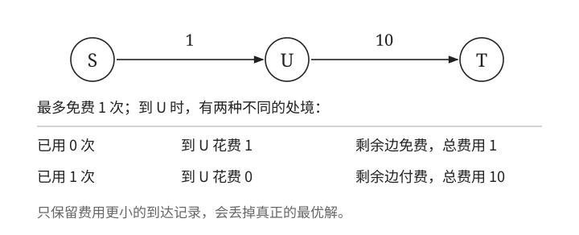

[[TOC]]

在普通最短路中，我们用 `dis[u]` 保存到达顶点 $u$ 的最小费用。如果到达同一个顶点时，手里剩余的机会、当前所处的模式不同，后面能走的边或需要付的费用也会不同，这一个数就不够用了。

分层图最短路的关键是：**把影响后续选择的信息并入状态，再在状态组成的新图上求最短路。**

本文默认你已经理解 [[[rbook: dijkstra]]] 中的松弛、小根堆与过期条目处理。先用“至多 $k$ 次免费通行”讲清状态设计，再推广到折扣、奇偶与模式。

## 一、为什么不能只保留到一个点的最小费用？

先看一个很小的有向图，最多可以让一次通行免费：



从 $S$ 到 $U$，有两种选择：

| 到达 $U$ 的方式 | 到这里的费用 | 已用免费次数 | 继续到 $T$ 的最佳选择 | 总费用 |
| --- | --- | --- | --- | --- |
| 付费走第一条边 | $1$ | $0$ | 把第二条边免费 | $1$ |
| 免费走第一条边 | $0$ | $1$ | 第二条边付费 $10$ | $10$ |

如果只比较到达 $U$ 的费用，第二条记录更小。把第一条记录删除，反而会丢掉总费用为 $1$ 的最优走法。

普通最短路能够丢弃较贵的到达记录，是因为到达同一个顶点后，后续的选择和代价相同。这里的免费机会改变了后续代价，所以“到达同一个顶点”已经不足以说明处境相同。

需要区分的是：

$$
(U,0)\quad\text{和}\quad(U,1).
$$

第一个分量表示位置，第二个分量表示已经用掉几次免费机会。这是两个不同的状态，各自都需要保存最小费用。

::: note 识别分层图的信号 icon=bulb
遇到“最多使用几次特殊操作”“边数的奇偶或余数”“当前开关、方向或交通模式”等条件时，先检查：只知道当前位置，能不能确定下一步的合法选择与代价？

如果不能，就找出必须保留的附加信息，再估算它有多少种取值。状态总数可控，才有机会把问题转成状态图最短路。
:::

## 二、把顶点拆成状态：每一层究竟表示什么？

现在考虑一般模型：图有 $n$ 个顶点，边权非负，从 $s$ 到 $t$，最多可以让 $k$ 次通行免费。

定义状态 $(u,j)$：当前在顶点 $u$，**恰好已经使用 $j$ 次免费机会**。因此：

$$
0\le j\le k.
$$

把所有第二维相同的状态画在同一排，就得到第 $j$ 层。原来的每个顶点都对应 $k+1$ 个状态，总共 $n(k+1)$ 个状态。

::: definition 状态距离
`dis[j][u]` 表示从 $(s,0)$ 出发，到达 $(u,j)$ 的最小费用，即到达 $u$ 时恰好使用了 $j$ 次免费机会的最小费用。

这里的层号是资源使用量，不是最短距离，也不是 BFS 的搜索深度。
:::

初始时只知道：

$$
dis[0][s]=0.
$$

其余状态初始化为无穷大。不能把起点所有层都设成 $0$，因为一开始并没有已经使用过免费机会。

“已用次数”也可以改成“剩余次数”，但状态定义、初始状态、转移方向和答案范围都要一起改。下面始终使用已用次数。

## 三、沿一条原图边，有两种走法

设原图有一条有向边 $u\to v$，原价为 $w$。到达状态 $(u,j)$ 后，只有下面两类选择。

### 1. 正常付费：位置变化，层号不变

$$
(u,j)\longrightarrow(v,j),\qquad\text{边权为 }w.
$$

对应松弛：

$$
dis[j][v]\gets\min\bigl(dis[j][v],\ dis[j][u]+w\bigr).
$$

免费机会没有使用，所以留在本层。

### 2. 使用一次机会：位置变化，层号加一

只有 $j<k$ 时可以这样走：

$$
(u,j)\longrightarrow(v,j+1),\qquad\text{边权为 }0.
$$

对应松弛：

$$
dis[j+1][v]\gets\min\bigl(dis[j+1][v],\ dis[j][u]\bigr).
$$

注意免费的是**这次沿边通行**。它把人从 $u$ 带到 $v$，同时消耗一次机会。直接连 $(u,j)\to(u,j+1)$，只改变层号却没有移动，表达的是另一种操作。

回到开头的有向图，把 $k=1$ 的两个状态层画出来：


两条到达 $U$ 的记录被保留在不同状态上；最优走法是 $(S,0)\to(U,0)\to(T,1)$。

如果原图是无向边 $\{u,v\}$，则把它看成 $u\to v$ 和 $v\to u$，分别应用上面的规则。免费跨层的方向分别是：

$$
(u,j)\to(v,j+1),\qquad(v,j)\to(u,j+1).
$$

它们的层号都加一。不能为了表示“无向”，把第一条跨层边直接反向连成 $(v,j+1)\to(u,j)$，那会把已经用掉的机会恢复回来。

## 四、为什么这样建图，求出来的就是原题答案？

### 1. 原题的走法，可以翻译成状态图上的走法

给定原图中一条路线，并指定每次通行是否免费。从 $(s,0)$ 出发：

- 付费时，走对应的同层边；
- 免费时，走对应的跨层边，已用次数加一。

只要原走法最多免费 $k$ 次，就不会超过第 $k$ 层。新图上的每一步费用与原走法相同，因此总费用也相同。

### 2. 状态图上的走法，也能还原成原题的走法

新图中的每条边都来自原图的一条真实边。去掉层号，就得到原图上的路线；跨层边表示使用一次免费机会，同层边表示照常付费。

层号从 $0$ 开始，只会在使用机会时加一，而且最大为 $k$，所以还原后的走法一定满足次数限制，费用仍然相同。

两边的合法走法可以互相翻译，并且保留费用，因此在合法终点状态中找最短距离，就等价于原问题。

### 3. 为什么不需要记录更早的历史？

对于当前模型，只要位置 $u$ 与已用次数 $j$ 相同，接下来可用的原图边、剩余机会以及每次通行的费用就完全相同。

所以到达同一个 $(u,j)$ 的记录，可以只保留费用最小的那条。我们补进状态的，正是让后续选择不再依赖更早历史的那部分信息。

如果题目还规定某种优惠不能连续使用，就可能需要再记录上一次是否使用；如果持有哪种钥匙决定能走哪条边，仅保存钥匙数量也不够。状态要根据规则确定，不能看见“优惠”就固定套用次数二维数组。

## 五、合法终点：至多和恰好不能混用

状态中的 $j$ 定义为“恰好已用次数”，但题目要求的是“至多 $k$ 次”。到达 $t$ 时可以剩下机会不用，所以答案为：

$$
\boxed{\min_{0\le j\le k}dis[j][t]}.
$$

只有题目要求恰好使用 $k$ 次，而且当前转移确实表达了这个规则时，答案才是 `dis[k][t]`。

例如一张有向图只有一条 $s\to t$ 的边，允许至多免费 $2$ 次：免费通过这条边就能到终点，答案为 $0$；但不存在恰好经过两次免费通行后到达终点的走法，第 $2$ 层的终点不可达。

| 题目要求 | 当前状态定义下的合法终点 |
| --- | --- |
| 至多免费 $k$ 次 | $(t,0),(t,1),\ldots,(t,k)$ |
| 恰好免费 $k$ 次 | 仅 $(t,k)$ |
| 已走边数必须为偶数 | 记录奇偶后，仅接受 $(t,0)$ |
| 到终点时两种模式都允许 | 两种终点模式都要考虑 |

这一步应该从题意推出来。写完状态和转移以后，别忘了问：哪些终点状态才算完成任务？

## 六、先确定状态图，再选择最短路算法

分层后的边，依然是普通的带权边。算法应该根据**新图的边权**选择：

| 状态图的边权情况 | 可用算法 |
| --- | --- |
| 所有转移代价都是 $1$ | [[[rbook: bfs]]] |
| 所有转移代价只能为 $0$ 或 $1$ | [[[rbook: zero_one_bfs]]] |
| 所有转移代价非负 | [[[rbook: dijkstra]]] |

主例中免费边权为 $0$，付费边权却可能是 $10$、$100$，所以使用 Dijkstra。只看见零权边，不能据此改用 0-1 BFS。

同样，分层也不会自动消除负权边。若转移中存在负权，就必须重新判断适用的最短路算法。

### 分层以后，能不能按层直接做 DP？

主例中免费次数只增不减，但同一层仍然保留原图中的边，也可能有环。因此不能只按层号从小到大扫描一次，就认为所有距离已经算好。

层号只是状态的一维，并没有保证整个状态图是 DAG。Dijkstra 仍要按费用顺序处理状态。

开头的反例会按下面的顺序发生更新：

| 弹出的有效状态 | 新得到或改进的距离 |
| --- | --- |
| $(S,0)$，费用 $0$ | $dis[0][U]=1$，$dis[1][U]=0$ |
| $(U,1)$，费用 $0$ | $dis[1][T]=10$ |
| $(U,0)$，费用 $1$ | $dis[0][T]=11$，将 $dis[1][T]$ 改为 $1$ |
| $(T,1)$，费用 $1$ | 已得到最小合法终点费用 |

先发现费用为 $10$ 的终点记录，并不意味着它已经最优。这里沿用的就是普通 Dijkstra 的松弛与过期记录处理。

## 七、隐式建图：二维距离数组就是状态图

可以真的建立 $k+1$ 份顶点和所有新边，也可以只保存原图。处理状态 $(u,j)$ 时，再根据原图的 `g[u]` 临时生成两种转移。

后者称为隐式建图。新图中的边虽然没有全部存入邻接表，但每条合法转移依然会在需要时被枚举。

和普通 Dijkstra 相比，只需要对应地改动三处：

| 普通 Dijkstra | 分层状态 Dijkstra |
| --- | --- |
| `dis[u]` | `dis[used][u]` |
| 堆中保存 `(费用, 顶点)` | 堆中保存 `(费用, 顶点, 已用次数)` |
| 沿原边正常付费 | 尝试付费通行和免费通行 |

过期判断也必须针对完整状态：

```cpp
if (du != dis[used][u]) {
    continue;
}
```

不能使用一个只按物理顶点下标的 `vis[u]`，让某一层到达后就封掉其他层的状态。

### 一份完整的 C++17 实现

下面采用 [[[p: luogu-P4568 | P4568「飞行路线」]]] 的输入形式：顶点编号为 $0\sim n-1$，航线是无向边，至多免费 $k$ 次。其约束为 $n\le10^4$、$m\le5\times10^4$、$k\le10$，价格非负。[原题面](https://www.luogu.com.cn/problem/P4568)

函数返回每个状态的距离，主程序按“至多”取终点各层的最小值；本实现约定不可达时输出 `-1`。

```cpp file=./layered_dijkstra.cpp
```

已有的 [[[p: luogu-P4568 | 飞行路线题解]]] 还提供了具体题目的讨论与演示，可以在理解本文的状态定义后对照阅读。

### 用官方样例核对免费机会的作用

```text
输入：
5 6 1
0 4
0 1 5
1 2 5
2 3 5
3 4 5
2 3 3
0 2 100

输出：
8
```

一条最优走法是先免费走 $0\to2$，再付费走 $2\to3\to4$，费用为 $0+3+5=8$。原图中的重边分别保留，状态转移会自动比较它们的费用。

### 实现时需要对齐的边界

- $k=0$ 时只有一层，不产生免费转移，算法回到普通 Dijkstra。
- 只初始化 `dis[0][s]`；其他层要通过真实转移到达。
- 已用次数到 $k$ 以后仍能正常付费通行，只是不能再跨层免费。
- 起点等于终点时，零次通行、零费用已经是合法答案。
- 零权边与重边都按正常松弛处理；严格变小才入堆，不会因零权环反复加入相同距离。
- 费用使用 `long long`；输入编号从 $0$ 还是从 $1$ 开始，要与数组和编号映射一致。

如果想提前结束，可以在弹出并确认有效的状态后，第一次遇到 `u == t` 时返回。堆中比较的是所有层的累计费用，因此这个状态就是最小合法终点。这里指“弹出有效条目”，不是刚把终点加入堆。

## 八、显式建图：把二维状态压成一个编号

隐式与显式表示的是同一张状态图。顶点从 $0$ 编号时，可以定义：

$$
id(u,j)=j\cdot n+u.
$$

状态编号范围为 $0\sim n(k+1)-1$。只看一条原图有向边 $u\to v$，显式连边可以写为：

```cpp
// new_graph 是分层后的邻接表；n 为原图顶点数。
auto id = [n](int u, int used) {
    return used * n + u;
};

for (int used = 0; used <= k; ++used) {
    new_graph[id(u, used)].push_back({id(v, used), w});
    if (used < k) {
        new_graph[id(u, used)].push_back({id(v, used + 1), 0});
    }
}
```

无向原图还要对 $v\to u$ 做同样的处理。随后在 `new_graph` 上直接使用普通 Dijkstra，源点为 `id(s,0)`，终点仍要在 `id(t,0)` 到 `id(t,k)` 中取最小距离。

显式写法适合第一次核对“哪些状态之间真的有边”；隐式写法省掉重复的边表。不要把“只存原图”误解为“仍然只在原图顶点上求最短路”。

## 九、复杂度：数的是状态与转移，不只是原图

令 $N'$ 表示新图状态数，$M'$ 表示新图的有向边数。对于 $n$ 个顶点、$m$ 条无向边的主例：

$$
N'=n(k+1),\qquad M'=2m\bigl((k+1)+k\bigr)=2m(2k+1).
$$

每个原图方向在所有 $k+1$ 层都能正常通行，在前 $k$ 层还能免费进入下一层。

代码使用允许过期条目的二叉堆。距离数组初始化需要 $O(N')$；每条转移至多带来一次成功松弛，堆内条目数可按 $O(M'+1)$ 估计，因此时间可以写为：

$$
O\bigl(N'+(M'+1)\log(M'+2)\bigr).
$$

空间要分开看：

| 存储内容 | 显式建图 | 本文的隐式建图 |
| --- | --- | --- |
| 邻接表 | $O(N'+M')$ | 原图的 $O(n+m)$ |
| 距离表 | $O(N')$ | $O(N')$ |
| 惰性堆的最坏条目量 | $O(M'+1)$ | $O(M'+1)$ |

隐式建图节省的是边表空间；它不会让需要尝试的转移消失，堆的空间也不能在估算总内存时忽略。

在 P4568 的上限下，状态数最多为 $110\,000$，对应的有向转移数最多为 $2\,100\,000$。这解释了为什么一个只有 $0\sim10$ 的次数维度值得加入状态，也说明不能只看到“小次数”就忘记乘上原图规模。

## 十、三个推广：层的含义可以变化

### 1. 折扣次数：跨层边的代价不必是零

若最多使用 $k$ 次半价优惠，状态仍然是 $(u,j)$，正常通行仍在本层，使用优惠则变为：

$$
(u,j)\to(v,j+1),\qquad\text{代价为折后价格}.
$$

若题目保证价格为偶数，折后价格就是 $w/2$；若出现奇数，就必须按题目规定处理，不能自行决定向下取整。

状态个数与主例相同，合法终点仍由“至多”或“恰好”的要求决定。若一次通行只能用一张卡，就只有加一层的转移，不能在同一条边上连续打折多次。

### 2. 路径边数奇偶：走一条边就换一层

若只接受经过偶数条边的走法，可以把状态定义为 $(u,p)$，其中 $p$ 是已走边数模 $2$：

$$
(u,p)\to(v,p\mathbin{\oplus}1).
$$

初始状态为 $(s,0)$，只接受终点 $(t,0)$。原图若每条边都计一步，新图边权也全为 $1$，可以用 BFS。

这里层号会从 $0$ 到 $1$，再从 $1$ 回到 $0$，不具有次数模型中的单向增长。若要求边数是 $q$ 的倍数，同样可以保存余数 $r$，每一步更新为 $(r+1)\bmod q$。

保存余数足够，是因为后续只关心最终的余数条件；如果要求恰好走 $L$ 条边，就不能把长度只压成奇偶而丢掉实际边数。

### 3. 当前模式：同一顶点的下一步可能连方向都不同

考虑一张有向图：每走一条边费用为 $1$，还可以在当前位置花费 $X$，将全图边方向翻转。翻转两次回到原方向，因此只需记录当前模式 $b\in\{0,1\}$，不需要记录总共翻了多少次。

对于原图边 $u\to v$，新图包含：

$$
(u,0)\to(v,0),\qquad(v,1)\to(u,1),\qquad\text{代价均为 }1.
$$

翻转操作则对应：

$$
(u,0)\leftrightarrow(u,1),\qquad\text{每次代价为 }X.
$$

这次跨层边留在同一个物理顶点，是因为题目中的翻转操作本来就不移动位置。它与主例中“沿边免费通行”的跨层方式不同，连边必须跟着操作含义来。

从 $(s,0)$ 出发，到终点时两种方向都允许，答案为 $\min(dis[0][t],dis[1][t])$。若 $X$ 为一般正数，使用 Dijkstra。这也是下方 ABC395 E 的模型。[原题面](https://atcoder.jp/contests/abc395/tasks/abc395_e)

## 十一、推荐练习与延伸

建议先练次数，再练层号循环变化的模型。每道题都先写状态、转移和合法终点，再选择最短路算法。

| 顺序 | 题目 | 训练目标 |
| --- | --- | --- |
| 1 | [[[p: luogu-P4568 | P4568：飞行路线]]] | 免费次数进入状态；区分层内付费与跨层免费；终点多层取最小值 |
| 2 | [[[p: luogu-P4822 | P4822：冻结]]] | 把跨层代价从免费改为半价，保持“一条道路一次用卡”的规则 |
| 3 | [[[p: atcoder-abc132_e | ABC132 E：Hopscotch Addict]]] | 将已走边数模 $3$ 作为层号，用 BFS 求满足余数限制的最短走法 |
| 4 | [[[p: atcoder-abc395_e | ABC395 E：Flip Edge]]] | 正向、反向两种模式；当前位置付费换层；到终点的模式不限 |

**冻结**保证原始边权均为偶数，且不必用完所有卡，因此可以直接用整数半价，最后在合法层中取最小值。[P4822 题面](https://www.luogu.com.cn/problem/P4822)

**Hopscotch Addict**每次完整操作恰好连续走三条边，中途经过终点不算完成。应查询余数为 $0$ 的终点；若 BFS 距离记录的是原始边数，最后还要除以 $3$，才是题目要求的操作次数。[ABC132 E 题面](https://atcoder.jp/contests/abc132/tasks/abc132_e)

学完上面四题，再按兴趣扩展状态内容：

- **钥匙集合**：[[[p: roj-1495 | 拯救大兵瑞恩]]]。同一格子、持有不同钥匙集合时，可通过的门不同；可以结合 [[[rbook: binary_state]]] 了解集合的位掩码表示。状态量要按格子数乘 $2^p$ 估算，而不是只乘钥匙种类数 $p$。
- **剩余油量**：[[[p: roj-1502 | 汽车加油行驶]]]。位置与油量一起决定能否继续行驶，再按规则处理行驶、加油等转移。本文不展开这些额外的操作规则。

这些题的共同检查是：两条路线到达相同位置后，未来的合法选择与费用是否完全相同？如果答案还取决于别的信息，就把那部分信息补进状态，再重新数一遍状态和边。
