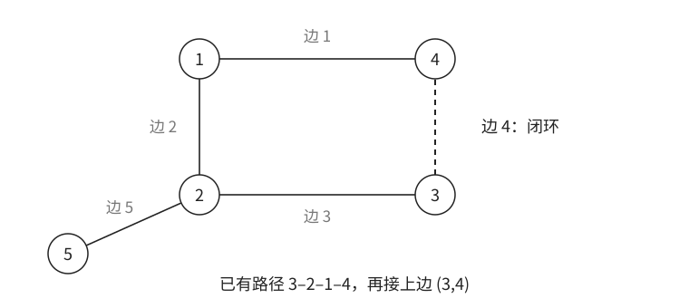
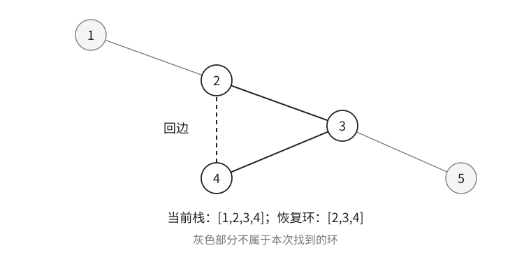
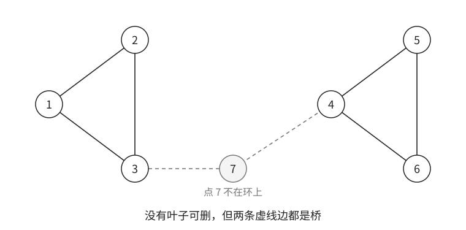

[[TOC]]

找环之前，先明确需要什么结果：判断是否有环、找一条环边，还是按顺序列出一个环上的点和边。它们需要保留的信息不同。

本文的环不重复经过顶点，末尾回到起点；允许自环作为长度为 $1$ 的环、两条不同的无向重边构成长为 $2$ 的环。普通无向边来回走两次，不算环。

| 任务 | 方法 | 结果 |
| --- | --- | --- |
| 无向图判环或找一条环边 | 并查集 | 一条使合并失败的原图边 |
| 无向图恢复任意一个环 | DFS | 环的点序、边序 |
| 基环树找出唯一的环 | 剥叶法 | 全部环上点，再沿环恢复顺序 |
| 有向图恢复任意一个环 | 三色 DFS | 按方向排列的点序、边序 |

一般图可能有很多环，本篇的恢复模板找到一个就停止。基环树恰好只有一个环，因此找到的就是它的全部环上点和边。结构与后续算法见 [[[rbook: functional-graph]]]。

## 并查集找环边

依次读入无向边 $(u,v)$，用 [[[rbook: disjoint_set]]] 维护此前的连通关系：

- 两端不连通：合并两个集合，保留这条边。
- 两端已经连通：保留的边中已经存在 $u$ 到 $v$ 的路径，再加上当前边就形成环。

成功合并的边始终构成森林，因此它们之间的路径唯一。**合并失败的这条原图边，一定在某个环上。**



沿用草稿的五点例子，边按如下顺序输入：

```text
5 5
1 4
1 2
2 3
3 4
2 5
```

前三条边已形成路径 $3\to2\to1\to4$。第 $4$ 条边 $(3,4)$ 两端已经连通，所以它是一条环边。最后一条边只接上一片叶子。

### 基环树断边

基环树是**连通且恰好含一个环的无向图**，等价于一棵树增加一条边，因而有 $n$ 个点、$n$ 条边。

处理完基环树的全部边，恰有一次合并失败：保留的 $n-1$ 条边已经构成生成树，失败的那条边就是可以断开的环边。删去它后，原图变成树。

这适合只需要断开一条环边、再运行树上算法的题目。它不一定是输入的最后一条边；改变输入顺序，也可能选中环上的另一条边。在一般多环图中，删除一条这样的边后还可能有环。

模板输入格式如上，边编号为输入行的顺序，从 $1$ 开始。有环时输出第一条失败边的 `编号 u v`，无环输出 `0`。样例输出为 `4 3 4`。

::: fold 完整代码
```cpp file=./dsu_cycle_edge.cpp
```
:::

采用路径压缩与按大小合并，时间复杂度为 $O(n+m\alpha(n))$，空间复杂度为 $O(n)$。

### 从一条边恢复环

如果还需要整个环，可以在成功合并时，额外将这条原图边存入邻接表。找到失败边 $(u,v)$ 后，在这片森林中搜索 $u$ 到 $v$ 的唯一路径，再补上失败边即可。

**不能直接沿并查集的 `fa` 数组恢复路径。** 并查集的父子关系用于维护集合，可能经过路径压缩，并不对应原图中的边。恢复原图路径需要另存的森林。

## DFS 恢复环

无向图 DFS 首次发现一个点时，记录它的父亲 `parent[v]` 和进入它的边号 `parent_edge[v]`，这些边构成 DFS 森林。

检查当前点 $u$ 的邻边时，跳过进入 $u$ 的那一条边。若遇到一个已访问的祖先 $v$，则：

$$
\text{一个环}=\text{树上从 }v\text{ 到 }u\text{ 的路径}+\text{边 }(u,v).
$$



图中 DFS 路径为 $1\to2\to3\to4$，从 $4$ 遇到祖先 $2$，恢复出的环是 $2\to3\to4\to2$。**当前搜索栈里不一定全是环上点**，祖先 $2$ 之前的前缀不属于这个环。

### 时间戳与来边

令 `dfn[u]` 为首次访问时间。无向图 DFS 的非树边连接祖先与后代，因此只在 `dfn[v] < dfn[u]` 时，从后代向祖先恢复环；另一侧会看到较大的时间戳，不必再处理。自环单独用 `v == u` 识别。

同一条无向边在两端邻接表中共用一个编号。跳过来边应写成：

```cpp
if (e.id == parent_edge[u]) continue;
```

不能跳过所有指向父亲顶点的边。如果父子之间有两条不同边，进入当前点的那条要跳过，另一条却恰好能构成长为 $2$ 的环。

### 恢复点序与边序

沿 `parent` 从 $u$ 回到 $v$，得到逆序点列，反转后为 $v,\ldots,u$。相邻父子间的边，读取孩子的 `parent_edge`；最后补上回边 $(u,v)$。草稿中回溯路径上的树边也必须一并记录，不能只标记回边。

三份恢复模板统一输出：第一行环长 $k$，第二行 $k$ 个点，第三行 $k$ 条边的编号。`cycle_e[i]` 连接 `cycle_v[i]` 与 `cycle_v[(i+1)%k]`，末尾不重复输出起点；没有环时只输出 `0`。

无向 DFS 还会设置 `on_vertex`、`on_edge`，标记**本次找到的这个环**，不是一般图中所有环的并集。

::: fold 完整代码
```cpp file=./find_cycle_undirected.cpp
```
:::

代码用 `st` 模拟递归路径，`next_edge[u]` 记录返回 $u$ 后继续检查哪条邻边。首次发现孩子时入栈，处理完全部邻边后才出栈，保持真正的深度优先顺序。遍历所有未访问点，因此非连通图也能处理。

每条边至多检查两次，找到环后只回溯一次，时间复杂度为 $O(n+m)$，空间复杂度为 $O(n+m)$。显式栈避免长链导致递归栈过深。

## 基环树剥叶

如果已知图是基环树，可以不断删除度数为 $1$ 的叶子。

环上每个点都有两条环边，不会被删成叶子；环外是一棵棵挂树，最外层叶子删除后，内部节点会逐渐成为新叶子。最终恰好留下唯一的环。前面的五点图只需删除点 $5$，便剩下 $1,2,3,4$。

用队列维护待删除点。删掉一个点时，将尚未删除邻点的度数减一，度数降到 $1$ 就入队。代码也将初始孤立点入队，以便统一删除度数不超过 $1$ 的点。

剥叶只能确定剩余的点集，不能得到环序。在基环树中，剩下每个点的度数恰好为 $2$，从任一点出发，每次选择不是来边的另一条环边，就能绕行一圈。仍应按边编号跳过来边，以支持重边。

::: fold 完整代码
```cpp file=./peel_cycle.cpp
```
:::

输入为连通基环树，$m=n$。输出格式与无向 DFS 相同，二者的起点、方向可能不同。自环对度数贡献 $2$；沿环走时走过它就回到起点，因此也能输出长度为 $1$ 的环。时间和空间复杂度均为 $O(n+m)$。

### 一般图的限制

一般无向图反复删除度数不超过 $1$ 的点，得到的是 **2-core**，即剩余点的度数都至少为 $2$。这些点不一定都在某个简单环上。



图中点 $7$ 的度数为 $2$，剥叶不会删掉它，但它只是两个环之间连接路径上的点。连接路径上的两条边都是桥，不属于任何环。因此，不能在一般图中把“剥叶剩余”直接当作“全部环上点”。

若已知每个连通块至多一个环，剥叶后确实只剩各个环，但还需要逐个分组、分别绕行。上面的单环模板只输出其中一个，不能直接当作所有环的枚举器。

## 有向图找环

有向图的边有方向，不能直接使用普通并查集判定有向环。例如 $1\to2,1\to3,3\to2$ 没有有向环，但忽略方向后形成三角形。

DFS 时也不能将“到达已访问点”等同于“发现环”。同一个例子中，先搜索完点 $2$，再走 $1\to3\to2$，会遇到已访问的 $2$，却没有返回当前路径的通路。

需要区分三种状态：

| `color` | 含义 |
| --- | --- |
| $0$ | 尚未访问 |
| $1$ | 已进入，仍在当前 DFS 路径上 |
| $2$ | 邻边全部检查完毕，已退出当前路径 |

从 $u$ 检查有向边 $u\to v$ 时：未访问则继续搜索；若 `color[v] == 1`，树上已有有向路径 $v\to\cdots\to u$，加上当前边就闭合成环；若为 $2$，继续检查其他边。

恢复方式仍是沿父亲回溯，再反转点列，边序必须与方向一致。有向图**不跳过指向父亲的边**：父亲到孩子的树边与孩子返回父亲的边，已经构成一个有向环。

::: fold 完整代码
```cpp file=./find_cycle_directed.cpp
```
:::

模板按有向边读入，每条边只存一次，使用显式栈并遍历所有连通部分。输出约定与前面的恢复模板一致，但每条边必须沿输入方向连接相邻点。时间和空间复杂度均为 $O(n+m)$。

如果只需判断有向图是否有环，也可以用 [[[rbook: topsort]]]：无法输出全部顶点就说明存在环。不过一般有向图中，Kahn 算法留下的顶点可能包含环的后继，不能直接当作环上点。

本文模板按 $n\le200000$ 预留点数组；无向 DFS 的边标记数组按 $m\le400000$ 预留，实际使用时根据题目上限调整。
