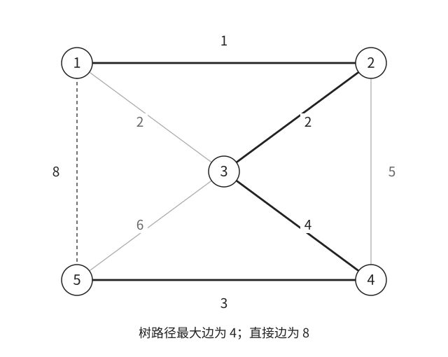
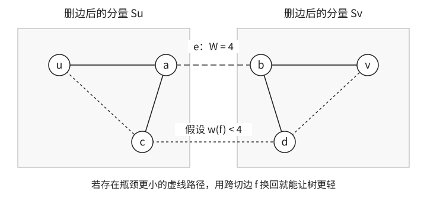

[[TOC]]

## 问题

给定无向带权图，反复询问两个不同顶点 $u,v$：从 $u$ 到 $v$ 的所有路径中，**路径上的最大边权，最小能是多少**？

记一条路径 $P$ 的瓶颈为

$$
B(P)=\max_{e\in P}w(e),
$$

目标为

$$
b(u,v)=\min_{P:u\leadsto v}B(P).
$$

它最小化的是一条路径上的最大值，不是边权和。若边权表示危险程度，就是寻找“最危险的一段也尽量安全”的路线。

本篇先用 [[[rbook: graph_mst]]] 压缩原图，再用 [[[rbook: jump_lca]]] 的倍增方法维护树上路径信息。

## 示例

沿用基础篇的五点八边图。比较从 $1$ 到 $5$ 的三条路线：

| 路线 | 边权 | 路径和 | 最大边 |
| --- | --- | --- | --- |
| $1\to5$ | $8$ | $8$ | $8$ |
| $1\to3\to5$ | $2,6$ | $8$ | $6$ |
| $1\to2\to3\to4\to5$ | $1,2,4,3$ | $10$ | $4$ |

第三条路虽然总长度更大，瓶颈却更小。它正是前文所选 MST 中连接 $1,5$ 的路径，瓶颈答案为 $4$。

## MST 上的路径

::: theorem 瓶颈路性质
在无向连通带权图中，任取一棵 MST。任意两个不同顶点之间，MST 上唯一路径的最大边权，等于原图中的最小瓶颈值。
:::

结论允许同权边，也不要求 MST 唯一。不同 MST 上的具体路径可能不同，但同一对点查询出的最大边权相同。

### 删边证明

设 $T$ 是 MST，$u,v$ 在树上的路径为 $P_T$。取路径上一条最大边 $e$，其权值为 $W$。删去 $e$ 后，树分成两部分 $S_u,S_v$，$u,v$ 分处两侧。

任意原图中的 $u$ 到 $v$ 路径，都必须至少经过一条跨过这次切分的边 $f$。

若存在这样的边满足 $w(f)<W$，用 $f$ 接回两部分，就能得到

$$
w(T-e+f)=w(T)-W+w(f)<w(T),
$$

与 $T$ 最优矛盾。因此每条跨切边都不轻于 $W$，任何替代路径的最大边权也至少为 $W$。

MST 自己的路径恰好达到 $W$，所以它就是最小瓶颈路。注意，证明比较的是最大边与一条跨切边，不需要比较整条替代路径的总长度。

### 阈值理解

只保留权值不超过 $t$ 的边。若 $u,v$ 连通，就存在一条最大边权不超过 $t$ 的路径；反之也成立。

所以 $b(u,v)$ 也是：**随阈值增大，两点首次连通时的最小阈值。**

这与 Kruskal 从小到大加入边的过程一致。单次询问可以按权扫描到两点连通；大量询问则保存生成树，再做树上查询。不要为每次询问重新排序和扫描全部边。

## 倍增查询

### 保存树边

Kruskal 选边成功时，将**原图中的这条边**加入树的邻接表。原图不连通时，会得到多棵树，即最小生成森林；每个连通分量内部仍可使用瓶颈路性质。

并查集只负责判断两点是否连通，树的邻接表负责保存路径，不能用并查集父亲指针代替。

### 路径最大值

在祖先表之外，维护

$$
mx[u][j]=u\text{ 向上 }2^j\text{ 步经过的最大边权}.
$$

若 $p=up[u][j-1]$，两段拼接得到

$$
\begin{aligned}
up[u][j]&=up[p][j-1],\\
mx[u][j]&=\max\bigl(mx[u][j-1],mx[p][j-1]\bigr).
\end{aligned}
$$

根没有父边，空段的最大值使用负无穷作为单位元；这样零权和负权边也不会被初值 $0$ 覆盖。

在样例 MST 的链 $1\to2\to3\to4\to5$ 中：

| 从 $5$ 上跳 | 到达点 | 经过边权 | 最大值 |
| --- | --- | --- | --- |
| $1$ 步 | $4$ | $3$ | $3$ |
| $2$ 步 | $3$ | $3,4$ | $4$ |
| $4$ 步 | $1$ | $3,4,2,1$ | $4$ |

### 查询过程

与倍增求 LCA 相同，区别是每次移动时把所经过的路径最大值并入答案：

1. 较深点先升到同一深度。
2. 若两点已重合，返回累计结果。
3. 从大到小同时上跳，保持两点的祖先不同。
4. 最后补上两条通向 LCA 的父边。

查询 $(2,5)$ 时，先把 $5$ 上跳两步到 $3$，取到最大值 $4$；再上跳一步到 $2$，取到边权 $2$，最终为 $\max(4,2)=4$。

## 代码

采用 [[[p: luogu-P2245 | 星际导航]]] 的边表与询问格式：

- 输入 $n,m$，再输入 $m$ 条 `u v w`。
- 输入询问数 $q$，再输入 $q$ 对顶点。
- 连通时输出最小瓶颈值，不连通输出 `impossible`。

~~~cpp file=./bottleneck.cpp
~~~

代码对每棵树分别进行队列遍历，建立祖先表。即使生成树退化成链，也不需要递归遍历。

输入：

~~~text
5 8
1 2 1
2 3 2
1 3 2
3 4 4
2 4 5
4 5 3
3 5 6
1 5 8
5
1 5
1 3
4 5
2 5
3 3
~~~

输出：

~~~text
4
2
3
4
0
~~~

数学性质只讨论不同顶点。对 `u==v`，本模板额外约定返回 $0$，表示无需经过边；这个接口约定不参与非空路径的瓶颈证明。

## 最大承重

[[[p: luogu-P1967 | 货车运输]]] 的目标相反：一条路径能承受的重量，等于其中最小的限重，希望这个最小值尽量大：

$$
c(u,v)=\max_{P:u\leadsto v}\min_{e\in P}w(e).
$$

使用**最大生成树上的路径最小值**即可求解。证明仍用删边换边：若树路径最小边为 $W$，删除它得到两部分；若有更重的跨切边，就能增加最大生成树总权值。因此任意替代路径都得经过不超过 $W$ 的跨切边。

修改时要同时调整三个地方：

| 最小瓶颈路 | 最大承重 |
| --- | --- |
| 按边权升序建最小生成森林 | 按边权降序建最大生成森林 |
| 倍增维护路径最大值 | 倍增维护路径最小值 |
| 空段使用负无穷 | 空段使用正无穷 |

只改排序方向不够，查询的合并运算与初值也要一起改。原题还要求不连通时输出 $-1$，并保证询问两点不同。

## 瓶颈生成树

“整棵树最大边最小”叫最小瓶颈生成树，它与“两点瓶颈路”相关，但不是同一个定义。

MST 一定是最小瓶颈生成树：任取一棵其他生成树，删去 MST 的一条全局最大边后，其他生成树也必须跨过这个切分，因此其最大边不会更小。

反过来不成立。三角形边权为 $1,2,2$，两条 $2$ 构成的树，最大边已达到最优值 $2$，但总权值 $4$ 大于 MST 的 $3$。

这种树也不保证保留所有点对的最优瓶颈：原图中权值为 $1$ 的那条边两端，在这棵树上的路径最大值是 $2$。本篇的查询结论要求使用 MST。

## 复杂度与边界

设询问数为 $q$。Kruskal 排序与建森林、倍增预处理、查询的总时间为

$$
O\bigl(n+m\log(m+1)+m\alpha(n)+n\log n+q\log n\bigr).
$$

空间为 $O(m+n\log n)$。模板容量为 $n\le10^5$、$m\le3\times10^5$，`LOG=18` 覆盖所需跳跃层数。

- 允许不连通、重边、自环。森林中的孤立点也要被初始化。
- 跨连通分量先输出不可达，不调用路径查询函数。
- 本系列按 $\lvert w\rvert\le10^9$ 使用，`NEG` 小于所有合法边权；`mx` 的零初始化不能代替负无穷。
- 必须先读取当前段的信息，再移动顶点。先改 `u` 再取 `mx[u][j]`，会漏掉原来的那一段。
- 相同点的返回值要遵循题目约定。本模板明确返回 $0$，一般理论中不必为最大空集合定义一个数值。

::: fold 负权与不可达检查
输入：

~~~text
3 1
1 2 -5
3
1 2
1 3
3 3
~~~

输出：

~~~text
-5
impossible
0
~~~

若把路径最大值的初值写成 $0$，第一条查询就会出错。
:::

## 练习

| 层次 | 题目 | 训练内容 |
| --- | --- | --- |
| 最小化最大边 | [[[p: luogu-P2245]]] | 最小生成森林加倍增查询，注意重边、自环与不可达。 |
| 最大化最小边 | [[[p: luogu-P1967]]] | 改用最大生成森林与路径最小值。 |
| 全树瓶颈 | [[[p: luogu-P2330]]] | 先最小化选边数，再最小化最大边；理解 MST 可以给出最优瓶颈，但反向结论不成立。 |

下一篇 [[[rbook: mst_second]]] 继续使用树上路径信息，决定加入一条非树边后应删除哪条边。
