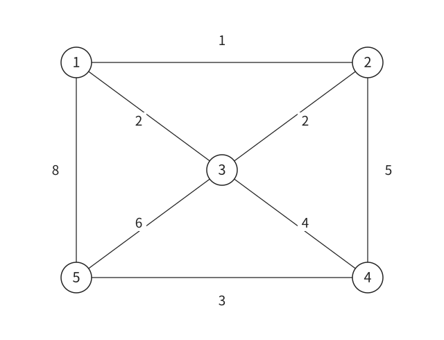
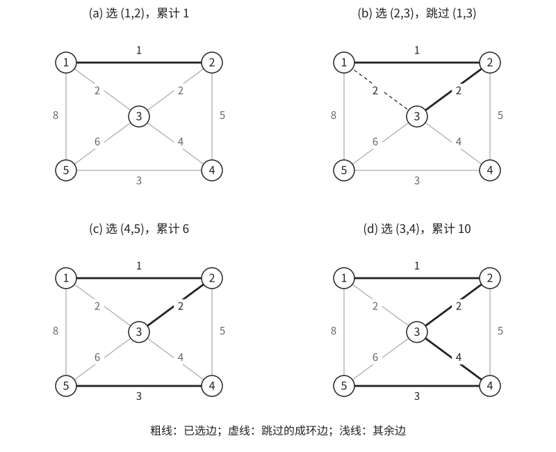
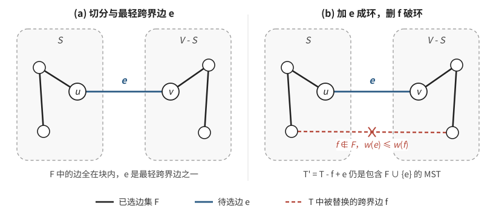

[[TOC]]

## 问题

给定一张 $n$ 个点、$m$ 条边的无向带权图，选出一些边，使所有点连通、不出现环，并使边权和最小。

连接全部顶点的树叫**生成树**，恰有 $n-1$ 条边；其中边权和最小的叫**最小生成树**（Minimum Spanning Tree，MST）。

原图连通时，至少存在一棵生成树。候选生成树数量有限，其中必有权值和最小的一棵；原图不连通时，则不存在生成树。只有一个点时，空边集就是生成树，总权值为 $0$。

本篇用 Kruskal 算法求解，前置知识是 [[[rbook: disjoint_set]]]。后续依次学习 [[[rbook: mst_prim]]]、[[[rbook: mst_bottleneck]]]、[[[rbook: mst_second]]]。

## 示例

四篇共用下面的图。含同权边，是为了区分“最小权值唯一”与“选出的树唯一”。

输入采用边列表：

~~~text
5 8
1 2 1
2 3 2
1 3 2
3 4 4
2 4 5
4 5 3
3 5 6
1 5 8
~~~

可以选择 $(1,2)$、$(2,3)$、$(4,5)$、$(3,4)$，总权值为

$$
1+2+3+4=10.
$$

把 $(2,3)$ 换成同权的 $(1,3)$，仍得到权值为 $10$ 的生成树。**MST 的边集可能不唯一，但最优权值相同。**

## 选边练习

在同一张图上自由选边，试着连通全部顶点。点击边或边权可以选中，再次点击可以取消；若两个端点已经连通，新边会被拒绝，并标出成环原因。

本练习先体验生成树的“连通、无环”，不考核总权值最小。选出一棵生成树后，再看下文如何选择更轻的边。

[[[animate: ./edge-game.animation.ts]]]

## 从小边开始

一开始每个点独立成块。为了把全图连通，需要不断用边连接不同连通块。

Kruskal 的做法是：**按边权从小到大扫描，只选择连接两个不同连通块的边。**

- 两端不连通，选边会合并两个块。
- 两端已连通，已有路径连接它们，再选这条边会形成环，跳过。
- 选够 $n-1$ 条边后停止。

并查集维护的是**已选边形成的连通块**。每次成功合并，块数减一；从 $n$ 块减到一块，恰好选择 $n-1$ 条边。

## 选边过程

同权时任选顺序都可以。正文与代码按输入顺序处理同权边。

| 扫描的边 | 操作 | 当前连通块 | 权值和 |
| --- | --- | --- | --- |
| 初始 | 不选边 | $\{1\},\{2\},\{3\},\{4\},\{5\}$ | $0$ |
| $(1,2,1)$ | 选 | $\{1,2\},\{3\},\{4\},\{5\}$ | $1$ |
| $(2,3,2)$ | 选 | $\{1,2,3\},\{4\},\{5\}$ | $3$ |
| $(1,3,2)$ | 两端已连通，跳过 | $\{1,2,3\},\{4\},\{5\}$ | $3$ |
| $(4,5,3)$ | 选 | $\{1,2,3\},\{4,5\}$ | $6$ |
| $(3,4,4)$ | 选，完成 | $\{1,2,3,4,5\}$ | $10$ |

剩余边无需继续扫描。若把全部边都处理完，仍选不足 $n-1$ 条，原图不连通。

## 贪心证明

“不会成环”只保证结果是一棵树，还需要证明总权值最小。

设当前已选边集为 $F$。只要证明一个结论：**每选进一条新边 $e$，$F$ 依然能被某棵 MST 完全包含**（即选边方向没有走歪）。

初始 $F$ 为空，结论显然成立。假设在某一步准备选边 $e=(u,v)$，此时 $u,v$ 位于 $F$ 的不同连通块。取 $u$ 所在连通块为 $S$，其余顶点为 $V-S$，如下图所示：

1. **$e$ 是跨过 $S$ 边界的最轻边之一**。若有更轻的跨界边，按权值从小到大扫描时早就遇到它了：若当时两端不同块，它已被选入 $F$ 合并了这两块；若当时已同块，以后也一直同块，不可能到现在仍跨在 $S$ 与 $V-S$ 之间。
2. **用 $e$ 替换得到包含 $F \cup \{e\}$ 的 MST**。由假设，存在一棵包含 $F$ 的 MST，记为 $T$。
   - 若 $e \in T$，直接保留 $T$ 即可。
   - 若 $e \notin T$，把 $e$ 加入 $T$ 会形成一个环。环上原来在 $T$ 中连通 $u$ 与 $v$ 的路径从 $S$ 内走到 $S$ 外，必有一条边 $f$ 跨过边界。因为 $F$ 的边全在各自连通块内、不跨边界，所以 $f \notin F$。删去 $f$、保留 $e$，得到新的生成树

$$
T' = T - f + e.
$$

由第 1 步，$w(e) \le w(f)$，因此 $T'$ 的总权值不大于 $T$。$T$ 已经最优，故 $T'$ 仍是 MST，且同时包含 $F$ 与 $e$。

按上述过程选够 $n-1$ 条边时，$F$ 已是一棵生成树，又能被某棵 MST 包含，因此 $F$ 自身就是 MST。原图连通时不会提前卡住，否则连接不同块的边在扫描时就会将它们合并。

## 切分与环路

上述换边方法也给出两个常用性质。以下都以无向连通图为前提：

| 性质 | 允许同权时 | 最轻或最重边唯一时 |
| --- | --- | --- |
| 切分 | 一次切分中的任意最轻跨切边，至少属于某棵 MST | 唯一最轻跨切边属于每棵 MST |
| 环路 | 一个环中的任意最重边，至少能被某棵 MST 舍弃 | 唯一最重边不属于任何 MST |

切分性质通过“加入轻边、删去不更轻的跨切边”证明。环路性质则反过来：若 MST 含环中的最重边，删去它形成两块，再从原环其余边中找一条跨切边接回，权值不会增加。

同权时不能把“存在某棵”改为“每棵”。等权三角形的每条边都可以出现在某棵 MST 中，也都可以被另一棵 MST 舍弃。

## 代码

采用 [[[p: luogu-P3366 | 最小生成树]]] 的输入输出格式：输入 $n,m$ 和 $m$ 条无向边；连通则输出 MST 总权值，不连通则输出 `orz`。

~~~cpp file=./kruskal.cpp
~~~

样例输出：

~~~text
10
~~~

代码有三处约定：

- `unite` 只有真正合并两个块时才返回 `true`，此时才累加权值。
- `kruskal` 用布尔返回值表示是否存在 MST，不把某个合法权值当作“不连通”标记。
- 同权边按原始编号排序，便于核对示例；这是确定输出顺序的约定，不是正确性要求。

如果还需要树上的路径，应在选边成功时另外保存原图边 $(u,v,w)$。**并查集的父亲指针不是 MST 的边**，不能直接用它建树。

## 边界与复杂度

初始化 $O(n)$，排序 $O(m\log(m+1))$，并查集操作 $O(m\alpha(n))$，总时间为

$$
O\bigl(n+m\log(m+1)+m\alpha(n)\bigr).
$$

通常由排序主导。连通且 $n\ge2$ 时，可简写为 $O(m\log m)$。空间为 $O(n+m)$。

- 模板容量为 $n\le2\times10^5$、$m\le5\times10^5$，下标从 $1$ 开始。
- 允许重边、自环、零权与负权。重边分别参与排序，自环始终无法合并两个块。
- 边权与总和使用 `ll`。本系列模板按 $\lvert w\rvert\le10^9$ 使用，累加和也须在类型范围内。
- $n=1$ 时，无需选择任何边，答案为 $0$；原图不连通时，只能得到各连通分量的最小生成森林。
- MST 要求选出的结构是一棵树。若题目只要求连通而允许保留环，负权边可能使保留更多边更优，不能不加判断地套用 MST。
- 最小生成树最小化的是**整棵树的边权和**，不保证从某个源点到其他点的路径和最短。

## 练习

### 手算

1. 等权三角形有几棵 MST？三条边能否同时选入？
2. 一个点、两条自环，权值分别为 $-5,2$，MST 权值是多少？
3. 图不连通时，能否把所有成功合并边的权值和直接作为 MST 答案？

::: fold 参考结果
1. 有三棵，每棵选两条边；三条同时选择会成环。
2. 为 $0$。生成树不包含自环，负权自环也不能选。
3. 不能。这是最小生成森林的权值，原图没有生成树。
:::

### 推荐题目

| 层次 | 题目 | 训练内容 |
| --- | --- | --- |
| 模板 | [[[p: luogu-P3366]]] | 排序、并查集判环、选边计数与不连通判断。 |
| 删边建模 | [[[p: luogu-P2820]]] | 保持原有连通性，保留最小生成森林，删边收益为总边权减森林权值；原图不一定连通，不能直接沿用 `orz` 输出。 |
| 虚拟源点 | [[[p: luogu-P1550]]] | 增加一个表示水源的点，把挖井费用转为连向水源的边，再求 MST。 |

下一篇用 [[[rbook: mst_prim]]] 比较另一种选边顺序。

## 参考

- [Princeton Algorithms：Minimum Spanning Trees](https://algs4.cs.princeton.edu/43mst/)：切分性质、Kruskal 与 Prim。

