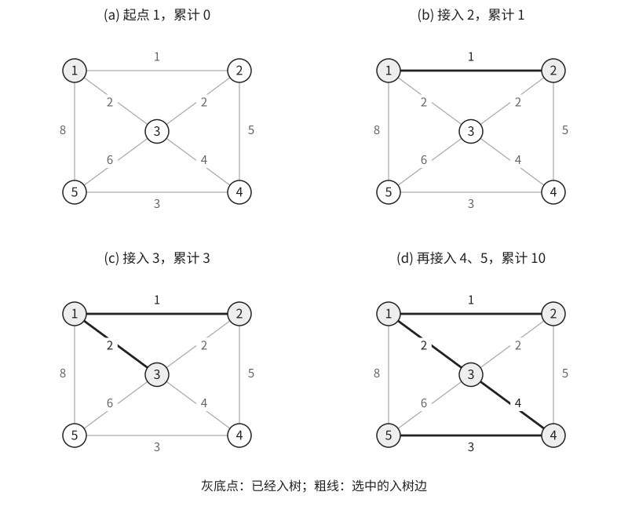
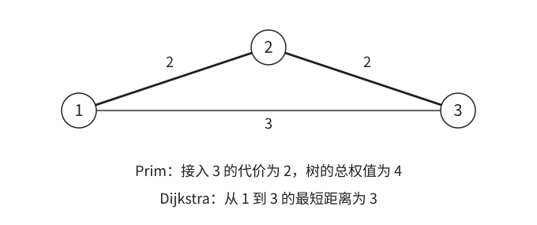

[[TOC]]

## 从一棵树扩展

[[[rbook: graph_mst]]] 中，Kruskal 同时维护多个连通块，按边权排序后逐步合并。

Prim 从任意一个点出发，维护已经入树的点集 $S$。每次选择**一端在 $S$、另一端不在 $S$ 的最轻边**，把新点接入，直到包含所有点。

两个算法都选择最轻跨切边。区别在于：Kruskal 合并一片森林，Prim 只扩展一棵树。

## 入树代价

对每个尚未入树的点 $v$，维护

$$
dis[v]=\min_{u\in S,\,(u,v)\in E}w(u,v).
$$

它表示从当前树中接入 $v$ 所需的最小边权。若没有相应边，记为无穷大。

`pre[v]` 记录提供该边的树内顶点。每次选出 `dis` 最小的未入树顶点 $u$，累加它的入树代价，再用它的出边更新其他点：

~~~cpp
if (!vis[v] && w < dis[v]) {
    dis[v] = w;
    pre[v] = u;
}
~~~

第一次还没有树，约定起点 `dis[1]=0`，其余点为无穷大。这个 $0$ 只是让起点先入树，不代表原图存在一条零权边。起点没有入树边，其他每个点各选一条，合计 $n-1$ 条。

## 示例

沿用基础篇的五点八边图。每次更新后，未入树点的代价如下：

| 已入树点集 $S$ | `dis[2]` | `dis[3]` | `dis[4]` | `dis[5]` | 累计权值 |
| --- | --- | --- | --- | --- | --- |
| $\{1\}$ | $1$ | $2$ | $\infty$ | $8$ | $0$ |
| $\{1,2\}$ | — | $2$ | $5$ | $8$ | $1$ |
| $\{1,2,3\}$ | — | — | $4$ | $6$ | $3$ |
| $\{1,2,3,4\}$ | — | — | — | $3$ | $7$ |
| 全部顶点 | — | — | — | — | $10$ |

按代码“严格变小才更新”的约定，$3$ 的父亲会保留为 $1$。选出的边为 $(1,2)$、$(1,3)$、$(3,4)$、$(4,5)$，与前篇 Kruskal 的边集略有不同，总权值仍为 $10$。

### 演示

可在下面的外部演示中观察跨切边与入树点的变化：

[[[dsa: prim]]]

## 正确性

设已经选出的树边为 $F$，它们能包含在某棵 MST $T$ 中。Prim 选择的边 $e$ 是切分 $(S,V-S)$ 上的最轻边之一。

若 $T$ 不含 $e$，加入 $e$ 形成的环中，必有另一条跨切边 $f$。因为 $F$ 的边都在 $S$ 内，$f$ 不属于 $F$。以 $e$ 换掉 $f$，仍是一棵包含 $F$ 的生成树，且权值不增。因此存在一棵同时包含 $F$ 与 $e$ 的 MST。

起点不含任何边，不变量成立；每次扩展都保持不变量。选完全部点后，已经是一棵生成树，故它就是 MST。

若所有未入树点的 `dis` 都为无穷大，表示不存在跨过 $(S,V-S)$ 的边，原图不连通，应报告无解。

## 与 Dijkstra 的区别

两种算法都可以“取最小代价顶点，再更新邻点”，但 `dis` 的含义不同：

| 算法 | `dis[v]` 含义 | 经由 $u$ 的候选 |
| --- | --- | --- |
| Prim | 从当前树接入 $v$ 的最小单边权 | $w(u,v)$ |
| Dijkstra | 从固定源点到 $v$ 的最短路径和 | $dis[u]+w(u,v)$ |

例如三角形边权为 $w(1,2)=2$、$w(1,3)=3$、$w(2,3)=2$：

加入 $2$ 后，Prim 会把 $3$ 的入树代价从 $3$ 改为 $2$；Dijkstra 则比较 $3$ 与 $2+2$，保留源点到 $3$ 的距离 $3$。

所以 Prim 的更新中**不能加 `dis[u]`**。Prim 可以处理负权边，其证明不依赖 Dijkstra 的非负权条件。

## 邻接矩阵

每轮扫描全部未入树点，选代价最小者，再扫描它与所有点之间的边。

~~~cpp file=./prim_dense.cpp
~~~

矩阵中的无边位置使用 `INF`，不能用 $0$，因为零权边合法。重边只保留最小边权，自环忽略。

代码与基础篇使用同一输入格式：先输入 $n,m$，再输入 $m$ 条边；连通输出总权值，不连通输出 `orz`。使用基础篇的样例，答案为 $10$。

**本矩阵模板容量为 $n\le2000$。** [[[p: luogu-P3366]]] 的最大规模为 $n=5000$，练习该题完整数据时应使用下面的堆版，或自行调整空间方案。

初始化与选点各需 $O(n^2)$，读入 $O(m)$，总时间为 $O(n^2+m)$，空间为 $O(n^2)$。代码中的 `pre[v]` 还可以用于记录最终树边。

## 堆优化

稀疏图不必每轮扫描全部点，可以把 `(dis[v],v)` 放入小根堆。某点代价变小时，直接插入新的候选；旧候选留在堆中，取出时跳过已经入树的点。

一个点的最新候选不大于它自己的旧候选，会先被取出。第一次取出时便以当前最小入树代价入树，之后都被 `vis` 排除；每个点的代价只累加一次。

::: fold 堆优化完整代码
~~~cpp file=./prim_heap.cpp
~~~
:::

这里使用普通 `priority_queue`，没有直接修改堆内旧项，因此堆中可能同时保存同一点的多个候选。每条边只被扫描常数次，最多产生 $O(m)$ 次有效更新，复杂度为

$$
O\bigl(n+m\log(m+1)\bigr),
$$

空间为 $O(n+m)$。不要把这种“保留旧项”的实现，与支持直接减小键值、堆内始终只有 $O(n)$ 项的实现混为一谈。

本模板支持 $n\le2\times10^5$。堆为空后若入树点数不足 $n$，原图不连通。

## 隐式完全图

有些图没有直接输入全部边，而是给出点坐标，任意两点都能连边。显式存储全部 $O(n^2)$ 条边并排序，代价较大。

此时仍可使用朴素 Prim：选出 $u$ 后，现场计算 $w(u,v)$，更新每个未入树点。若单条边权可在 $O(1)$ 时间得到，总时间为 $O(n^2)$，除坐标外只需 $O(n)$ 辅助空间，不必真正建立矩阵。

几何距离题还需把边权、`dis` 和累加和统一改为浮点类型，不能直接复制整数版的读入与存储。

## 边界

- 起点任选；连通图上，从不同起点得到的 MST 边集可能不同，但总权值相同。
- 零权、负权均可正常比较，边权与总和使用 `ll`；本系列按 $\lvert w\rvert\le10^9$ 使用。
- $n=1$ 时起点独自入树，答案为 $0$，不需要真实边。
- 朴素版选不到有限代价顶点、堆版不能访问所有点，都是不连通的表现。
- 遍历部分顶点得到的权值，不是整个原图的 MST 答案。
- 多组数据时，要重置 `dis`、`vis`、`pre` 及图的存储；两个算法函数已重置自己的选点状态。

## 练习

### 手算

1. 为什么起点不需要累加真实边权？
2. 三角形边权为 $2,3,2$ 时，Prim 的总权值与从 $1$ 出发的最短路径树的总边权各是多少？
3. 堆内某顶点出现两次，能否把两次弹出的代价都加入答案？

::: fold 参考结果
1. 起点构成单点树，没有入树边；其余 $n-1$ 个点各用一条边接入。
2. MST 为 $2+2=4$；最短路径树使用边 $(1,2)$、$(1,3)$，总边权为 $5$。
3. 不能。一个点只能入树一次，旧候选需要跳过。
:::

### 推荐题目

| 层次 | 题目 | 训练内容 |
| --- | --- | --- |
| 矩阵输入 | [[[p: luogu-P1546]]] | 从邻接矩阵直接选点、更新入树代价。 |
| 虚拟源点 | [[[p: luogu-P1550]]] | 将挖井看作连向虚拟水源的边，用 Prim 统一处理两种费用。 |
| 完全图 | [[[p: luogu-P2872]]] | 点间边权为欧氏距离，已有道路按零费用处理，求新增道路总长度。 |
| 堆版对照 | [[[p: luogu-P3366]]] | 与 Kruskal 使用相同数据，对比答案与不连通判断。 |

下一篇 [[[rbook: mst_bottleneck]]] 讨论：最小生成树如何同时回答两点之间的瓶颈值。
