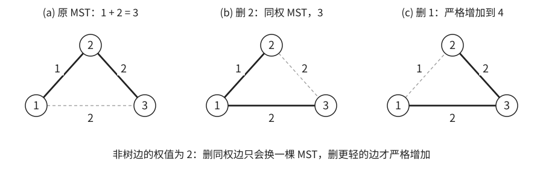
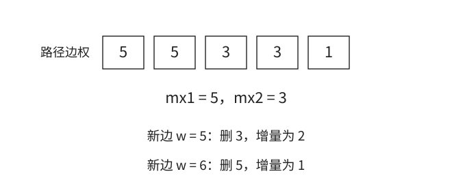

[[TOC]]

## 问题

设最小生成树的总权值为 $W$。严格次小生成树要求：

$$
w(T')>W,
$$

并在所有满足这个条件的生成树中，令 $w(T')$ 最小。

换成另一棵同权 MST 不算严格次小；原图也可能没有严格次小生成树，例如原图本身就是一棵树，或所有生成树的总权值都相同。

本篇沿用 [[[rbook: graph_mst]]] 的 Kruskal 建树，以及 [[[rbook: mst_bottleneck]]] 的树上倍增查询。

## 加边与删边

固定一棵 MST $T$。加入一条非树边 $e=(u,v,w)$，会与 $T$ 中的 $u$ 到 $v$ 路径形成唯一环。

要重新得到生成树，必须删去环上的一条原树边 $f$。新权值为

$$
W'=W+w-w(f).
$$

若要求 $W'>W$，就必须满足

$$
w(f)<w.
$$

为了让新权值尽量小，应删除路径上**严格小于 $w$ 的最大边权**。

例如三角形边权为 $1,2,2$。MST 取 $1,2$，总权值为 $3$；加入剩余的 $2$：

- 删去原来的 $2$，仍为 $3$，只得到另一棵 MST。
- 删去 $1$，得到 $4$，才是严格次小。

因此，不能总是删除路径最大边，也不能在非树边等于最大值时直接放弃。

## 单次换边

::: theorem 单次换边性质
固定任意一棵 MST，若严格次小生成树存在，则至少有一棵严格次小生成树，可以从这棵 MST 删去一条边、加入一条边得到。
:::

这里说“至少有一棵”，不要求每棵严格次小树都只与固定的 MST 相差一条边。

### 证明

设固定 MST 为 $T$，任选一棵严格次小树 $T^*$。记

$$
A=T^*\setminus T,\qquad B=T\setminus T^*.
$$

两边的边数相同。使用一个树的交换引理：**可以将 $A,B$ 一一配对为 $(e_i,f_i)$，使每个 $T-f_i+e_i$ 都是一棵合法生成树。**

由于 $T$ 最优，每个独立交换的增量都非负：

$$
\delta_i=w(e_i)-w(f_i)\ge0.
$$

又因为配对恰好覆盖所有不同边，

$$
w(T^*)-w(T)=\sum_i\delta_i>0.
$$

必有某个 $\delta_j>0$，且 $\delta_j\le\sum_i\delta_i$。因此单次换边得到的树满足

$$
w(T)<w(T-f_j+e_j)\le w(T^*).
$$

$T^*$ 已是所有严格大于 MST 的树中最轻的，所以右边只能取等号。单次换边足够。

注意，这些是**分别从同一棵 $T$ 出发的独立交换**。证明没有假设把 $T$ 逐步变成 $T^*$ 时，每一步都只增不减。

::: fold 交换引理的证明
这部分使用 Hall 匹配定理，可在理解算法后阅读。

先收缩 $T,T^*$ 的全部共同边。共同边构成森林，收缩后仍得到同一顶点集上的两棵树，它们的边集分别为 $B,A$。

构造一个二分图：左侧为 $A$ 中的边，右侧为 $B$ 中的边；当 $f$ 位于 $e$ 两端在 $T$ 中的路径上时，连接 $e,f$。这样的配对正好保证 $T-f+e$ 仍是一棵树。

任取左侧边集 $X\subseteq A$，记它的所有右侧邻居为 $N(X)$。$N(X)$ 是树 $T$ 的边子集，因此是一片森林。每条 $X$ 中的边，两端都位于这片森林的同一个连通分量，因为它在 $T$ 中的整条路径都被包含在 $N(X)$ 中。

一个含 $s$ 个顶点的分量中，$N(X)$ 恰有 $s-1$ 条边。而 $X$ 是另一棵树的边子集，不能成环，所以该分量内部最多容纳 $s-1$ 条 $X$ 中的边。对所有分量求和，有

$$
|X|\le |N(X)|.
$$

Hall 定理说明：若左侧任意子集的邻居数都不少于自身，就存在覆盖左侧的匹配。两侧大小相同，这个匹配给出所需的一一配对。

这个引理只要求每对边单独交换后，$T-f+e$ 合法；不要求两棵树能够按同一个配对顺序完成交换。
:::

## 最大与严格次大

非树边 $e=(u,v,w)$ 的权值不可能小于树上 $u,v$ 路径的最大边权，否则换掉那条最大边就能让 MST 更轻。

设路径上两个最大的**不同边权**为 $M_1,M_2$：

- 若 $w>M_1$，删去 $M_1$，候选为 $W+w-M_1$。
- 若 $w=M_1$，只能删去严格次大值 $M_2$，候选为 $W+w-M_2$。
- 若第二种情况中不存在 $M_2$，这条非树边不能产生严格增加的候选。

例如路径权值为 $[5,5,3,3,1]$，两个最大不同值是 $5,3$，不是 $5,5$。若新边权为 $5$，应删 $3$，增加 $2$；若新边权为 $6$，则删 $5$，增加 $1$。

## 倍增维护

### 信息合并

用 `Info{mx1,mx2}` 保存两个最大不同值。插入一个候选权值 $x$ 时：

~~~cpp
void add_value(Info &a, ll x) {
    if (x == NEG) return;
    if (x > a.mx1) {
        a.mx2 = a.mx1;
        a.mx1 = x;
    } else if (x < a.mx1 && x > a.mx2) {
        a.mx2 = x;
    }
}
~~~

等于最大值的数不能进入第二位。单条边的信息为 `{w,NEG}`，空段为 `{NEG,NEG}`。

合并两段路径，只需将它们各自的两个候选合并。某个被舍弃的值，在原段内已有两个更大的不同值，因此不可能进入合并后的前两大。

### 祖先表与查询

定义：

- `up[u][j]`：$u$ 向上 $2^j$ 步的祖先。
- `mx1[u][j]`：这段路径的最大边权。
- `mx2[u][j]`：这段路径的严格次大边权。

预处理时，合并前后两段 $2^{j-1}$ 路径的信息。查询时，按倍增 LCA 的相同顺序移动两端，将经过的每段信息合入答案。

关键仍是**先合并当前段，再移动顶点**。两点最后停在 LCA 的两个孩子时，还要补上它们到 LCA 的两条父边。

## 示例

仍用基础篇的五点八边图，固定边集

$$
T=\{(1,2),(2,3),(3,4),(4,5)\},\qquad W=10.
$$

枚举四条非树边：

| 非树边 | 路径最大值 $M_1$ | 严格次大值 $M_2$ | 删除边权 | 新权值 |
| --- | --- | --- | --- | --- |
| $(1,3,2)$ | $2$ | $1$ | $1$ | $11$ |
| $(2,4,5)$ | $4$ | $2$ | $4$ | $11$ |
| $(3,5,6)$ | $4$ | $3$ | $4$ | $12$ |
| $(1,5,8)$ | $4$ | $3$ | $4$ | $14$ |

第一条非树边等于路径最大值，但仍能删除权值 $1$ 得到合法候选。答案为 $11$。

## 代码

采用 [[[p: luogu-P4180 | 严格次小生成树]]] 的边列表格式。先输入 $n,m$，再输入 $m$ 条 `u v w`，输出严格次小总权值。

原题保证严格次小存在。下面的模板额外约定：原图不连通，或不存在严格次小树时，输出 $-1$。

~~~cpp file=./second_mst.cpp
~~~

使用基础篇的输入：

~~~text
5 8
1 2 1
2 3 2
1 3 2
3 4 4
2 4 5
4 5 3
3 5 6
1 5 8
~~~

输出：

~~~text
11
~~~

模板先用 Kruskal 建 MST，按**原始边编号**标记是否被选中，再建立树上倍增表。排序后仍使用原编号访问标记，重边也能分别识别。

树的遍历采用数组队列，避免链形 MST 造成递归栈过深。并查集的 `find` 仍使用路径压缩与按大小合并，树高受到控制。

## 正确性

单次换边性质保证，全部严格次小解中，至少有一个能通过本算法枚举的方式产生。

对固定非树边，加入后形成唯一环；要恢复生成树，只能删除环上的原树边。严格增加要求删边权小于新边权，取其中最大的一个，就得到以这条新边完成交换时的最优候选。

MST 性质保证新边权不小于路径最大值，因此“最大值或严格次大值”覆盖了全部所需情况。倍增查询正确合并路径信息，所有非树边的候选取最小，便得到严格次小权值。

## 复杂度与边界

Kruskal 需要排序与并查集操作，倍增预处理为 $O(n\log n)$，每条非树边查询 $O(\log n)$。总时间为

$$
O\bigl(n+m\log(m+1)+m\alpha(n)+n\log n+m\log n\bigr),
$$

空间为 $O(m+n\log n)$。

- 模板支持 $n\le10^5$、$m\le3\times10^5$，`LOG=18` 覆盖所需层数。
- 允许零权、负权与重边，本系列按 $\lvert w\rvert\le10^9$ 使用。权值、总和与候选均用 `ll`。
- `NEG` 表示不存在某种边权，`INF` 表示尚无候选。不能用 $0$ 作为不存在标记。
- 不存在 MST 用布尔值判断，不能用 `total==-1` 判断；负权图中 $-1$ 也可能是合法总权值。
- 自环不能成为生成树边，枚举非树边时也要跳过，不能对空路径做换边。
- 若路径上只有一种边权，严格次大值不存在。不能把另一次出现的最大值放进第二位。
- 最小生成树不唯一，不代表没有严格次小；但也不能保证一定存在严格次小。例如等权三角形只有同权生成树。

## 练习

### 边界数据

分别求下面三张图的 MST 权值与严格次小权值：

1. 三角形边权 $1,2,2$。
2. 三角形边权 $2,2,2$。
3. 三角形边权 $-3,-1,-1$。

::: fold 参考结果
1. MST 为 $3$，严格次小为 $4$。
2. MST 为 $4$，不存在严格次小。
3. MST 为 $-4$，严格次小为 $-2$。仍需删除严格次大值，不能使用零初值。
:::

### 推荐题目

| 层次 | 题目 | 训练内容 |
| --- | --- | --- |
| 严格次小 | [[[p: luogu-P4180]]] | 完整实现最大、严格次大值的倍增合并，处理自环与同权边。 |
| 换边变体 | [[[p: codeforces-609E]]] | 对每条边求必须包含它时的最小生成树权值；此题允许结果等于 MST，非树边直接删除路径最大边。点数可达 $2\times10^5$，需扩大点数组容量。 |

完成本篇后，可以进一步研究 MST 唯一性与必须包含某条边的最优代价；这些问题都建立在“非树边与树上路径形成环”的关系上。

## 参考

- [Donald 与 Tobey：A Generalised Exchange Theorem for Matroid Bases](https://www.cambridge.org/core/services/aop-cambridge-core/content/view/940572AE13A51935F19399AC1B31EF85/S0004972700028938a.pdf/generalised_exchange_theorem_for_matroid_bases.pdf)：独立交换的一一配对及 Hall 定理背景。
