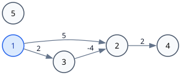
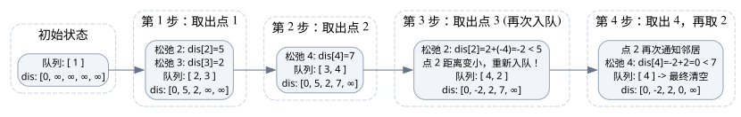

[[TOC]]

## 算法背景与直觉

前置算法: `[[bellman-ford]]`。

在 Bellman-Ford 算法中，我们每一轮都对图上的**所有边**进行松弛操作。

回顾松弛操作的定义：

::: pseudocode
\begin{algorithm}
\begin{algorithmic}
\IF{$dis(v) > dis(u) + w(u,v)$ }
\STATE $dis(v) = dis(u)+w(u,v)$
\ENDIF
\end{algorithmic}
\end{algorithm}
:::

思考一个问题：**什么样的边才可能成功进行松弛？**

如果点 $u$ 的最短路估计值 $dis(u)$ 自上一轮以来**根本没有发生改变**，那么对于它的所有出边 $(u,v)$，$dis(u)+w(u,v)$ 的值也不会改变，而 $dis(v)$ 只可能变小或不变，因此这些边不可能在这一轮松弛成功。

**定理1**：只有当一个点 $u$ 的 $dis(u)$ 变小了，以 $u$ 为起点的边 $(u, v)$ 才有可能对后继点 $v$ 进行有效的松弛。

证明：

设在某一时刻，对于边 $(u, v)$ 有 $dis(v) \leqslant dis(u) + w(u,v)$（无法松弛）。
若 $dis(u)$ 没有变小，$dis(v)$ 也没有变大（松弛过程具有单调不增性），则 $dis(v) \leqslant dis(u) + w(u,v)$ 必然持续成立，该边不可能进行有效松弛。
只有 $dis(u)$ 减小，$dis(u) + w(u,v)$ 才可能小于当前的 $dis(v)$。证毕。

因此，我们不需要盲目枚举所有边，只需要维护一个**待更新队列**：

- 只有 $dis$ 被成功减小的点，才有资格入队去尝试更新它的邻居。
- 用一个队列保存所有“获得了更短路径、需要通知邻居”的点。
- 出队一个点 $u$，扫描它的所有出边 $(u, v)$ 进行松弛；若 $v$ 被更新了且 $v$ 当前不在队列中，则把 $v$ 入队。

这就是 **SPFA (Shortest Path Faster Algorithm)**，本质上就是**队列优化的 Bellman-Ford 算法**。

---

## 图解 SPFA 执行过程

为了直观理解“**谁变小了谁去通知邻居**”以及“**重复入队**”的过程，我们来看一个包含负权边的示例有向图（源点为 $1$）：



图中边权如下：
- $1 \to 2$，权值 $5$
- $1 \to 3$，权值 $2$
- $2 \to 4$，权值 $2$
- $3 \to 2$，权值 $-4$
- 点 $5$ 为孤立点（不可达）

### 过程演进流程图



### 详细步骤追踪表

| 步骤 | 出队点 $u$ | 考察出边及松弛操作 | 产生影响 | 队列状态（左为队头） | $dis$ 数组 `[1..5]` |
| :--- | :--- | :--- | :--- | :--- | :--- |
| **初始** | - | 初始化源点 $dis[1]=0$，其余 $\infty$ | 点 1 入队 | `[1]` | `[0, ∞, ∞, ∞, ∞]` |
| **第 1 步** | **1** | $1 \to 2$：$0 + 5 < \infty \Rightarrow dis[2]=5$<br>$1 \to 3$：$0 + 2 < \infty \Rightarrow dis[3]=2$ | 点 2, 3 入队 | `[2, 3]` | `[0, 5, 2, ∞, ∞]` |
| **第 2 步** | **2** | $2 \to 4$：$5 + 2 < \infty \Rightarrow dis[4]=7$ | 点 4 入队 | `[3, 4]` | `[0, 5, 2, 7, ∞]` |
| **第 3 步** | **3** | $3 \to 2$：$2 + (-4) = -2 < dis[2]=5$ | **关键点**：点 2 距离被进一步变小（$-2$），而此时点 2 不在队列中，因此**再次入队**！ | `[4, 2]` | `[0, -2, 2, 7, ∞]` |
| **第 4 步** | **4** | 无出边 | 无更新 | `[2]` | `[0, -2, 2, 7, ∞]` |
| **第 5 步** | **2** | $2 \to 4$：$-2 + 2 = 0 < dis[4]=7$ | 点 2 再次通知邻居，点 4 被更新为 $0$ 并再次入队 | `[4]` | `[0, -2, 2, 0, ∞]` |
| **第 6 步** | **4** | 无出边 | 队列变空，算法终止 | `[]` | `[0, -2, 2, 0, ∞]` |

### 图形分析与结论

通过上图可以看到：
1. **重复入队的必要性**：点 $2$ 第一次出队时其距离是 $5$；后来经过 $1 \to 3 \to 2$ 发现了一条更短路径（距离为 $-2$）。如果像普通 BFS 那样把访问过的点永久标记为“已访问”，那么点 $4$ 的距离就会永远停留在次优的 $7$，而无法得到最优解 $0$。
2. **`in_queue` 标记的物理含义**：`in_queue[v]` 仅表示“**点 $v$ 当前是否在队列排队**”。如果已经排在队列中，再次松弛只需直接更新数值 $dis[v]$，无需放入两个相同的点。

---

## 负环判定的图形解释

当图中存在**负权环**（环上所有边的权值之和 $< 0$）时：


在上面的图中，环 $2 \to 3 \to 2$ 的总权值为 $(-2) + 1 = -1 < 0$。

- 每在负环上绕一圈，路径总长度就会减少 $1$。
- 这会导致点 $2$ 和点 $3$ 的 $dis$ 可以无限减小下去，因而两点会不断互相松弛、无限次入队与出队，使得普通队列陷入死循环。

**计数判定法（边数法）**：
- 在一个无负环的图上，任意两点间的最短简单路最多经过 $n$ 个点，即最多经过 **$n-1$ 条边**（推论1）。
- 我们维护 $cnt[v]$ 表示从源点到点 $v$ 当前最短路径所包含的边数。
- 当通过边 $u \to v$ 松弛成功时，令 $cnt[v] = cnt[u] + 1$。
- 一旦发现某个点的 $cnt[v] \geqslant n$，则说明该路径上至少经过了 $n+1$ 个点，根据抽屉原理必然出现了重复经过的点，即**检测到了负环**，此时应当立即报告并退出。

---

## 算法核心过程

1. 初始化：$dis(s) = 0$，其余所有点 $dis(i) = \infty$。
2. 将源点 $s$ 加入队列 $Q$，设置标记 `in_queue[s] = true`。
3. 循环直到队列为空：
   - 队头元素 $u$ 出队，标记 `in_queue[u] = false`。
   - 遍历点 $u$ 的所有出边 $(u, v, w)$：
     - 若 $dis(v) > dis(u) + w$：
       - 更新 $dis(v) = dis(u) + w$。
       - 记录经过边数：$cnt(v) = cnt(u) + 1$。
       - **负环判定**：若 $cnt(v) \geqslant n$，则说明存在负环，算法直接返回 `false`。
       - 若 $v$ 不在队列中（即 `!in_queue[v]`），将 $v$ 入队，并标记 `in_queue[v] = true`。

---

## 模板代码

```cpp file=./spfa.cpp
```

---

## 负环判定与拓展

关于 SPFA 查找负环的更多原理与证明（边数判定、点更新次数判定、DFS 版 SPFA 对比），见后续章节：`[[negative_circle]]`。
