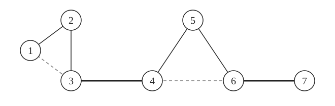

[[TOC]]

## 割边

::: definition 割边
在无向图中，删除一条边后，若图的连通分量数增加，则称这条边为**割边**，也称桥（bridge）。删除边时保留它的两个端点。
:::

若删除边 $(u,v)$ 后，$u,v$ 之间还有另一条路径，原来的路径就可以绕行，连通分量数不会增加。因此，**割边是连接两端的唯一通路**。

枚举删除每条边，再用 DFS 或 BFS 统计连通分量，时间复杂度为 $O(m(n+m))$。利用 DFS 树和 $low$ 数组，可以在 $O(n+m)$ 时间内找出所有割边。

本文沿用 [[[rbook: graph_tarjan_cut]]] 中的 DFS 树、树边与回边概念。

## 判定条件

### dfn 与 low

- $dfn[u]$：第一次访问点 $u$ 的次序。
- $low[u]$：从 $u$ 出发，沿树边向下走若干步，再走至多一条回边，能到达的点中最小的 DFS 序。允许不走任何边。

初值为 $low[u]=dfn[u]$。两种更新与求割点相同：

| 边的类型 | 更新方式 |
| --- | --- |
| 树边 $(u,v)$，递归返回后 | $low[u]=\min(low[u],low[v])$ |
| 回边 $(u,v)$，$v$ 是祖先 | $low[u]=\min(low[u],dfn[v])$ |

进入当前点的那条无向边必须跳过，否则会把沿原路返回父亲误当作另一条路。

### 树边判定

设 $(u,v)$ 是树边，$u$ 是 $v$ 的父亲。删除这条边后，DFS 树被分成 $v$ 的子树与其余部分。

如果 $v$ 的子树能通过回边到达 $u$ 或 $u$ 的祖先，就能绕过被删除的边，两侧仍然连通。否则，两侧分离。

::: theorem 割边判定
树边 $(u,v)$ 是割边，当且仅当

$$
low[v]>dfn[u].
$$
:::

$low[v]\le dfn[u]$ 表示子树存在回边，可以连接到 $u$ 或其祖先；$low[v]>dfn[u]$ 则表示没有这样的回边。

**非树边不可能是割边**：它的两端已经由 DFS 树上的路径连接，删除它不影响连通性。根节点发出的树边也使用同一判定，无须特殊处理。

### 等号的区别

割点与割边的判定相差一个等号。

| 判定对象 | 条件 | 删除后需要绕过什么 |
| --- | --- | --- |
| 非根点 $u$ | 存在孩子 $v$，$low[v]\ge dfn[u]$ | 整个点 $u$ |
| 树边 $(u,v)$ | $low[v]>dfn[u]$ | 这一条边，点 $u$ 仍在 |

当 $low[v]=dfn[u]$ 时，子树能通过另一条路回到 $u$。删边后这条路仍然有效，所以该边不是割边；删点后 $u$ 已不存在，所以这棵子树仍会分离。

两种概念也不能仅凭端点互相推断。例如，只有两个点、一条边的图中，这条边是割边，但两个端点都不是割点。反过来，两条环共用的点是割点，图中却可以没有割边。

## 示例

下面指定 DFS 顺序为 $1,2,3,4,5,6,7$。实线表示树边，虚线表示回边，粗线表示割边。



| 点 $u$ | 1 | 2 | 3 | 4 | 5 | 6 | 7 |
| --- | --- | --- | --- | --- | --- | --- | --- |
| $dfn[u]$ | 1 | 2 | 3 | 4 | 5 | 6 | 7 |
| $low[u]$ | 1 | 1 | 1 | 4 | 4 | 4 | 7 |

- 对树边 $(3,4)$，有 $low[4]=4>dfn[3]=3$，所以它是割边。
- 对树边 $(6,7)$，有 $low[7]=7>dfn[6]=6$，所以它是割边。
- 对树边 $(4,5)$，有 $low[5]=dfn[4]=4$，可经 $5\to6\to4$ 绕行，所以它不是割边。

## 重边处理

旧模板使用 `if (v == parent) continue` 跳过父亲。简单图中可以这样写，但有重边时会出错。

假设 $u,v$ 之间有两条边。沿第一条边进入 $v$ 后，应只跳过这条边，另一条边仍能让 $v$ 回到 $u$，使 $low[v]=dfn[u]$。两条边都不是割边。

若把所有通向父亲的边都跳过，就会漏掉这条回边，错误地判出割边。

因此，每条无向边分配一个唯一编号，两端邻接表中的记录共用该编号。递归时传入边号，只跳过进入当前点的那一条边。自环也不是割边，代码中不会将它作为树边。

## 代码实现

输入 $n,m$，接着输入 $m$ 条无向边。每条割边输出一行，较小端点在前，所有端点对按字典序排列；没有割边时不输出任何边。输出格式与 [[[p: luogu-P1656 | P1656 炸铁路]]] 一致。

```cpp file=./bridge.cpp
```

外层循环从每个未访问的点开始 DFS，处理所有连通分量。割边只在树边递归返回后记录，每条边至多记录一次。

Tarjan 部分的时间复杂度为 $O(n+m)$。设割边数为 $b$，排序另需 $O(b\log b)$；若只统计数量或按发现顺序输出，可省去排序。邻接表占 $O(n+m)$ 空间，辅助数组与递归栈占 $O(n)$ 空间。链状图的递归深度可达 $n$，规模较大时可改用显式栈模拟 DFS。

### 示例输入

下面的边顺序会得到前文指定的 DFS 顺序。

```text
7 8
1 2
2 3
3 1
3 4
4 5
5 6
6 4
6 7
```

输出：

```text
3 4
6 7
```

## 环与缩点

一条边是割边，当且仅当它不属于任何环。

若它在环上，删边后还能沿环的另一侧连接两端，因此不是割边。反之，若删边后两端仍有另一条路径，加回这条边就组成了一个环。重边形成的两条边也提供了彼此的绕行路径。

删除所有割边后，剩余的连通块称为**边双连通分量**，孤立点也单独成块。将每块缩成一个点，原来的割边连接这些新点，得到一片森林；原图连通时是一棵树。若缩点后仍有环，环上的边就有绕行路径，与它们是割边矛盾。

## 练习

| 题目 | 练习重点 |
| --- | --- |
| [[[p: atcoder-abc075_c | ABC075 C Bridge]]] | 统计桥数；数据较小，可用枚举删边对照 Tarjan |
| [[[p: luogu-P1656 | P1656 炸铁路]]] | 输出所有割边，统一端点顺序并排序 |
