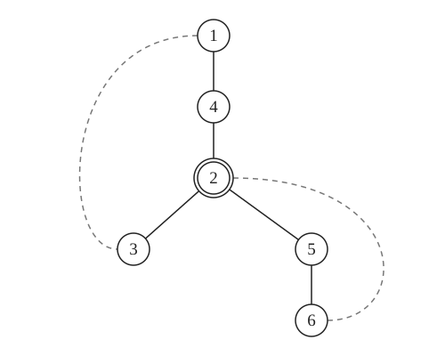

[[TOC]]

## 割点

::: definition 割点
在无向图中，删除一个点及其关联的所有边后，若图的连通分量数增加，则称这个点为**割点**，也称割顶或关节点（articulation point）。
:::

例如，两条环共用一个点，删除这个共用点后，两侧不再连通，因此它是割点。孤立点不是割点；删除它会使连通分量数减少。

最直接的方法是枚举删除的点，每次用 DFS 或 BFS 重新统计连通分量。设图有 $n$ 个点、$m$ 条边，时间复杂度为 $O(n(n+m))$。

Tarjan 算法利用 DFS 树，一次遍历即可找出所有割点。

## DFS 树

DFS 访问一个尚未访问的点时，经过的边称为**树边**。这些边组成 DFS 树；图不连通时得到 DFS 森林。

在无向图的 DFS 中，除树边外的边连接祖先与后代。把它从后代看向祖先，称为**回边**，也称返祖边。返回父亲的那条树边不算回边；若有重边，另一条连接父亲的边仍可作为回边。自环不影响割点判定，可忽略。

下面沿用旧文的六点图。指定 DFS 顺序为 $1,4,2,3,5,6$，实线表示树边，虚线表示回边，双圈标出割点 $2$。



DFS 树有一个关键性质：**不同孩子的子树之间没有边**。否则，DFS 沿这条边就会把两侧搜进同一棵子树。

因此，删除点 $u$ 后，它的某棵孩子子树若还想连到上方，只能借助回边到达 $u$ 的严格祖先。只回到 $u$ 本身没有用，因为 $u$ 已被删除。

## dfn 与 low

用 $dfn[u]$ 记录第一次访问 $u$ 的次序，从 $1$ 开始编号。

用 $low[u]$ 记录：从 $u$ 出发，沿树边向下走若干步，再走至多一条回边，能到达的点中最小的 DFS 序。允许不走任何边，因此初值为：

$$
low[u]=dfn[u].
$$

DFS 时有两种更新。

| 边的类型 | 更新方式 | 含义 |
| --- | --- | --- |
| 树边 $(u,v)$ | $low[u]=\min(low[u],low[v])$ | 搜完孩子后，继承其子树能到达的最小序号 |
| 回边 $(u,v)$ | $low[u]=\min(low[u],dfn[v])$ | 通过这条边直接到达祖先 $v$ |

树边要在递归返回后更新，因为此时 $low[v]$ 才计算完毕。进入 $u$ 的那条无向边应跳过。

示例中的数组为：

| 点 $u$ | 1 | 4 | 2 | 3 | 5 | 6 |
| --- | --- | --- | --- | --- | --- | --- |
| $dfn[u]$ | 1 | 2 | 3 | 4 | 5 | 6 |
| $low[u]$ | 1 | 1 | 1 | 1 | 3 | 3 |

点 $3$ 通过回边到达 $1$，所以 $low[3]=1$；点 $6$ 只能通过回边到达 $2$，所以 $low[6]=dfn[2]=3$。

### 回边为何用 dfn

仍看上图。搜完孩子 $3$ 后，点 $2$ 已有 $low[2]=1$。随后搜索 $5,6$，在 $6$ 遇到回边 $(6,2)$。

正确更新是：

$$
low[6]=\min(dfn[6],dfn[2])=3.
$$

如果改用 $low[2]$，就会得到 $low[6]=1$。这相当于把两条回边拼起来：

$$
6\to 2\to 3\to 1.
$$

这条路仍经过点 $2$，删除 $2$ 后就不存在。它不能证明 $\{5,6\}$ 能绕过 $2$，却会错误地把 $low[5]$ 降为 $1$，漏掉割点 $2$。

**回边只提供到达其另一端的信息**，所以使用 $dfn[v]$。

## 割点判定

### 非根节点

设 $v$ 是 $u$ 在 DFS 树中的孩子，且 $u$ 不是根。

::: theorem 非根节点的判定
非根节点 $u$ 是割点，当且仅当存在一个 DFS 孩子 $v$，满足

$$
low[v]\ge dfn[u].
$$
:::

若 $low[v]\ge dfn[u]$，说明 $v$ 的子树无法通过回边到达 $u$ 的严格祖先。删除 $u$ 后，这棵子树与 $u$ 的父亲分离，因此 $u$ 是割点。

反之，若每个孩子都有 $low[v]<dfn[u]$，则每棵孩子子树都能绕过 $u$，连到其祖先。祖先之间由树边连接，删除 $u$ 不会增加连通分量。

这里必须包含等号：$low[v]=dfn[u]$ 只说明子树能够回到 $u$，仍不能绕过它。示例中 $low[5]=dfn[2]=3$，所以 $2$ 是割点。

### 根节点

DFS 根没有父亲，应单独判断。

::: theorem 根节点的判定
DFS 根是割点，当且仅当它有至少两个 DFS 孩子。
:::

不同孩子的子树之间没有边。删除根后，每棵孩子子树分别成为一个连通分量。因此，零个或一个孩子时根不是割点，至少两个孩子时才是割点。

这里统计的是 **DFS 孩子数**，不是图上的度数。例如三角形中，根的度数为 $2$，但 DFS 只有一个孩子，根不是割点。

非根的 DFS 叶子没有孩子，也不可能满足割点条件。

## 代码实现

输入 $n,m$，接着输入 $m$ 条无向边。输出割点数，以及按编号升序排列的割点，格式与 [[[p: luogu-P3388 | P3388 割点（割顶）]]] 一致。

每条无向边分配一个编号，两端的邻接表使用同一编号。递归时只跳过进入当前点的那条边，保留重边带来的回边。

```cpp file=./template.cpp
```

外层循环从每个未访问的点开始 DFS，分别处理各个连通分量。一个点可能被多个孩子判为割点，先用布尔数组标记，最后统一计数，避免重复。

每个点访问一次，每条边处理常数次，时间复杂度为 $O(n+m)$。邻接表占 $O(n+m)$ 空间，辅助数组与递归栈占 $O(n)$ 空间。链状图的递归深度可达 $n$；规模较大时应确认运行环境的栈容量，或改用显式栈模拟 DFS。

### 示例

下面的边顺序会得到前文指定的 DFS 顺序。

```text
6 7
1 4
4 2
2 3
3 1
2 5
5 6
6 2
```

输出：

```text
1
2
```

删除 $2$ 后，原连通分量分成 $\{1,3,4\}$ 与 $\{5,6\}$。

## 分裂数量

割点判定还可以用于计算删点后分成几块。

设 $u$ 原来所在的连通分量中，除 $u$ 外的点在删除后分成 $k$ 块。

- 若 $u$ 是 DFS 根，$k$ 等于它的 DFS 孩子数；孤立点对应 $k=0$。
- 若 $u$ 不是根，设满足 $low[v]\ge dfn[u]$ 的孩子有 $s$ 个，则 $k=s+1$。这些孩子子树各成一块，其余点与父亲所在部分连成一块。

若原图共有 $C$ 个连通分量，删除 $u$ 后总共有 $C-1+k$ 个连通分量。

## 练习

若要继续划分割点两侧的完整分量，可阅读 [[[rbook: graph_vertex_bcc]]]；割点可能同时属于多个分量。

| 题目 | 练习重点 |
| --- | --- |
| [[[p: luogu-P3388 | P3388 割点（割顶）]]] | 直接应用割点判定，处理非连通图 |
| [[[p: luogu-P3469 | P3469 BLO-Blockade]]] | 在分裂判定中维护子树大小，统计不连通的有序点对 |

BLO-Blockade 的题面删除关联的边并保留该点，因此还要计入该点成为孤立点后涉及的有序点对。题意以[原题](https://www.luogu.com.cn/problem/P3469)为准。
