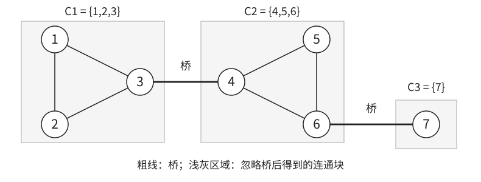
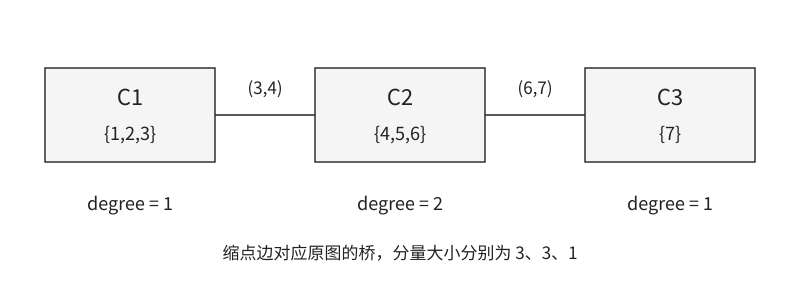
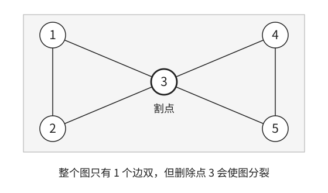
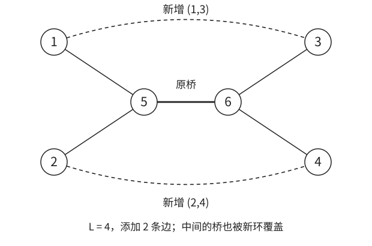

[[TOC]]

## 边双

[[[rbook: graph_tarjan_bridge]]] 找出了哪些边一旦删除，就会使原图分裂。现在继续划分：哪些点之间的连通关系，不会被删除一条边破坏？

一个无向连通图若没有桥，就称为**边双连通的**。等价地，任意两个不同顶点之间，都存在两条没有公共边的路径；这两条路径可以经过相同的中间顶点。

原图中满足这个条件的极大部分，称为**边双连通分量**，简称边双或 e-BCC。极大表示不能继续扩大，不是只取规模最大的部分。单个顶点也允许单独成块。

**删除所有桥后，剩余的每个连通块就是一个边双。** 因此每个点恰好属于一个边双，桥连接不同的边双。

## 示例

沿用割边篇的七点八边图。两个三角形由 $(3,4)$ 连接，顶点 $7$ 通过 $(6,7)$ 接入。

两条桥为 $(3,4)$、$(6,7)$。忽略它们后，得到：

$$
C_1=\{1,2,3\},\qquad
C_2=\{4,5,6\},\qquad
C_3=\{7\}.
$$

用 `belong[u]` 记录顶点 $u$ 所属的分量编号：

| 顶点 $u$ | 1 | 2 | 3 | 4 | 5 | 6 | 7 |
| --- | --- | --- | --- | --- | --- | --- | --- |
| `belong[u]` | 1 | 1 | 1 | 2 | 2 | 2 | 3 |

编号只是标签。两个点是否位于同一边双，取决于编号是否相等，与编号的大小无关。

## 两遍遍历

### 第一遍找桥

保留割边篇的 `dfn`、`low` 和边编号。对树边 $(u,v)$，若

$$
low[v]>dfn[u],
$$

就标记它为桥。

~~~cpp
void dfs_bridge(int u, int in_edge) {
    dfn[u] = low[u] = ++timer;
    for (auto [v, id] : g[u]) {
        if (id == in_edge) continue;
        if (!dfn[v]) {
            dfs_bridge(v, id);
            low[u] = min(low[u], low[v]);
            if (low[v] > dfn[u]) is_bridge[id] = true;
        } else if (dfn[v] < dfn[u]) {
            low[u] = min(low[u], dfn[v]);
        }
    }
}
~~~

同一条无向边在两端邻接表中共用同一个 `id`，只跳过进入当前点的那条边，不能跳过所有通向父亲的边，否则重边会被误判。

与前篇的区别是：现在保存 `is_bridge[id]`，供第二遍查询，不必先把桥的端点排序输出。

### 第二遍编号

从一个尚未编号的点出发，忽略桥，只沿普通边遍历，把能到达的点全部标为同一编号：

~~~cpp
void paint(int u, int color) {
    belong[u] = color;
    for (auto [v, id] : g[u]) {
        if (is_bridge[id] || belong[v]) continue;
        paint(v, color);
    }
}
~~~

遍历所有起点：

~~~cpp
for (int u = 1; u <= n; ++u) {
    if (!belong[u]) paint(u, ++bcc_count);
}
~~~

第一遍的 `dfn` 已经非零，第二遍应使用 `belong` 判断是否编号，不能直接沿用第一遍的访问状态。

在样例中，从 $1$ 出发只能访问 $1,2,3$，无法越过桥 $(3,4)$；再从 $4$ 出发编号 $4,5,6$；最后为 $7$ 单独编号。不需要真的从邻接表中删除桥，只需在遍历时跳过。

## 正确性

先说明：一次性删除全部桥后，不会把原来的非桥变成新桥。

对于一条非桥、非自环边，两端存在另一条路径，二者组成一个环。环上的边都不是桥，所以这个绕行环在删桥后仍完整保留。自环的删除本来就不影响顶点间连通性。

因此删桥后，每个连通块内部仍不存在桥，满足边双条件。

不同块之间若原本连通，任何连接它们的路径都会经过某条原图中的桥；把两块合在一起，就不能保证删去该桥后仍连通。因此每块都已经极大。原本不连通的块当然也不能合并。

第二遍恰好求出了删桥图的全部连通块，所以得到的分量划分正确。

## 缩点森林

把每个边双缩为一个新点，把原图中的桥保留下来：

缩点时遍历每条原始无向边一次。只有桥会连接不同分量：

~~~cpp
for (int id = 0; id < m; ++id) {
    if (!is_bridge[id]) continue;
    int a = belong[eu[id]], b = belong[ev[id]];
    tree[a].push_back(b);
    tree[b].push_back(a);
}
~~~

不能在原图的双向邻接表中不加区分地重复建边，否则同一条桥会被计算两次。完整模板同时维护缩点后的 `degree`。

### 为什么是森林

若缩点后存在环，环上的一条桥就能通过环的其余部分绕行；每个分量内部也连通，所以原图中同样存在绕行路径，与它是桥矛盾。

缩点不会改变原图的连通分量数。因此：

- 原图连通，缩点后是一棵桥树。
- 原图不连通，缩点后是一片森林。
- 孤立顶点缩成的点，度数为 $0$。

设原图有 $C$ 个连通分量、$K$ 个边双、$B$ 条桥。森林有 $K$ 个点、$C$ 棵树，因此

$$
B=K-C.
$$

样例中 $K=3,C=1,B=2$。如果再加入孤立点 $8$，则 $K=4,C=2$，桥数仍为 $2$；不能对非连通图直接使用 $B=K-1$。

## 容易混淆

### 边双内部可以有割点

两个三角形共用一个顶点 $3$，整张图没有桥，因此只有一个边双；但删去点 $3$，图会分裂，所以 $3$ 是割点。

边双关心删边，点双关心删点。**不同边双不共用顶点；割点却可能属于多个点双。** 不能把割点当成划分边双的边界。

点双的边栈分块方法见 [[[rbook: graph_vertex_bcc]]]。

### low 不是分量编号

在上图中，按 $1,2,3,4,5$ 的顺序 DFS，可以得到

$$
low[1..5]=[1,1,1,3,3].
$$

虽然 `low` 不全相等，五个点仍属于同一个边双。树边 $(3,4)$ 满足 $low[4]=dfn[3]$，有等号，所以不是桥。

`low` 用于判定边是否为桥，`belong` 才表示分量。不要直接把 `low` 相等的点分为一组。

## 代码

采用 [[[p: luogu-P8436 | 边双连通分量]]] 的格式：输入 $n,m$，再输入 $m$ 条无向边。

输出第一行为分量数；随后每行先输出该分量的点数，再输出成员。原题允许任意顺序，模板按最小未编号顶点依次编号，再按原顶点顺序收集成员，便于手算核对。

~~~cpp file=./edge_bcc.cpp
~~~

代码保留了两个结果：

- `block[c]`：第 $c$ 个边双的全部顶点。
- `tree[c]`、`degree[c]`：缩点森林中与第 $c$ 个边双相邻的分量及其度数。

森林只保存在内存中，不增加输出，避免改变模板题的输出格式。

### 示例输入

~~~text
7 8
1 2
2 3
3 1
3 4
4 5
5 6
6 4
6 7
~~~

输出：

~~~text
3
3 1 2 3
3 4 5 6
1 7
~~~

两条桥的代码边号分别为 $3,7$：顶点从 $1$ 编号，边号从 $0$ 编号。

### 非递归版本

递归版两遍遍历的深度都可能达到 $n$。模板题最大为 $50$ 万点，普通默认栈不保证足够；提交大规模数据时，优先使用下面的非递归版本。

第一遍必须保留 DFS 的“进入、处理下一条边、退出回传”顺序。只有孩子处理完，才能把它的 `low` 回传给父亲；不能简单改成普通 BFS。第二遍只是求连通块，使用普通栈即可。

::: fold 非递归完整代码
~~~cpp file=./edge_bcc_iterative.cpp
~~~

第一遍的 `stk` 保存当前 DFS 路径，`next_edge[u]` 记录该点处理到了哪条邻边。第二遍复用这个栈，但入栈时立即设置 `belong`，保证每个点只入栈一次。
:::

两版使用同样的边编号、分量编号与输出方式，只是遍历的实现不同。

## 应用

### 必经桥数量

原图中查询 $u,v$，先映射为分量 $a=belong[u]$、$b=belong[v]$。

若两点原本连通，桥树上 $a,b$ 的唯一路径，就对应原图中连接 $u,v$ 必须经过的全部桥。分量内部可以绕行，跨分量的桥却无法绕过。

因此结合 [[[rbook: jump_lca]]]，可以求

$$
\text{必经桥数}
=dep[a]+dep[b]-2dep[\operatorname{lca}(a,b)].
$$

样例中 $1,7$ 必须经过两条桥，$1,2$ 之间没有必经桥。这里统计的是桥数，不是原图最短路的边数；跨原连通分量的询问，应先报告不可达。

### 加边消桥

若原图**连通，且允许新边与已有边连接相同的一对顶点**，可以在桥树上分析最少加几条边，使整张图不再有桥。

若只剩一个缩点，原图已经边双，答案为 $0$。否则设桥树有 $L$ 个叶子，则答案为

$$
\left\lceil\frac L2\right\rceil.
$$

下界：每个叶子对应的部分仅通过一条桥与外界相连，至少需要一条新边连向外界。一条新边最多照顾两个叶子，因此至少需要 $\lceil L/2\rceil$ 条。

上界：可以按 DFS 叶子顺序跨两半配对，使新边形成的环覆盖全部树边。下面四个叶子的例子，只需连接 $(1,3)$、$(2,4)$，中间的桥也会被覆盖。

不能只随意把叶子两两配对。例如只连接左侧的 $(1,2)$ 与右侧的 $(3,4)$，就不能消除中间的桥。

::: fold 配对上界的说明
对于至少三个点的树，选一个非叶点作根，按 DFS 顺序列出所有叶子。叶子数为奇数时，将最后一个叶子再列一次，得到长度为 $2r$ 的序列，其中 $r=\lceil L/2\rceil$。

将第 $i$ 个叶子与第 $i+r$ 个叶子连接，$1\le i\le r$。新增边可以复用某个叶子，但两端不会是同一个顶点。

对任意树边，删去后，孩子一侧的叶子在 DFS 序列中构成一个非空的连续区间，其余叶子也非空。一个非空且不占满整圈的连续区间，不可能在“下标平移半圈”后保持不变，因此至少有一对配对叶子分处两侧。

这对新边与原树路径构成环，覆盖被考察的树边。每条树边都如此，所以全部原桥都被消除；新边自身也位于对应的环上。

只有两个缩点时，添加一条与原桥平行的边即可。缩点代表一整块顶点时，从对应两块中各选任意一个真实顶点作为新边端点。
:::

这个结论使图变成**边双**，不保证变成点双。原图不连通时，不能直接对整片森林数叶子套同一公式。

## 复杂度与边界

找桥、忽略桥编号、收集成员、建立缩点森林，都只扫描每个点或每条边常数次，总时间为 $O(n+m)$，空间为 $O(n+m)$，不需要排序。

- 模板容量为 $n\le5\times10^5$、$m\le2\times10^6$，每条无向边有两条邻接表记录，但桥标记只开 $m$ 份。
- 两条重边可以互相绕行，都不是桥；必须按边编号过滤进入边。
- 自环不会成为桥，也不会把顶点接到另一个分量。
- 孤立点单独成块；即使没有边，也应处理所有顶点。
- 没有桥不代表整张图只有一个边双，原图可能有多个互不连通的无桥分量。
- 多组数据要清空邻接表、成员表、缩点森林及所有状态数组，重置计时器与分量计数。

## 练习

### 手算

1. 两个点之间有两条平行边，再加一个孤立点。边双数、桥数、原连通分量数分别是多少？
2. 三角形 $1,2,3$ 接一条边 $(3,4)$，再加孤立点 $5$。三个边双是什么？
3. 两个三角形只共用一个顶点，是否会因为有割点而拆成两个边双？

::: fold 参考结果
1. 分别为 $2,0,2$。平行边的两个端点属于同一边双，孤立点另成一块。
2. $\{1,2,3\}$、$\{4\}$、$\{5\}$。有 $K=3,C=2,B=1$，满足 $B=K-C$。
3. 不会。没有桥，整张图仍是一个边双。
:::

### 推荐题目

| 层次 | 题目 | 训练内容 |
| --- | --- | --- |
| 模板 | [[[p: luogu-P8436]]] | 输出全部边双，处理重边、自环与大规模深链。 |
| 加边应用 | [[[p: luogu-P2860]]] | 原图连通且允许添加平行道路，缩点后统计叶子，求最少加边数。 |
| 缩点路径 | [[[p: codeforces-1000E]]] | 将两点间必经桥数转为桥树距离，再求桥树直径；可结合 [[[rbook: diameter]]] 学习。 |
