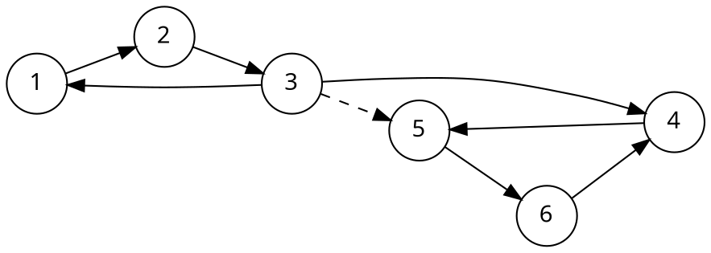
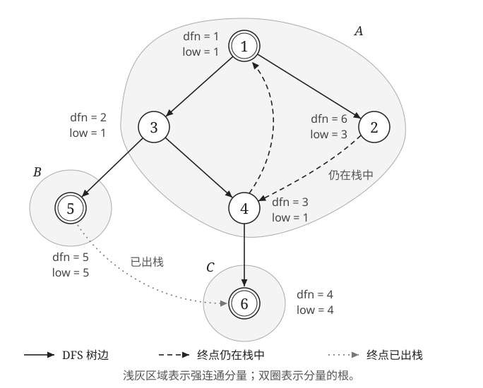

[[TOC]]

## 从「互相可达」说起

有向图里，两点之间的关系不是对称的：$u$ 能到 $v$，不代表 $v$ 能到 $u$。把「互相都能到」的点聚成一类，就得到了这张图最粗的一层结构。

::: definition 强连通
在有向图 $G=(V,E)$ 中，若 $u$ 与 $v$ 互相可达（$u\rightsquigarrow v$ 且 $v\rightsquigarrow u$），称 $u,v$ 强连通。若 $G$ 中任意两点都强连通，称 $G$ 是一个强连通图。
:::

::: definition 强连通分量
非强连通的有向图中，极大的强连通子图称为**强连通分量**（strongly connected component，SCC）。「极大」指点集不能再加进任何一个点而保持强连通。每个点恰好属于一个强连通分量。
:::

「每个点恰好属于一个」这句话值得停一下：它说明求 SCC 等价于给每个点染一个颜色，同色点两两互相可达，异色点至少有一个方向走不通。把一张图按颜色收缩（每个分量当成一个点），得到的图里再没有环——这就是下文「缩点」的由来。



## 朴素做法，以及它为什么慢

要判断 $u,v$ 是否强连通，最直接的办法是逐个点求出它的可达集合：从每个 $u$ 出发 DFS，记下 $u$ 能到达的所有点 $R(u)$。$u$ 所在的强连通分量就是 $\{\,v \mid u\in R(v)\ \text{且}\ v\in R(u)\,\}$——也就是所有和 $u$ 互相可达的点。

那么只要把「可达关系」算出来，再按「互相可达」分组，就得到了所有分量。求「可达关系」有两种朴素思路：

- **方案一：每个点跑一次 DFS**，得到 $R(u)$。代价 $O\bigl(n(n+m)\bigr)$。
- **方案二：Floyd 求传递闭包**，一次性把整张可达矩阵算出来。代价 $O(n^3)$。

两者都只在 $n$ 很小时可用（$n=10^5$ 时不可行），是「对拍用暴力」的标准写法。

::: fold 方案一：每个点跑一次 DFS 求可达集合
```cpp
// 朴素做法（方案一）：每个点都当一次起点，在正图上求「能到谁」
// 时间复杂度 O(n(n+m))，只在 n 很小（约 1000 以内）时可用。
// 输入格式与 Tarjan 版模板相同，可以直接拿两份程序对拍。
#include <bits/stdc++.h>
using namespace std;

const int maxn = 1005;

int n, m;
int start;            // 本轮 DFS 的起点
vector<int> g[maxn];  // 正图
bool vis[maxn];

// reach[u][v]: u 能不能到 v
bool reach[maxn][maxn];

void dfs(int u) {
    vis[u] = true;
    reach[start][u] = true; // u 能被起点 start 到达
    for (int v : g[u]) {
        if (!vis[v]) dfs(v);
    }
}

int main() {
    cin >> n >> m;
    for (int i = 0; i < m; i++) {
        int u, v;
        cin >> u >> v;
        g[u].push_back(v);
    }

    // 每个点跑一次 DFS，记下它能到哪些点
    for (int u = 1; u <= n; u++) {
        start = u; // 这一轮从 u 出发
        memset(vis, 0, sizeof(vis));
        dfs(u);
    }

    // u 与 v 强连通 <=> u 能到 v，且 v 能到 u
    int color[maxn] = {0};
    int cnt = 0;
    for (int u = 1; u <= n; u++) {
        if (color[u]) continue; // 已经在某个分量里了
        cnt++;
        color[u] = cnt;
        for (int v = u + 1; v <= n; v++) {
            if (color[v]) continue;
            // reach[u][v] 表示 u->v；reach[v][u] 表示 v->u，正好凑成互相可达
            if (reach[u][v] && reach[v][u]) color[v] = cnt;
        }
    }

    for (int u = 1; u <= n; u++) {
        cout << "node " << u << ": " << color[u] << "\n";
    }
    return 0;
}
```
:::

读方案一时有两点值得留意：

- 一个 `reach` 矩阵就够：`reach[v][u]` 正是`back` 的职责，反图那套是多余的。
- `reach` 是 $n^2$ 的 `bool`，$n=1000$ 约 $1$ MB、$n=10^5$ 就炸，所以只能当对拍暴力。

::: fold 方案二：Floyd 求传递闭包
```cpp
// 朴素做法（方案二）：用 Floyd 求传递闭包，代替逐个点 DFS
// 时间复杂度 O(n^3)，只在 n 很小（约 500 以内）时可用。
// 输入格式与 Tarjan 版模板相同，可以直接拿两份程序对拍。
#include <bits/stdc++.h>
using namespace std;

const int maxn = 1005;

int n, m;
// reach[u][v]: u 能不能到 v
bool reach[maxn][maxn];

int main() {
    cin >> n >> m;

    // 自反：每个点都能到达自己（本文分组不读对角元，这行可省，保留只为语义清晰）
    for (int i = 1; i <= n; i++) reach[i][i] = true;

    for (int i = 0; i < m; i++) {
        int u, v;
        cin >> u >> v;
        reach[u][v] = true; // 一条边就是一个直接可达
    }

    // Floyd 求传递闭包：枚举中间点 k，能 u->k 且 k->v 则 u->v
    for (int k = 1; k <= n; k++)
        for (int u = 1; u <= n; u++)
            if (reach[u][k])
                for (int v = 1; v <= n; v++)
                    if (reach[k][v]) reach[u][v] = true;

    // u 与 v 强连通 <=> u 能到 v，且 v 能到 u
    int color[maxn] = {0};
    int cnt = 0;
    for (int u = 1; u <= n; u++) {
        if (color[u]) continue; // 已经在某个分量里了
        cnt++;
        color[u] = cnt;
        for (int v = u + 1; v <= n; v++) {
            if (color[v]) continue;
            // reach[u][v] 表示 u->v；reach[v][u] 表示 v->u，正好凑成互相可达
            if (reach[u][v] && reach[v][u]) color[v] = cnt;
        }
    }

    for (int u = 1; u <= n; u++) {
        cout << "node " << u << ": " << color[u] << "\n";
    }
    return 0;
}
```
:::

方案二说明：

- `reach[i][i] = true` 可省：分组只比 $u<v$ 的点对，从不读对角元。
- 再加任何剪枝都不改 $O(n^3)$ 的主项。
- 比方案一短但慢，稀疏图上方案一的 $O(n\cdot m)$ 更快。

两种朴素方案读同样的输入、输出同样的格式，可以直接对拍。但注意它们与 Tarjan 的**分量划分相同、编号不同**：朴素版按点的编号顺序给新分量编号，Tarjan 版按出栈时刻编号。比较时要看「两点是否同色」，而不是直接比数字。

更好的方法是 **Kosaraju**（正图、反图各跑一次 DFS，按出栈顺序挑起点）和 **Tarjan**（一次 DFS 用栈和两个数组直接划出分量），都是 $O(n+m)$。Kosaraju 更好想、好写；Tarjan 只要一次 DFS，常数更小，还能顺手处理割点、边双连通分量。下面讲 Tarjan。

## DFS 树上，一个分量连成一片

Tarjan 的全部内容都建立在 DFS 树的性质上，先把这条性质说清楚，否则后面的 `low` 会变成背公式。

::: theorem 同一个分量的点在同一棵 DFS 树里
一个强连通分量的点一定落在同一棵 DFS 树上；分量中最先被访问的点，是其余所有点的祖先。
:::

证明只需要一句：设分量中最先被访问的点为 $r$。此时分量中其余点都还没被访问，而 $r$ 能到达它们，DFS 会在退出 $r$ 前将它们全部接进 $r$ 的子树。$\square$

由此，一个分量在 DFS 树上表现为「以某个点 $r$ 为根、连成一片的区域」，$r$ 就是分量里 `dfn` 最小的点，本文称它为这个分量的**根**。

**但请注意：$r$ 的子树里可能有别的分量的点。** 上图从 $1$ 出发 DFS，得到的树是 $1\to2\to3\to4\to5\to6$，而 $3$ 的子树是 $\{3,4,5,6\}$，其中 $4,5,6$ 属于另一个分量。所以说「分量是 DFS 树的一棵子树」是不准确的；准确的说法是「分量在子树内部，是它的一段连续部分」。怎么把这一段从子树里挑出来，正是栈要解决的问题。

::: algorithm Tarjan 的一句话
DFS 时把点按访问顺序压栈；一个点 $u$ 能回到的最早编号等于自己的访问编号时，它就是所在分量的根，此时栈顶到 $u$ 之间的点正好是这个分量。
:::

下面再看一个有分支的 DFS 树。与开头的六点图不同，这张图从 $1$ 开始，依次访问 $1,3,4,6,5,2$；节点旁标出这次遍历得到的 `dfn` 和最终 `low`，下一节解释如何维护它们。



三个分量分别为 $A=\{1,2,3,4\}$、$B=\{5\}$、$C=\{6\}$，根为 $1,5,6$。图中有两处值得留意：

- 处理 $5\to6$ 时，$6$ 已经出栈，不能用它更新 `low[5]`，因此 `low[5] = 5`。
- 处理 $2\to4$ 时，$4$ 已退出递归，但**仍在 Tarjan 栈中**，所以用 `dfn[4] = 3` 更新，得到 `low[2] = 3`。$2$ 仍属于以 $1$ 为根的分量，可见 `low` 不一定等于分量根的 `dfn`。

## dfn、low 与栈

维护三样东西：

- `dfn[u]`：$u$ 被首次访问的序号，从 $1$ 开始，DFS 每进入一个新点就加一。
- `low[u]`：从 $u$ 出发、只沿 DFS 树往下走再借助至多一条非树边，能到达的**仍在栈中**的点的最小 `dfn`。直观说，它是 $u$ 的子树所能「退回」的最早位置。
- 一个栈：按访问顺序压入，尚未确定分量的点都留在里面。

遍历 $u$ 的每条出边 $u\to v$，按 $v$ 的状态分三种情况：

| 边的类型 | 判断条件 | 处理 |
| --- | --- | --- |
| 树枝边（$v$ 未访问） | `vis[v] == 0` | 先递归 `dfsscc(v)`，回来再 `low[u] = min(low[u], low[v])` |
| 指向栈中点的非树边 | `vis[v] && in_sta[v]` | `low[u] = min(low[u], dfn[v])` |
| 指向已出栈点的非树边 | `vis[v] && !in_sta[v]` | 忽略：$v$ 属于更早完成的分量 |

两类更新为什么不一样？树枝边下去的是自己子树里的点，子树的信息已经算全了，所以取 `low[v]`；非树边只说明「$u$ 能直接到达仍在栈中的 $v$」，所以取 `dfn[v]`。$v$ 可以是祖先，也可以像图中的 $2\to4$ 一样，位于先前搜索过的另一条分支。

::: note 讨论：非树边能不能写 `low[u] = min(low[u], low[v])`
不少文章这样写，也常常能过题。但这会改变本文中 `low`「沿树边向下，再借助至多一条非树边」的含义。例如图中若用 `low[4]` 更新，就会得到 `low[2] = 1`，而标准更新得到的是 $3$。模板里保留 `dfn[v]` 的写法，不把分量的根与每个点的 `low` 混为一谈。
:::

退出 $u$ 时做最后一次判断：

$$
\text{若 } \text{low}[u]=\text{dfn}[u] \quad\Longrightarrow\quad u \text{ 是某个分量的根}
$$

::: lemma 栈里「更早」的点能到达当前点
设正在处理 $u$。若 $y$ 仍在栈中且 $\text{dfn}[y]<\text{dfn}[u]$，则 $y\rightsquigarrow u$；但 $y$ 不一定是 $u$ 的祖先。
:::

证明：若 $y$ 尚未退出递归，它就是 $u$ 的祖先，沿树边可到达 $u$。否则，$y$ 返回时没有出栈，说明 `low[y] < dfn[y]`，它能到达一个更早的栈中点。反复沿这样的路径寻找，`dfn` 严格下降，最终会到达一个尚未退出递归的点 $a$，而 $a$ 是 $u$ 的祖先。所以 $y\rightsquigarrow a\rightsquigarrow u$。这些更早的点也不会提前出栈：若弹出了其中的点，其上方的 $y$ 也会一同弹出。$\square$

这条引理说清了 Tarjan 的底气：当 $u$ 经子树碰到栈里更早的点 $y$ 时，既有 $u\rightsquigarrow y$，又有 $y\rightsquigarrow u$，于是**互相可达**成立。图中 $4$ 不是 $2$ 的祖先，但 $4\to1\to2$ 仍提供了返回路径。

::: theorem 根的判据
`low[u] = dfn[u]` 当且仅当 $u$ 是所在分量的根（分量中 `dfn` 最小的点）。
:::

两个方向分别论证。

**方向一：`low[u] < dfn[u]`，则 $u$ 不是根。** 栈里有更早的点 $y$ 被 $u$ 的子树碰到，于是 $u\rightsquigarrow y$；由引理又有 $y\rightsquigarrow u$，两点强连通。而 `dfn[y] < dfn[u]`，所以 $u$ 不是分量里第一个被访问的点。

**方向二：$u$ 不是根，则 `low[u] < dfn[u]`。** 设所在分量的根为 $r$（`dfn[r] < dfn[u]`），取一条从 $u$ 到 $r$ 的路径 $u=x_0\to x_1\to\cdots\to x_k=r$，令 $x_i$ 是路径上第一个 `dfn` 小于 `dfn[u]` 的点，则 $x_{i-1}$ 还在 $u$ 的子树里。

关键一步：$x_i$ 与 $u$ 属于同一个分量。因为 $x_i\rightsquigarrow r$（路径余下的部分）、$r\rightsquigarrow u$（同分量）、$u\rightsquigarrow x_i$（前半段路径），三段拼成环。既然 $u$ 还没出栈，同分量的 $x_i$ 也没有出栈，处理 $x_{i-1}$ 时它就在栈里。于是 $\text{low}[x_{i-1}] \le \text{dfn}[x_i] < \text{dfn}[u]$，而 `low[u]` 只会被 $u$ 的子树拉得更小，矛盾于 `low[u] = dfn[u]`。

判据成立时弹出栈：从栈顶一直弹到 $u$（含），弹出的点染同一个颜色。**栈里在 $u$ 上面的点恰好都是本分量的点**——不属于本分量的点，在各自分量的根退栈时早就弹掉了。

## 走一遍例子

输入格式：第一行 $n,m$，接下来 $m$ 行有向边 $u\to v$。用上面那张图：

```
6 8
1 2
2 3
3 5
3 4
3 1
4 5
5 6
6 4
```

DFS 过程中状态变化如下（栈写成「底 → 顶」）：

| 事件 | `dfn` | `low` | 栈 | 说明 |
| --- | --- | --- | --- | --- |
| 进入 1 | 1 | 1 | `1` | |
| 进入 2 | 2 | 2 | `1 2` | $1\to2$ 是树枝边 |
| 进入 3 | 3 | 3 | `1 2 3` | $2\to3$ 是树枝边 |
| 走 $3\to1$ | 3 | 1 | `1 2 3` | 1 在栈中，`low[3] = min(3, dfn[1]) = 1` |
| 进入 4 | 4 | 4 | `1 2 3 4` | 走 $3\to4$ |
| 进入 5 | 5 | 5 | `1 2 3 4 5` | |
| 进入 6 | 6 | 6 | `1 2 3 4 5 6` | |
| 走 $6\to4$ | 6 | 4 | `1 2 3 4 5 6` | 4 在栈中，`low[6] = 4` |
| 退出 6 | 6 | 4 | `1 2 3 4 5 6` | `low ≠ dfn`，不是根，不出栈 |
| 退出 5 | 5 | 4 | `1 2 3 4 5 6` | `low[5] = min(5, low[6]) = 4` |
| 退出 4 | 4 | 4 | `1 2 3 4 5 6` | `dfn = low`，**是根**，弹出 6 5 4 → 分量① |
| 回到 3 | 3 | 1 | `1 2 3` | `low[3] = min(1, low[4]) = 1`，不受影响 |
| 走 $3\to5$ | 3 | 1 | `1 2 3` | 5 **已出栈**，属于别的分量，忽略 |
| 退出 3 | 3 | 1 | `1 2 3` | `low ≠ dfn`，不是根 |
| 退出 2 | 2 | 1 | `1 2 3` | 不是根 |
| 退出 1 | 1 | 1 | `1` | `dfn = low`，**是根**，弹出 3 2 1 → 分量② |

结果：$\{4,5,6\}$ 是第一个分量（最早完成），$\{1,2,3\}$ 是第二个。注意分量编号是**按出栈时刻**给的，与点的编号无关，更不是拓扑序。

这张表里三种边都出现了，可以逐行对着看：

- $1\to2$、$2\to3$、$4\to5$、$5\to6$ 是树枝边；
- $3\to1$、$6\to4$ 是返祖边（环就是靠它们被发现的）；
- $3\to5$ 是横叉边，而且 $5$ 已经出栈，所以它对 `low[3]` 毫无影响——如果这里错误地写成「访问过就更新」，$5$ 所在分量的信息就会污染 $\{1,2,3\}$ 的 `low`。

下面的动画把这一遍 DFS 走位演示出来，可以边看边对上表里的 `dfn`、`low` 和栈：

[[[dsa: dfsscc]]]

## 代码模板

模板把图存成链式前向星（`linkList`），栈自己用数组维护（`mystack`），递归函数是 `dfsscc`。

```cpp file=./scc.cpp
```

几处要点：

- `e.add(u,v)` 是**头插**，所以 `e(u)` 遍历出边的顺序与输入顺序相反。这不会影响结果（分量与遍历顺序无关），但会让你看到的 `dfn` 顺序与「按输入顺序想象」的不一样。
- `vis[u]` 与 `in_sta[u]` 是两件事：前者表示「进过一次 DFS」，后者表示「还没出栈，即分量未定」。第三种情况（访问过但已出栈）就靠 `in_sta` 排除。
- 退栈时先 `in_sta[t]=0` 再染色，两者顺序无所谓，但都要在 `t != u` 的循环体里执行。

::: warn 多连通块：循环里不要写死起点
```cpp
for (int i = 1; i <= n; i++)
    if (vis[i] == 0)
        dfsscc(i);   // 不能写成 dfsscc(1)
```
写成 `dfsscc(1)` 时，只有 $1$ 能到达的点会被染色，其余点的 `color` 全是 $0$。这个错误在单连通块的样例上完全看不出来，一交就挂。
:::

::: warn 递归深度
`dfsscc` 的递归层数最多是 $n$。$n=10^6$ 时会先撞上系统栈（默认 $8$ MB 左右），表现为段错误而不是 TLE。三个办法：把 `maxn` 调到实际数据范围、用 `ulimit -s` 或 `-Wl,--stack` 放大栈、或者改成手写栈迭代版。
:::

复杂度：每个点只入栈、出栈一次，每条边只看一次，时间 $O(n+m)$；`dfn`/`low`/`color`/`vis`/`in_sta` 与栈都是 $O(n)$，链式前向星 $O(n+m)$。

## 缩点：把分量当成一个点

既然分量内部任意两点互相可达，把它们压成一个点不丢失任何关于可达性的信息。这就是**缩点**，也是 Tarjan 在题目里最常被用到的形态。

::: theorem 缩点后是 DAG
把每个强连通分量缩成一个点、分量之间的边照原样保留，得到的图一定是有向无环图。
:::

若缩点后有环 $C_1\to C_2\to\cdots\to C_k\to C_1$，则这些分量两两互相可达，它们本该是同一个分量，与「极大」矛盾。$\square$

有了 DAG，就能接上拓扑排序上的一切：入度为 $0$ 的起点、最长路、计数、可达性。典型写法是在 Tarjan 之后扫一遍所有边统计入度：

```cpp
int in_deg[maxn] = {0};
for (int u = 1; u <= n; u++) {
    for (int i = e(u); i != -1; i = e[i].next) {
        int v = e[i].v;
        if (color[u] != color[v]) // 跨分量的边，才计入度
            in_deg[color[v]]++;
    }
}
```

::: note 重边与自环
同一条跨分量边重复出现时，`in_deg` 会被重复累加——如果题目只问「有多少个分量的入度为 $0$」，这不影响答案；如果问「入度为 $1$ 的分量」，就必须先去重（或用一个 `bool` 数组按分量对去重）。分量内部的边（包括自环）在缩点后消失，`color[u] == color[v]` 直接跳过即可。
:::

[[[include: ./practice.md]]]
