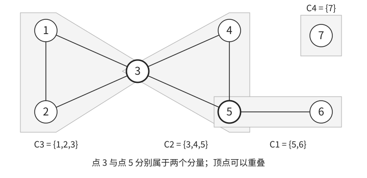
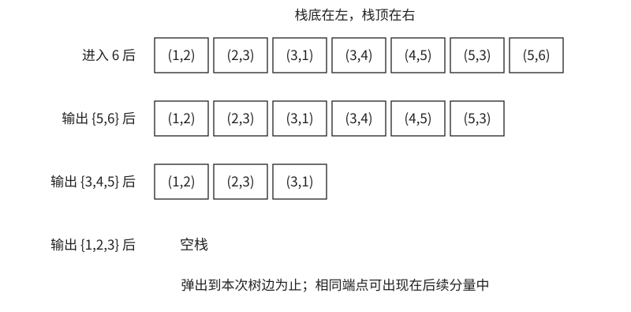
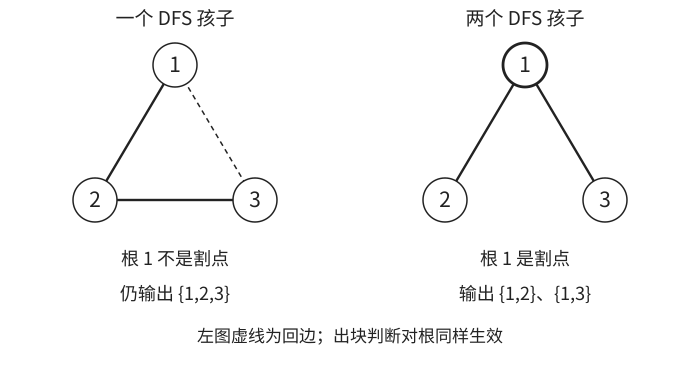
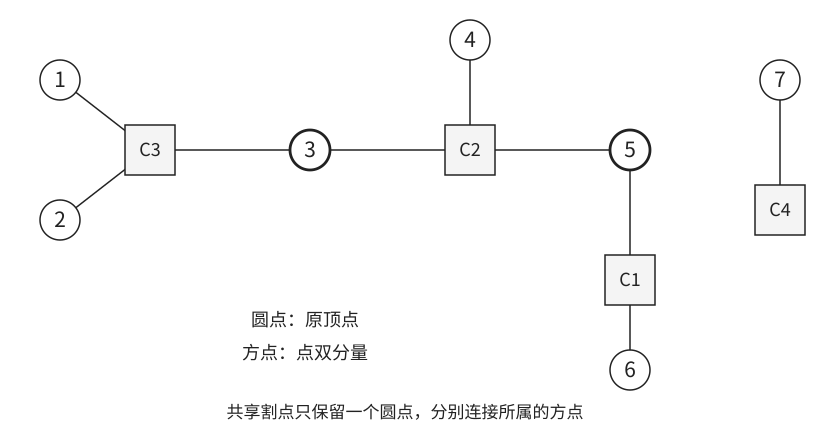

[[TOC]]

## 点双

[[[rbook: graph_tarjan_cut]]] 判断哪些点被删除后会使图分裂。现在继续求出这些分界点两侧的完整结构。

本篇采用 [[[p: luogu-P8435 | 点双连通分量]]] 的约定：**没有割点的极大连通子图**称为点双连通分量，简称点双或 v-BCC。极大表示不能继续扩大，不是只取规模最大的部分。

需要明确小规模情形：

- 一条桥与它的两个端点，单独形成一个两点分量。
- 孤立点单独形成一个单点分量。
- 自环不改变这里的顶点分块，读入时忽略；只有自环的点按孤立点处理。

当分量至少有三个顶点时，也可以用“两点之间存在两条内部顶点互不重合的路径”理解。不能把这个表述不加区分地用于上述两点、单点情形。

与 [[[rbook: graph_edge_bcc]]] 不同，**割点可以属于多个点双，不能给每个顶点只记一个所属编号**。本篇用 `block[c]` 保存第 $c$ 个点双的成员，用边栈完成分块。

## 示例

两个三角形共用顶点 $3$，再从顶点 $5$ 接出桥 $(5,6)$，顶点 $7$ 孤立：

按后面的 DFS 顺序，分量依次输出为

$$
C_1=\{5,6\},\quad
C_2=\{3,4,5\},\quad
C_3=\{1,2,3\},\quad
C_4=\{7\}.
$$

顶点 $3$ 属于 $C_2,C_3$，顶点 $5$ 属于 $C_1,C_2$，它们都是割点。其他顶点各属于一个分量。编号按出块顺序产生，没有大小含义。

除自环外，每条原图边恰好属于一个点双；共享的是割点，不是边。不同点双最多共用一个顶点：若共用至少两个点，删除其中任意一个点后仍能通过另一个公共点连接，两块就可以继续合并，与极大性矛盾。

## 分界条件

对 DFS 树边 $(u,v)$，递归完成 $v$ 后，若

$$
low[v]\ge dfn[u],
$$

说明 $v$ 子树无法绕过 $u$ 到达 $u$ 的严格祖先。此时以 $(u,v)$ 为入口、尚未归属的那部分边，可以封闭成一个点双。

有等号也要出块：回到 $u$ 本身，并不等于能够绕过 $u$。求桥用的是严格大于，求点双使用大于等于。

这里不是把整个 $v$ 子树都装进一块。更深处已经封闭的点双，会先被取走；当前只收集**尚未归属的边**。

样例中，先处理桥 $(5,6)$ 得到 $\{5,6\}$，之后再处理以 $(3,4)$ 为入口的块，里面就不会混入顶点 $6$。

## 边栈

### 入栈

维护 `edge_stack`，保存已经访问、尚未归属到某个点双的边。

每条无向边只入栈一次：

- 树边：递归进入孩子之前入栈。
- 回边：仅从后代看向祖先时入栈，即 `dfn[v] < dfn[u]`。
- 沿父边反向返回：跳过。
- 从祖先再次看到已经处理过的后代：不重复入栈。

同一无向边的两条邻接表记录共用一个边号。过滤的是进入边的编号，不能过滤所有通向父亲的边，否则会漏掉平行边提供的回边。

### 出块

当树边 $(u,v)$ 触发 `low[v] >= dfn[u]`，不断弹出边，直到把这条树边也弹出。所有弹出边的端点，组成当前点双。

~~~cpp
void make_block(int stop_edge) {
    ++bcc_count;
    while (true) {
        int id = edge_stack[--edge_top];
        add_vertex(eu[id]);
        add_vertex(ev[id]);
        if (id == stop_edge) break;
    }
}
~~~

停止边必须包含在块内，不能在弹出它之前结束。

### 顶点去重

一个顶点可能是多条弹出边的端点，在同一块内只应出现一次。用当前分量编号作为时间戳：

~~~cpp
void add_vertex(int u) {
    if (mark[u] == bcc_count) return;
    mark[u] = bcc_count;
    block[bcc_count].push_back(u);
}
~~~

不能用永久的 `visited[u]` 阻止重复加入，因为割点还要进入其他分量。每生成新块，`bcc_count` 改变，旧标记不会阻止它再次加入。

边栈法也不意味着点栈法不可行。点栈法需要弹到孩子 $v$，再补入并保留边界点 $u$；本篇统一使用边栈，直接对应“每条非自环边只归属一块”。

## 手算过程

按输入边顺序 DFS，访问次序为 $1,2,3,4,5,6$，最后单独访问 $7$。边号从 $0$ 开始：

| 边号 | 0 | 1 | 2 | 3 | 4 | 5 | 6 |
| --- | --- | --- | --- | --- | --- | --- | --- |
| 原边 | $(1,2)$ | $(2,3)$ | $(3,1)$ | $(3,4)$ | $(4,5)$ | $(5,3)$ | $(5,6)$ |

到达 $6$ 时，边栈从底到顶是

$$
[0,1,2,3,4,5,6].
$$

接下来的关键返回：

| 返回 | 判断 | 弹出边号 | 分量 |
| --- | --- | --- | --- |
| $6\to5$ | $low[6]=6\ge dfn[5]=5$ | $6$ | $\{5,6\}$ |
| $5\to4$ | $low[5]=3<dfn[4]=4$ | 不弹 | — |
| $4\to3$ | $low[4]=3\ge dfn[3]=3$ | $5,4,3$ | $\{3,4,5\}$ |
| $3\to2$ | $low[3]=1<dfn[2]=2$ | 不弹 | — |
| $2\to1$ | $low[2]=1\ge dfn[1]=1$ | $2,1,0$ | $\{1,2,3\}$ |

弹出 $(5,6)$ 时，点 $5$ 已进入 $C_1$，但它仍是栈中 $(4,5)$、$(5,3)$ 的端点，之后自然再次进入 $C_2$。边被取走，不等于将端点永久删除。

顶点 $7$ 没有非自环边，无法通过弹边得到，必须额外输出单点分量。

## 根节点

根是否为割点，与是否生成点双，是两个判断：

| 判断对象 | 根节点规则 |
| --- | --- |
| 是否为割点 | DFS 孩子数至少为 $2$ |
| 是否出块 | 每个满足 `low[v] >= dfn[u]` 的树孩子都要出块 |

根只有一个 DFS 孩子时，不是割点，但仍要输出包含根的那个分量。

因此代码中这两个判断分开写：

~~~cpp
if (low[v] >= dfn[u]) {
    if (in_edge != -1) cut[u] = true;
    make_block(id);  // 不限制 u 必须是非根
}
// 完成根的全部邻边后，再按孩子数判断根是否为割点。
~~~

若把整个出块过程放进“非根才执行”的分支，会漏掉每个原连通分量最上方的点双。

## 正确性

DFS 中的树边和指向祖先的回边分别只入栈一次，每次出块只弹出一个连续栈段，因此不同点双不会重复占有同一条边。

按返回顺序考虑一次 `low[v] >= dfn[u]`：

- 更深处遇到的分界已经先出块，保留的栈段不包含那些已经分离的部分。
- 若保留部分中仍有一个内部割点，更深处的相应孩子返回时就应先触发出块，与它仍留在本段矛盾。
- 顶端 $u$ 连接的只是当前这一支尚未封闭的部分；删去 $u$ 后，这一支仍由 DFS 树相连，所以 $u$ 在当前块内也不是割点。
- 当前部分不能绕过 $u$ 接入上方，其他已经分离的部分也必须经过各自边界，故不能继续扩大。

因此取出的块没有内部割点且已经极大。桥以两点块处理，孤立点补单点块，覆盖全部顶点。根的每个孩子返回时同样执行出块，保证每个原连通分量中的非自环边最终全部归属。

## 代码

采用 [[[p: luogu-P8435 | 点双模板]]] 的输入输出格式。先输入 $n,m$，再输入 $m$ 条无向边；输出分量数，再逐行输出“点数与成员”。

~~~cpp file=./vertex_bcc.cpp
~~~

成员按照弹边时遇到端点的顺序收集，不需要排序。原题允许任意顺序。

输入：

~~~text
7 7
1 2
2 3
3 1
3 4
4 5
5 3
5 6
~~~

输出：

~~~text
4
2 5 6
3 5 3 4
3 3 1 2
1 7
~~~

其中 `3 5 3 4` 表示三个顶点 $\{5,3,4\}$，与 $\{3,4,5\}$ 是同一个分量。重复的割点可以出现在不同行，但同一行内不会重复。

### 非递归版本

递归深度最坏达到 $n$，模板题最大为 $50$ 万点。大规模深链应使用下面的显式 DFS 版本。

::: fold 非递归完整代码
~~~cpp file=./vertex_bcc_iterative.cpp
~~~

这里有两个栈：`dfs_stack` 模拟递归调用，`edge_stack` 保存尚未归属的边。只有模拟“从孩子返回”时，才更新父亲的 `low` 并判断出块，不能把 DFS 栈与分量边栈混用。
:::

两版采用相同的边栈规则、时间戳去重和输出顺序。`cut[u]` 同时保留割点判定结果，不额外输出。

## 关联森林

点双相互重叠，不能像边双一样，把每块直接缩成互不相交的新点。

可以保留所有原顶点，再为每个点双增加一个辅助点：原顶点画圆，分量点画方。若顶点属于某分量，就在对应圆点、方点之间连边。

若分量数为 $K$，原顶点编号为 $1\sim n$，方点可编号为 $n+1\sim n+K$：

~~~cpp
for (int c = 1; c <= bcc_count; ++c) {
    for (int u : block[c]) {
        tree[u].push_back(n + c);
        tree[n + c].push_back(u);
    }
}
~~~

`tree` 需另外声明为 `vector<int> tree[maxn * 2]`。这段是后续建图接口，模板题只输出分量，不需要执行它。

这就是圆方树的一种表示。若出现交替经过圆点、方点的环，环上的多个块就能通过另一侧绕过公共点，应当合并，与各块极大矛盾。因此原图连通时得到树，不连通时得到森林。

样例中两个割点 $3,5$ 分别连接两个方点。孤立点 $7$ 与它的单点方点组成一棵独立的小树。

这层表示可以继续处理“哪些割点是必经点”等树上问题。本篇先建立结构，不展开圆方树上的路径与计数算法。

## 复杂度与边界

每条非自环边入栈、出栈各一次，端点用时间戳去重，每次只需 $O(1)$；总时间与空间均为 $O(n+m)$。

每个非单点分量都对应一次树孩子返回，数量不超过 DFS 树边数；再加孤立点后，分量总数不超过 $n$，因此 `block[maxn]` 足够。

- 模板容量为 $n\le5\times10^5$、$m\le2\times10^6$，边栈容量按边数，显式 DFS 栈容量按点数。
- 重边必须按边号区分。另一条通向父亲的边可以作为回边入栈，不能一起跳过。
- 自环忽略后，只有自环的顶点也要输出单点分量；自环依附于其他块时，不额外生成单点块。
- 根是否为割点需要特判，根是否出块不需要取消或延后。
- 点双不允许用唯一的 `belong[u]` 保存顶点归属，`low[u]` 也不是分量编号。
- 不能只删去全部割点，再给剩余连通块补相邻割点。例如路径 $1-2-3-4$，这种做法会漏掉由两个割点组成的块 $\{2,3\}$。
- 同一顶点属于至少两个点双，当且仅当它是割点；可以用这个性质核对 `cut` 与输出结果。
- 多组数据须清空邻接表与分量表，重置时间戳、计时器、栈顶和全部状态数组。

## 练习

### 手算

1. 路径 $1-2-3-4$ 有几个点双？哪些点重复出现？
2. 三角形从 $1$ 开始 DFS，根只有一个树孩子，是否应该出块？
3. 输入只有顶点 $1$ 和自环 $(1,1)$，应输出几个分量？若再增加边 $(1,2)$ 呢？

::: fold 参考结果
1. 三个：$\{1,2\}$、$\{2,3\}$、$\{3,4\}$。割点 $2,3$ 各出现两次。
2. 应该输出整个三角形。根不是割点，不影响出块。
3. 先得到单点块 $\{1\}$；增加边后只有两点块 $\{1,2\}$，自环不会使 $\{1\}$ 另成一块。
:::

### 推荐题目

| 层次 | 题目 | 训练内容 |
| --- | --- | --- |
| 模板 | [[[p: luogu-P8435]]] | 边栈出块、分量内去重、根与孤立点处理。 |
| 割点与块 | [[[p: luogu-P3225]]] | 统计块中的割点，判断哪些部分必须设置出口；注意多组数据、有效顶点编号与方案数。 |
| 圆方树进阶 | [[[p: luogu-P4630]]] | 点双分解后进行圆方树上的计数；需要继续学习树形计数，不能直接套用本篇输出模板。 |
