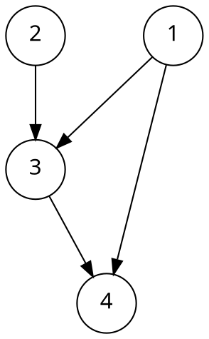

[[TOC]]

## 拓扑排序：给有依赖的任务排顺序

有些任务不能随便安排顺序。例如，学习一门课程前，必须先学完它的先修课程；编译一个程序前，必须先生成它依赖的文件。

把任务看成顶点，用有向边 $u\to v$ 表示：**必须先完成 $u$，才能完成 $v$**。我们要找一个顺序，让所有依赖都得到满足。

这个顺序就叫作**拓扑序**。形式化地说，把有向图的全部 $n$ 个顶点排列成一个序列，如果对每条边 $u\to v$，$u$ 都出现在 $v$ 前面，那么这个序列就是图的一个拓扑序。求这个序列的过程叫作**拓扑排序**（topological sort）。

这里的“排序”是安排顶点的先后关系，不是把顶点编号从小到大排列。

例如，图中有四条边：

```text
1 → 3
2 → 3
3 → 4
1 → 4
```



`1, 2, 3, 4` 和 `2, 1, 3, 4` 都是合法拓扑序，因为 $1$ 与 $2$ 之间没有先后约束。`1, 3, 2, 4` 则不合法，因为边 $2\to3$ 要求 $2$ 在 $3$ 前面。

由此可以看出：

- 拓扑序可能不唯一，没有依赖关系的任务可以有不同安排。
- 图不必连通；不同部分之间没有依赖，也可以一起排序。
- 孤立点没有依赖，但它仍然是一个任务，不能漏掉。

## 算法是怎么想到的

### 谁可以排在第一个

假设准备把顶点 $u$ 排在第一个。如果还有一条边 $v\to u$，就要求先处理 $v$，这与“$u$ 是第一个”矛盾。

所以，**第一个顶点只能从入度为零的顶点中选**。入度就是指向这个点的边数；入度为零，意味着它不依赖任何尚未完成的任务。

选出 $u$ 后，相当于完成了任务 $u$。此时，与 $u$ 有关的先后约束已经满足，可以把 $u$ 及其发出的边从图中删除，再为剩余任务安排顺序。

问题又回到了原来的样子：在剩余图中，继续寻找入度为零的点。

### 用入度数组模拟删边

不必真的修改邻接表。用 `in_deg[v]` 记录顶点 $v$ 的入度，每处理一条从 $u$ 出发的边 $u\to v$，执行一次 `--in_deg[v]`，就等价于删除了这条边。

要特别注意这个数组在运行中的含义：

::: colorfulbox

$in\_deg[v]$ 

$in\_deg[v]$ 表示剩余图中指向 $v$ 的边数，也就是 $v$ 还有多少条来自未处理前驱的依赖。

只有这些依赖全部解除，$v$ 才能被处理。

:::

为了随时取得一个可处理的点，可以用队列保存入度为零、等待处理的顶点。这个做法叫作 **Kahn 算法**。

1. 统计每个顶点的入度，把所有入度为零的点加入队列。
2. 取出队首 $u$，把它加入答案序列。
3. 遍历 $u$ 的所有出边 $u\to v$，令 `in_deg[v]` 减一；如果恰好减到零，就把 $v$ 入队。
4. 重复以上操作，直到队列为空。

队列里的点已经满足了所有前置条件，因此先取哪一个都合法。使用普通队列，只是其中一种选择。

## 手推一次算法

仍然使用前面的图，按编号从小到大加入初始入度为零的顶点。

初始入度为 $(0,0,2,2)$，所以先把 $1$ 和 $2$ 入队。下面的队列均按“队首在左”书写，入度四元组依次对应顶点 $1,2,3,4$。

| 操作 | 删除出边后的剩余入度 | 操作后的队列 | 已输出的序列 |
| --- | --- | --- | --- |
| 初始化 | $(0,0,2,2)$ | `1, 2` | 空 |
| 取出 $1$，删除 $1\to3$、$1\to4$ | $(0,0,1,1)$ | `2` | `1` |
| 取出 $2$，删除 $2\to3$ | $(0,0,0,1)$ | `3` | `1, 2` |
| 取出 $3$，删除 $3\to4$ | $(0,0,0,0)$ | `4` | `1, 2, 3` |
| 取出 $4$，没有出边 | $(0,0,0,0)$ | 空 | `1, 2, 3, 4` |

处理完 $1$ 时，$3$ 还不能入队，因为它仍然依赖 $2$；$4$ 也还不能入队，因为它仍然依赖 $3$。**一个前驱完成，不等于所有前驱都已完成。**

如果一开始先把 $2$ 入队，再把 $1$ 入队，就会得到另一个合法答案 `2, 1, 3, 4`。

想看拓扑排序一步步把入度为零的点剥出来的过程，试试这个动画。观察一个点什么时候入队，以及每次出队后哪些点的入度发生了变化：

[[[dsa: topsort]]]

## 为什么拓扑排序与 DAG 等价

**有向无环图**（Directed Acyclic Graph，简称 **DAG**）指不含有向环的有向图。下面证明：

$$
G\text{ 存在拓扑序}\quad\Longleftrightarrow\quad G\text{ 是 DAG}
$$

### 存在拓扑序，就不可能有环

假设图中有一个环：

$$
v_1\to v_2\to\cdots\to v_k\to v_1
$$

前面的边要求 $v_1$ 排在 $v_2$ 前面，$v_2$ 排在 $v_3$ 前面，依此类推；最后一条边又要求 $v_k$ 排在 $v_1$ 前面。

合起来相当于要求 $v_1$ 排在自己前面，这是不可能的。因此，有环的图不存在拓扑序。自环 $u\to u$ 也包含在这种情况中。

### 非空 DAG 一定有入度为零的点

反过来，假设一个非空有向图中，每个点的入度都大于零。

任取一个点 $v_0$，因为它有入边，可以找到前驱 $v_1\to v_0$；$v_1$ 也有入边，又能找到 $v_2\to v_1$。不断沿着前驱往回找，就得到：

$$
\cdots\to v_2\to v_1\to v_0
$$

图的顶点数量有限，这个过程却可以一直进行，所以必然遇到重复顶点；两次出现之间的边就构成一个有向环。

因此，如果图没有有向环，就不可能每个点都有入边：**非空 DAG 至少有一个入度为零的点。**

### Kahn 算法为什么能得到完整拓扑序

对一个 DAG，选出入度为零的点 $u$，把它排在当前序列的末尾。因为剩余图中没有边指向 $u$，这个选择不会违反任何依赖。

删除 $u$ 及其出边后，剩余图仍然无环。只要还有顶点，根据上面的结论，就仍然能找到入度为零的点。因此，算法一定能处理完全部顶点。

同时，对于任意一条边 $u\to v$，只要 $u$ 还没被处理，这条边就会使 $v$ 的剩余入度大于零，阻止 $v$ 被提前选中。所以输出序列中一定是 $u$ 在 $v$ 前面。

这既证明了 DAG 存在拓扑序，也证明了 Kahn 算法的正确性。

## 用处理点数判断是否有环

记录已经输出的顶点数量：

- 如果等于 $n$，说明得到了完整拓扑序，原图无环。
- 如果小于 $n$，说明还有顶点，却已经没有入度为零的点，剩余图必然有环。

不过，**没有被处理的顶点不一定都在环上**。例如：

```text
1 → 2
2 → 1
2 → 3
```

初始时三个点的入度都大于零，队列为空，一个点都无法处理。$1$、$2$ 在环上，$3$ 并不在环上，只是它依赖的 $2$ 永远无法完成。

因此，Kahn 算法可以判断“是否有环”，但不能在一般有向图中直接把“剩下的点”当成“所有环上的点”。如果要具体找出一个环，可以继续阅读 [[[rbook: graph_tarjan_loop]]]。

## C++ 模板

下面使用定长全局数组 `vector<int> g[maxn]` 保存出边，顶点编号为 $1\sim n$。程序读入 $n,m$，再读入 $m$ 条有向边 $u\to v$；成功时输出一种拓扑序，否则输出 `Cycle`。

```cpp file=./topsort.cpp
```

`maxn` 是数组上限，按题目数据范围调大即可；顶点数超过 `maxn` 会直接越界，不像动态 `vector` 那样能自动扩容。

建边时，`g[u].push_back(v)` 与 `++in_deg[v]` 必须配套。处理 $u$ 时遍历其出边，才能准确解除相应依赖。

`topsort()` 返回 `true` 时，`ta` 保存完整拓扑序；返回 `false` 时，`ta` 只是已经处理的部分，不能当成全图的拓扑序使用。

### 复杂度

设顶点数为 $n$，边数为 $m$。

- 每个顶点至多入队、出队一次，每条边至多遍历一次，因此时间复杂度为 $O(n+m)$。
- 邻接表占用 $O(n+m)$ 空间；入度数组、队列和答案序列的额外空间为 $O(n)$。模板把邻接表和入度都做成定长的 `maxn` 数组，所以实际占用是 $O(\text{maxn}+m)$，与数据上限有关而不是 $n$。

### 使用时容易遗漏的细节

- **算法会修改入度数组。** 即使清空队列和答案，也不能直接用已经修改过的入度再跑一次。可以事先保存副本，或重新遍历所有边统计入度。
- **要检查所有顶点。** 初始入队不能只从某个起点开始，否则可能漏掉其他连通部分或孤立点。
- **重边要成对处理。** 如果保存了两条 $u\to v$，建图时入度要加两次，处理 $u$ 时也要减两次。如果重复输入只是同一个约束的重复记录，也可以先去重，再统一建图。
- **多组数据要清空定长数组。** `g` 和 `in_deg` 都是全局数组，不会因为重新读入 $n$ 而变空，记得先 `g[u].clear()` 并把 `in_deg[u]` 清零，否则上一组的边和入度会混进这一组。
- **自环会导致失败。** 它要求一个任务先于自己完成，不存在合法拓扑序。
- **入队条件是入度恰好减到零。** 不需要每处理一个前驱就把后继入队，也不需要额外使用 `visited` 数组。

## 应用：按拓扑序进行 DAG 动态规划

拓扑序除了安排任务，还能安排**状态的计算顺序**。

假设顶点 $v$ 的状态需要由它的前驱转移得到。那么，在处理 $v$ 之前，应该先处理所有前驱。拓扑序恰好满足这个要求：

::: colorfulbox

核心

按拓扑序逐点处理，并沿出边传递贡献。当轮到 $v$ 时，所有前驱都已经处理完，来自前驱的转移已经到齐。

:::

这解释了为什么在 DAG 上，许多问题可以只遍历一遍顶点和边。

### 从指定起点出发的路径计数

给定 DAG 和起点 $s$，求从 $s$ 到每个顶点的有向路径条数。为了避免数值过大，下面对 $10^9+7$ 取模。

令 $dp[v]$ 表示从 $s$ 到 $v$ 的路径条数。初始时，只有 $s$ 有一条长度为零的路径：

$$
dp[s]=1,\qquad dp[v]=0\quad(v\ne s)
$$

对于每条边 $u\to v$，每条从 $s$ 到 $u$ 的路径都可以接上这条边，形成一条到 $v$ 的路径，所以转移为：

$$
dp[v]\gets dp[v]+dp[u]
$$

每条到 $v$ 的非空路径都有确定的最后一条边。按最后一条边分类，可以覆盖所有路径而不重复计数。若图中有重边，下面的程序会把经过不同边的路径视为不同路径。

下面的函数与前面的模板共用 `n`、邻接表 `g` 和拓扑序 `ta`，**必须在 `topsort()` 成功后调用**：

```cpp
vector<int> count_paths(int s) {
    const int MOD = 1000000007;
    vector<int> dp(n + 1, 0);
    dp[s] = 1;

    for (int u : ta) {
        for (int v : g[u]) {
            dp[v] += dp[u];
            if (dp[v] >= MOD) dp[v] -= MOD;
        }
    }
    return dp;
}
```

在最开始的例子中，取 $s=1$。处理 $1$ 后，$dp[3]=1$、$dp[4]=1$；处理 $2$ 时，因为 $dp[2]=0$，没有新增贡献；处理 $3$ 时，把 $dp[3]$ 加到 $dp[4]$，得到 $dp[4]=2$。

这两条路径分别是 $1\to4$ 和 $1\to3\to4$。

这里有三个容易混淆的地方：

- 初始时只把 $dp[s]$ 设为 $1$。如果把所有入度为零的点都设为 $1$，计算的就是从所有这些起点出发的路径总数，问题已经变了。
- 仍然按完整拓扑序处理。即使某个点无法从 $s$ 到达，它也可能是其他点的前驱；它的贡献为零，并不影响顺序的合法性。
- `dp[s]=1` 计入了长度为零的路径。如果题目只问非空路径，需要按题意处理起点自身的答案。

### 迁移到 DAG 最长路

如果把“统计路径条数”改成“寻找最长路径”，依赖关系没有变，仍然可以按同一个拓扑序处理。

例如，求从指定起点 $s$ 出发的最长路径经过多少条边。令 $dis[s]=0$，其他点初始化为负无穷，表示暂时不可达；沿边 $u\to v$ 转移：

$$
dis[v]\gets\max\bigl(dis[v],dis[u]+1\bigr)
$$

下面这段代码同样要在 `topsort()` 成功之后执行：

```cpp
const long long NEG_INF = -(1LL << 60);
vector<long long> dis(n + 1, NEG_INF);
dis[s] = 0;

for (int u : ta) {
    if (dis[u] == NEG_INF) continue; // 不从不可达的状态转移
    for (int v : g[u]) {
        dis[v] = max(dis[v], dis[u] + 1);
    }
}
```

如果边有权值，把邻接表改为保存终点和边权，再将转移中的 $1$ 换成 $w(u,v)$。只要图是 DAG，即使有负权边，仍然可以按拓扑序求最长路；需要根据数据范围选择负无穷和整数类型。

求“从指定起点出发的最长路”时，不能把所有点的距离都初始化为零，否则会把不可达的点也当成起点。若题目允许从任意点出发，并允许长度为零的路径，才可以把所有点初始化为零。

路径计数用加法汇总，最长路用最大值汇总。它们共用的基础都是：**按拓扑序计算，保证一个状态被用于向后转移之前，它依赖的状态已经处理完。**

## 两个常用扩展

### 字典序最小的拓扑序

普通队列能得到一种合法顺序，但不保证字典序最小。例如，较大的编号可能先入队，而较小的编号稍后才变成入度为零。

要得到字典序最小的拓扑序，每次从当前所有入度为零的点中取编号最小的即可。把模板中的队列换成小根堆：

```cpp
priority_queue<int, vector<int>, greater<int>> q;
```

同时把 `q.front()` 换成 `q.top()`，其余入堆、出堆逻辑不变。

为什么这样选正确？设当前可选点中最小的是 $x$。选 $x$ 不会破坏剩余图的无环性，因此存在以当前前缀接上 $x$ 的完整拓扑序。任何在这一位选择更大编号的序列，字典序都更大；继续对后面的每一位作同样选择即可。

每个点至多进堆、出堆一次，时间复杂度为 $O(m+n\log n)$。

### 判断拓扑序是否唯一

对于 DAG，拓扑序唯一，当且仅当**每次取点前，可选的入度为零的点都恰好只有一个**。

- 如果某一步同时有两个可选点 $a,b$，就可以分别先选 $a$ 或先选 $b$；两种选择都能继续完成排序，因此至少有两种拓扑序。
- 如果每一步都只有一个可选点，那么第一个点被确定，删去它后第二个点也被确定，依此类推，整个序列就被唯一确定。

实现时，在模板的 `while` 循环中、取出队首之前，检查 `q.size()`；若大于 $1$，记录“存在多种选择”。最后仍要检查是否处理了全部顶点：**有环时根本不存在拓扑序，不能仅根据队列大小判断唯一性。**

## 进一步理解：偏序与剥点

对于 DAG，定义 $u\preceq v$ 表示“$u=v$，或者存在从 $u$ 到 $v$ 的有向路径”，就得到一个偏序关系。某些顶点必须有先后次序，另一些顶点则不可比较。

拓扑序把这些局部的先后关系扩展成一个完整序列，同时保留原来的约束。这也叫作偏序的**线性扩张**。偏序相关的内容可继续阅读 [[[rbook: dilworth]]]。

从算法操作上看，Kahn 算法则是在不断剥掉当前入度为零的点。这种“剥掉可以确定的部分，再处理剩余结构”的做法，也会用于 [[[rbook: functional-graph]]] 中的函数图找环；能否把剩余点直接认作环上顶点，需要结合那类图的结构条件，不能照搬到一般有向图。

[[[include: ./practice.md]]]
