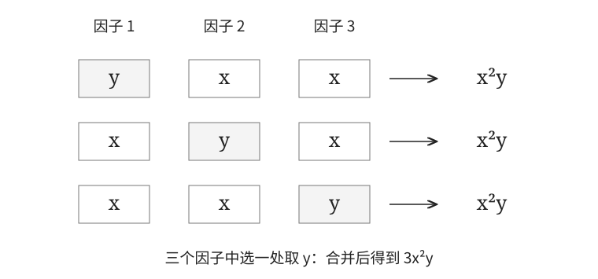

[[TOC]]

## 展开式

对非负整数 $n$，有：

$$
\boxed{(x+y)^n=\sum_{k=0}^{n}\binom nk x^{n-k}y^k}.
$$

这就是**二项式定理**。其中 $\binom nk$ 表示从 $n$ 个不同位置中选出 $k$ 个，组合数的含义见 [[[rbook: combinatorics]]]。

例如：

$$
(x+y)^3=x^3+3x^2y+3xy^2+y^3.
$$

各项的总次数都是 $n$。当 $n=0$ 时，展开式只有常数项 $1$，对应 $\binom00=1$。

## 系数的来源

把 $(x+y)^n$ 写成 $n$ 个因子的乘积。分配律展开时，每个因子恰好选一个 $x$ 或 $y$，再把选出的项相乘。

要产生 $x^{n-k}y^k$，必须恰好在 $k$ 个因子中选择 $y$，其余因子选择 $x$。因此，需要选择的是**哪些因子取 $y$**，共有 $\binom nk$ 种，合并同类项后的系数就是 $\binom nk$。

例如 $n=3,k=1$，三种选择都产生 $x^2y$：



因子在乘积中有不同的位置，所以选择方案不同；乘法交换律又让它们产生相同的单项式。因此要把这些贡献相加，而不是只保留一项。

## 计算系数

将两个加数换成 $ax$、$by$，得到：

$$
(ax+by)^k=\sum_{j=0}^{k}\binom kj a^{k-j}b^j x^{k-j}y^j.
$$

要求 $x^ny^m$ 的系数，先检查 $n+m=k$，再取 $j=m$：

$$
\boxed{\text{系数}=\binom km a^nb^m=\binom kn a^nb^m}.
$$

若 $n,m$ 是非负整数且 $n+m\ne k$，该单项式不会出现，系数为 $0$。注意幂次要跟随相应变量，不能把 $a^n$ 与 $b^m$ 交换。

例如 $(2x-y)^5$ 中，$x^3y^2$ 的系数为：

$$
\binom52\cdot2^3\cdot(-1)^2=80.
$$

负号属于 $y$ 的系数，必须一起乘方；若要求 $x^4y$ 的系数，则为 $\binom51\cdot2^4\cdot(-1)=-80$。

### 例题

题目：[[[p: luogu-P1313 | 计算系数]]]。

输入 $a,b,k,n,m$，求上述系数对 $10007$ 取模的结果。题目保证 $0\le k\le1000$、$0\le n,m\le k$、$n+m=k$，且 $0\le a,b\le10^6$。

在这个范围内，用杨辉三角递推组合数：

$$
\binom ij=\binom{i-1}{j-1}+\binom{i-1}j,
\qquad \binom i0=\binom ii=1.
$$

两个分支分别表示是否选中第 $i$ 个位置。整个递推只需要加法，可以直接对模数取模；幂次部分使用 [[[rbook: quick_pow]]]。

```cpp file=./coefficient.cpp
```

时间为 $O(k^2+\log(n+1)+\log(m+1))$，空间为 $O(k^2)$。边界 $k=0$、$n=0$ 或 $m=0$ 都需要保留：指数为零表示该因子未被选用，对乘积贡献 $1$。

不要先用普通整数计算阶乘再相除，结果可能早已溢出；也不能把整数除法直接照搬到模运算中。这里使用的杨辉三角递推不需要除法。

完整题解：[pcs2：计算系数](https://pcs2.roj.ac.cn/problems/luogu/P1313/)。

## 常用恒等式

### 系数和

取 $x=y=1$，得到：

$$
\sum_{k=0}^{n}\binom nk=2^n.
$$

组合意义是：按选取元素个数分类，所有子集共有 $2^n$ 个。这一式对 $n=0$ 也成立。

### 奇偶选择

当 $n\ge1$ 时，取 $x=1,y=-1$，得到：

$$
\sum_{k=0}^{n}(-1)^k\binom nk=0.
$$

把偶数项与奇数项分别移到等式两侧，再结合系数和，可知：

$$
\sum_{\substack{0\le k\le n\\k\text{ 为偶数}}}\binom nk
=\sum_{\substack{0\le k\le n\\k\text{ 为奇数}}}\binom nk
=2^{n-1}.
$$

因此，当原集合至少含一个元素时，偶数大小子集与奇数大小子集数量相同，空集也计入偶数大小子集。$n=0$ 时只有一个空集，交错和为 $1$，不能套用上式。

### 范德蒙德恒等式

对非负整数 $r,s,k$，有：

$$
\sum_{i=0}^{k}\binom ri\binom{s}{k-i}=\binom{r+s}k,
$$

约定选取数量超出范围时组合数为 $0$。

从两个互不相交、大小分别为 $r,s$ 的集合中，一共选 $k$ 个元素。左侧按从第一个集合选了 $i$ 个分类，右侧直接从并集中选择，两者统计同一件事。

也可以比较 $(1+x)^r(1+x)^s=(1+x)^{r+s}$ 两侧 $x^k$ 的系数。展开式中的系数既能表示选择数，也能用来组织分组计数。
