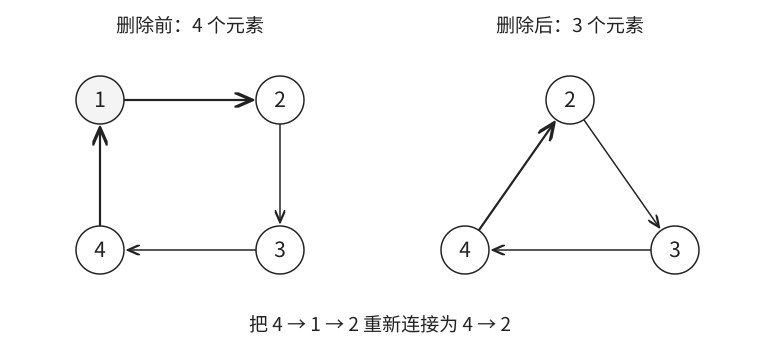

[[TOC]]

## 信封问题

题目：[[[p: luogu-P1595 | 信封问题]]]。

有 $n$ 封不同的信和 $n$ 个对应的信封，每个信封恰好放一封信。要求每封信都不进入自己的信封，求方案数。

把信 $i$ 放入的信封编号记作 $p_i$，则 $p$ 是 $1\sim n$ 的一个排列，并且：

$$
p_i\ne i\qquad(1\le i\le n).
$$

这种没有元素留在原位的排列称为**错排**，方案数记作 $D_n$。例如 $n=3$ 时只有两种：

$$
(2,3,1),\qquad(3,1,2).
$$

这里禁止的是每个元素回到自己的位置。它与“排列不能和原排列完全相同”不同，后者只排除一个方案，答案是 $n!-1$。

## 分类递推

先固定信 $1$ 放入信封 $j$，其中 $j\ne1$，有 $n-1$ 种选择。接下来按信 $j$ 的去向分类。

### 两封信互换

若 $p_j=1$，即 $1,j$ 互相进入对方的信封，可以把这两封信和对应信封一起删掉。其余 $n-2$ 封信仍需全部装错，有 $D_{n-2}$ 种方案。

反过来，给任意一个剩余元素的错排补上 $1\leftrightarrow j$，都会得到且只得到一种本类方案。

### 不构成互换

若 $p_j\ne1$，由于每个信封都恰好被使用一次，必有另一封信 $k$ 进入信封 $1$。此时 $k\ne1,j$，局部关系为：

$$
k\to1\to j.
$$

删去信 $1$ 和信封 $1$，把信 $k$ 改放进信封 $j$，即把这段关系接成 $k\to j$。因为 $k\ne j$，不会产生新的原位元素，其余位置不变，得到 $n-1$ 个元素的错排。

例如 $1\to2\to3\to4\to1$，删去 $1$ 后变为 $2\to3\to4\to2$：



这一步是可逆的：给定剩余元素的错排，找到进入信封 $j$ 的信 $k$，把 $k\to j$ 改成 $k\to1\to j$，就能唯一恢复原方案。因此本类方案数恰好是 $D_{n-1}$。

### 递推式

两类互不重叠，并覆盖信 $j$ 的所有可能去向。对每个固定的 $j$，共有 $D_{n-2}+D_{n-1}$ 种方案；再乘以 $j$ 的选择数，得到：

$$
\boxed{D_n=(n-1)(D_{n-1}+D_{n-2})}\qquad(n\ge2).
$$

边界为 $D_0=1,D_1=0$。空排列只有一种；一个元素无法离开自己的位置。取 $D_0=1$ 也使 $D_2=(2-1)(D_1+D_0)=1$ 正确成立。

| $n$ | $0$ | $1$ | $2$ | $3$ | $4$ | $5$ |
|---|---|---|---|---|---|---|
| $D_n$ | $1$ | $0$ | $1$ | $2$ | $9$ | $44$ |

## 代码实现

P1595 中 $1\le n\le20$，结果可以用 `long long` 保存。代码也保留了 $n=0$ 的数学边界。

```cpp file=./derangement.cpp
```

时间、空间均为 $O(n)$。若只需要一个答案，也可以用两个变量保存前两项，将辅助空间降至 $O(1)$。

错排数增长很快，$D_{20}=895014631192902121$，而 $D_{21}$ 已超过有符号 $64$ 位整数范围。更大范围应按题意取模或使用高精度；要求取模时，直接在递推中取模即可，不需要除法。

## 恰好若干个原位元素

若要求恰好有 $m$ 个位置满足 $p_i=i$，先从 $n$ 个位置中选出这 $m$ 个固定位置，再让剩余元素全部错排，答案为：

$$
\binom nm D_{n-m}\qquad(0\le m\le n).
$$

不能让剩余元素任意排列，否则它们还可能产生新的固定位置，使总数超过 $m$。

例如 $n=3$ 时，恰好有 $0,1,2,3$ 个固定位置的方案数分别为 $2,3,0,1$，相加为 $3!=6$。特别地：

- $m=n$ 时，所有元素固定，答案为 $D_0=1$。
- $m=n-1$ 时，只剩一个元素，它也只能留在原位，因此没有方案。
- $m>n$ 时，答案为 $0$。

练习：[[[p: luogu-P4071 | 排列计数]]]。题目需要多次查询并取模，应预处理错排数和组合数所需的数据。

## 容斥表达式

也可以从所有 $n!$ 个排列中排除含固定位置的排列。设 $A_i$ 表示 $p_i=i$，固定任意 $k$ 个位置后，其余元素有 $(n-k)!$ 种排列；选择这 $k$ 个位置有 $\binom nk$ 种方法。

由 [[[rbook: inclusion-exclusion]]] 得到：

$$
D_n=\sum_{k=0}^{n}(-1)^k\binom nk(n-k)!.
$$

这里的交集只要求选中的位置固定，允许其他位置也固定；重复覆盖由容斥的正负号修正。这个式子适合解释“排除所有固定位置”，实际逐项计算时仍须注意阶乘的范围，不能用浮点近似代替精确计数。
