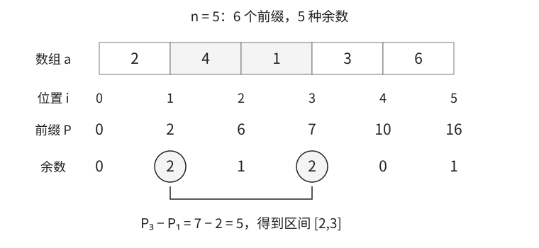

[[TOC]]

## 基本形式

把 $n+1$ 个对象放入 $n$ 个盒子，至少有一个盒子含有两个或更多对象。这就是**鸽巢原理**，也称抽屉原理。

证明只需反设每个盒子至多放一个对象，那么总数至多为 $n$，与有 $n+1$ 个对象矛盾。

盒子不一定是实际容器，也可以是一种分类。例如 $13$ 个人按出生月份分为 $12$ 类，必有两个人的出生月份相同。

原理保证的是某个类别发生重复，不要求每个类别都非空。

## 一般形式

把 $N$ 个对象分入 $M$ 个类别，其中 $M\ge1$，则至少有一类包含：

$$
\left\lceil\frac NM\right\rceil
$$

个对象。否则，每一类都少于这个数量，所有类别的总容量就不足 $N$。

等价地，要保证某类至少有 $k$ 个对象，只需对象总数达到：

$$
M(k-1)+1.
$$

如果只有 $M(k-1)$ 个，可以恰好每类放 $k-1$ 个，因此这个界限不能再减少。

例如 $10$ 个对象分成 $3$ 类，某类至少有 $4$ 个。这里没有声称每类都至少有 $4$ 个。

## 构造分类

应用时需要同时说明三件事：有哪些对象、最多有多少类、同类对象能推出什么结论。

仅有“对象多于类别”还不够，分类必须保留题目要求的关系。下面分别使用相邻数对、奇数部分和余数作为类别。

### 相邻数对

从 $1\sim2n$ 中任取 $n+1$ 个**不同的数**，证明其中必有两个数互质。

将所有数分成 $n$ 类：

$$
\{1,2\},\{3,4\},\ldots,\{2n-1,2n\}.
$$

选出的数超过类别数，必有一类中的两个数同时被选中。它们相邻，公因数必须整除两者之差 $1$，所以互质。

### 奇数部分

仍从 $1\sim2n$ 中任取 $n+1$ 个不同的数，证明其中必有一个数整除另一个数。

把每个正整数唯一写成：

$$
x=2^tq,\qquad q\text{ 为奇数}.
$$

按奇数部分 $q$ 分类。$q$ 只能取 $1,3,\ldots,2n-1$，共 $n$ 种，因此必有两个选中的数属于同一类。

设它们是 $2^aq,2^bq$，不妨令 $a<b$，则后者是前者的 $2^{b-a}$ 倍，整除关系成立。

例如在 $1\sim6$ 中，可以这样分类：

| 奇数部分 | 类中的数 |
|---|---|
| $1$ | $1,2,4$ |
| $3$ | $3,6$ |
| $5$ | $5$ |

每类中的数相差若干次乘 $2$，因此同类的任意两个不同数都存在整除关系。分类依据来自需要证明的结论。

## 同余前缀

给定任意 $n$ 个整数 $a_1,\ldots,a_n$，证明存在一个**非空连续区间**，其元素和能被 $n$ 整除，并构造出这个区间。

要让区间和被 $n$ 整除，可以先把区间和写成两个前缀和之差：

$$
P_0=0,\qquad P_i=\sum_{j=1}^i a_j.
$$

若两个前缀满足 $P_i\equiv P_j\pmod n$，其中 $i<j$，则：

$$
P_j-P_i=\sum_{k=i+1}^{j}a_k\equiv0\pmod n.
$$

现在对象是 $P_0,P_1,\ldots,P_n$，共 $n+1$ 个；按模 $n$ 的余数分类，只有 $0\sim n-1$ 共 $n$ 类。由鸽巢原理，必有两个不同位置的前缀同余，因此所求非空区间一定存在。

例如 $n=5$，数组为 $[2,4,1,3,6]$：



前缀 $P_1=2$、$P_3=7$ 的余数同为 $2$，所以区间 $[2,3]$ 的和为 $7-2=5$，可被 $5$ 整除。

### 代码实现

存在性证明已经给出了构造方法：扫描前缀余数，保存每个余数首次出现的位置。一旦某个余数再次出现，就能输出两次前缀位置之间的区间。

约定输入 $1\le n\le2\times10^5$，随后输入 $n$ 个整数，$|a_i|\le10^9$；输出任意一组满足条件的区间端点 $l,r$，下标从 $1$ 开始。

```cpp file=./divisible_segment.cpp
```

时间、空间均为 $O(n)$。代码只保存前缀和的余数，不需要保存全部前缀和或原数组。

两个边界影响正确性：

- 必须加入空前缀 $P_0=0$，否则只剩 $n$ 个对象，不能直接保证它们在 $n$ 类中发生重复，也会漏掉从位置 $1$ 开始的区间。
- C++ 对负数取余可能得到负值，应统一到 $0\sim n-1$，才能作为同一套类别与数组下标。

## 使用条件

鸽巢原理给出的是必然存在的关系。实现构造时，还需要保存同类对象的位置或代表，不能只统计每类的数量。

“每个盒子可以装多少个”必须与分类性质一致。例如上述连续段结论使用 $n+1$ 个前缀、模 $n$ 分类；若把模数改成 $m$，只有在 $n\ge m$ 时，才能用相同计数直接保证前缀余数重复。

这不表示 $n<m$ 时一定无解，只表示对象数量本身已经不足以保证有解。
