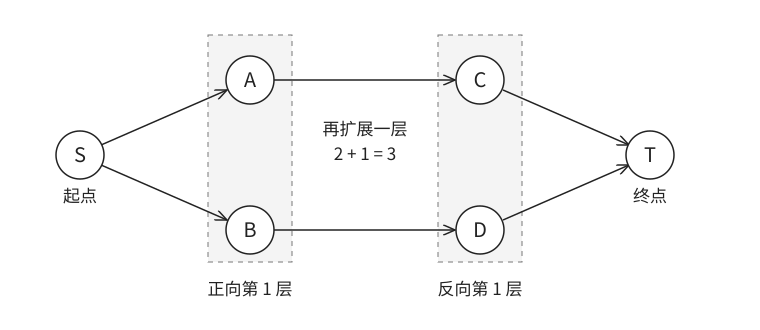

[[TOC]]

## 从两端搜索

[[[rbook: bfs]]] 从起点逐层扩展，第一次发现终点时得到最少步数。若每个状态平均产生 $b$ 个新状态，答案深度为 $d$，搜索树的规模可能达到 $b^d$ 量级。

当终点已知，而且能够枚举一个状态的前驱时，可以从起点、终点分别搜索，在中间连接两条路径。

下面的有向图中，从 $S$ 到 $T$ 最少需要 $3$ 步。图上的箭头始终表示原图方向。



正向先发现 $\{A,B\}$，反向先发现 $\{C,D\}$。再扩展正向的一层，就能在 $C$ 或 $D$ 连接两侧：

$$
S\to A\to C\to T,\qquad 2+1=3.
$$

在分支较均衡、重复状态较少的搜索树中，两侧各搜索约 $d/2$ 层，状态量约为 $2b^{d/2}$。这是常见的加速原因，不是任意图上的复杂度保证。

## 反向搜索

设两侧距离为：

- $d_s[u]$：从起点 $S$ 到 $u$ 的最少步数。
- $d_t[u]$：从 $u$ 到终点 $T$ 的最少步数。

反向 BFS 要沿**反图**扩展。原图有边 $u\to v$，反图就有边 $v\to u$。这样从 $T$ 搜到 $u$ 的距离，才等于原图中 $u$ 到 $T$ 的距离。无向图的两个方向可以使用同一张邻接表。

两侧都发现状态 $u$ 时，得到一条长度为 $d_s[u]+d_t[u]$ 的路径。

## 按层相遇

每次选择当前待扩展节点较少的一侧，**扩展完整的一层**。这一层产生的所有相遇候选取最小值，随后结束搜索。选择较小的一层只影响效率，不改变最优性。

证明如下。假设扩展前，两侧已经分别发现距离不超过 $a,b$ 的全部状态，而且尚未相遇。

若存在长度不超过 $a+b$ 的路径，它必然有一个节点同时落在这两个距离范围内，与尚未相遇矛盾。因此，最短路长度至少为 $a+b+1$。

现在正向完整扩展一层，新相遇点给出的路径长度至多为 $(a+1)+b$，恰好达到上述下界。反向扩展时同理。若这一层没有相遇，就继续下一轮。

这个结论依赖三个条件：单位边权、正确的反向转移、按整层扩展。不要把代码改成每次只取一个节点、重新选择方向后立即返回第一次相遇。

## 代码实现

输入 `n m s t`，随后输入 $m$ 条有向边；节点编号为 $1\sim n$，$n\le 2\times10^5$。输出最少步数，不可达时输出 `-1`。

`expand` 开始时记录队尾，保证这一轮只处理原有的一层，新加入的节点留到下一轮。

```cpp file=./bidirectional_bfs.cpp
```

在显式图上，每个方向至多访问每个节点、每条边一次，时间和空间复杂度均为 $O(n+m)$。若某侧队列为空且仍未相遇，就不存在从起点到终点的路径。

## 字串变换

题目：[[[p: luogu-P1032 | 字串变换]]]。

给定起始串 $A$、目标串 $B$ 和不超过 $6$ 条替换规则。每步选择一条规则，把当前串中匹配的一处子串替换掉，求 $10$ 步以内的最少变换次数。

把整个字符串看作一个节点，一次替换看作一条有向边。反向搜索时，必须把每条规则的左右两端交换：

| 正向规则 | 反向规则 |
|---|---|
| `ab → x` | `x → ab` |
| `x → yz` | `yz → x` |

例如正向路径是 `cab → cx → cyz`，反向就从 `cyz` 经 `cx` 回到 `cab`。**从目标串继续使用原规则，得到的不是前驱状态。**

### 状态生成

对每条规则，枚举左串在当前串中的所有出现位置，每次只替换一处。出现位置可以重叠：规则 `aa → b` 作用于 `aaa`，能够产生 `ba` 和 `ab`。

字符串状态用哈希表记录最短距离，入队时判重。输入串长度不超过 $20$，不代表中间串也不超过 $20$，不能据此截断搜索。

### 搜索边界

初始时两侧半径之和为 $0$。每轮只扩展一侧的一层，半径之和增加 $1$。因此，最多扩展 $10$ 轮，就能判断是否存在不超过 $10$ 步的路径。

若 $A=B$，直接输出 $0$；否则在首个相遇层取得最少步数。两侧半径不必各为 $5$，代码会根据前沿大小选择方向。

::: fold 完整代码
```cpp file=./string_transform.cpp
```
:::

设两侧共发现 $V$ 个状态，规则数为 $R$，搜索中的串长上界为 $L$。按字符串查找、构造和哈希的通常代价估计，时间为 $O(VRL^2)$，空间为 $O(VL)$。状态数仍可能随深度指数增长；双向搜索不保证消除所有大分支。

完整题解：[pcs2：字串变换](https://pcs2.roj.ac.cn/problems/roj/3517/)。
