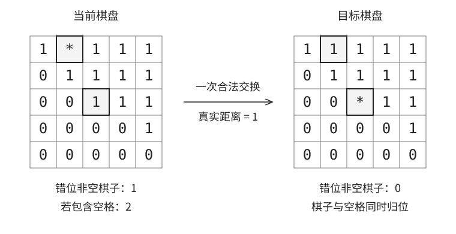

[[TOC]]

## 剩余步数下界

[[[rbook: iterative_deepening]]] 依次增加深度上限，用 DFS 寻找最少步数。如果已经走了 $g$ 步，上限为 $D$，普通限深搜索只知道剩余步数不超过 $D-g$。

若还能计算当前状态到目标**至少**需要多少步，记作 $h(s)$，就得到更早的剪枝条件：

$$
g+h(s)>D\quad\Longrightarrow\quad\text{在当前上限内不可能完成}.
$$

这种按 $f(s)=g+h(s)$ 的上限进行迭代加深的方法称为 **IDA***（Iterative Deepening A*）。本文只讨论每步代价为 $1$ 的情形。

估价函数必须满足：

$$
0\le h(s)\le\text{从 }s\text{ 到目标的真实最少步数}.
$$

它可以低估，但不能高估。低估只会多搜一些状态；高估则可能把最优解剪掉。

## 骑士精神

题目：[[[p: luogu-P2324 | 骑士精神]]]。

在 $5\times5$ 棋盘上放置 $12$ 枚黑棋、$12$ 枚白棋和一个空格。每次选择一枚能按国际象棋中骑士走法到达空格的棋子，与空格交换位置。

骑士走法为横向移动 $1$ 格、纵向移动 $2$ 格，或横向移动 $2$ 格、纵向移动 $1$ 格，共 $8$ 个方向。求到达以下目标棋盘的最少步数，超过 $15$ 步则输出 `-1`。

```text
11111
01111
00*11
00001
00000
```

`1` 表示黑棋，`0` 表示白棋，`*` 表示空格。直接枚举所有移动时，每层最多产生 $8$ 个分支；需要利用当前棋盘与目标的差异估计剩余步数。

## 错位棋子

把“当前非空，且内容与目标格不同”的格子数记作 $h$。目标应为空格、当前却有棋子的格子，也要计入。

一次移动只让**一枚非空棋子**换了位置，其余棋子原地不动。因此，$h$ 至多减少 $1$。即使这枚棋子一步就能归位，也只能修正它自己的一处错位。

如果当前有 $h$ 枚棋子错位，至少还要移动 $h$ 次才能让错位数降到 $0$，所以：

$$
\text{剩余最少步数}\ge h.
$$

棋子可能需要绕行，也可能先把正确棋子移开，因此真实步数可以更大。这不影响下界的正确性。

### 不统计空格

若把空格也算作一个错位对象，一次交换可能同时让棋子和空格归位，使错位数减少 $2$。直接用这个总数估计剩余步数，就可能高估。

下面两个棋盘只差一次合法交换：左图第二列第一行的空格，与第三列第三行的黑棋交换后，就得到目标。



左图若包含空格，错位数为 $2$；但真实距离只有 $1$。只统计非空棋子时 $h=1$，符合下界要求。

这里 $h=0$ 可以作为成功条件：若所有非空格都与目标相同，则目标空格位置不可能被棋子占据，唯一的空格也必然在正确位置。一般的估价函数未必有这个性质，不能一概把 $h=0$ 当作到达目标。

## 搜索上限

从初始棋盘的 $h$ 开始，依次尝试上限 $D=h,h+1,\ldots,15$。每轮都从初始棋盘重新 DFS。

递归中已走 $g$ 步时：

1. 若 $g+h>D$，返回失败。
2. 若到达目标，返回成功。
3. 否则枚举合法交换，递归后恢复棋盘。

注意剪枝条件是 `>`，不是 `>=`。当 $g+h=D$ 时，仍可能恰好在上限内完成。

### 最优性

设最优解需要 $d$ 步。沿着这条路径，到任意中间状态已经走了 $g$ 步，路径上还剩 $d-g$ 步。由于 $h$ 不高估：

$$
g+h\le g+(d-g)=d.
$$

因此，当上限达到 $d$ 时，最优路径上的状态都不会被估价剪掉，DFS 必定能够找到解。小于 $d$ 的上限不可能成功，所以第一轮成功的上限就是最少步数。

### 避免立即返回

若本次交换后，下一次立刻与原来的空位交换，就会回到相同棋盘，白走两步。删除这两步仍能接上原路径，因此最短路不会包含这种操作，可以直接跳过。

这只是消除一步撤销。它不等于全局判重，也不会消除所有较长的环。

## 代码实现

代码每次重新统计 $25$ 个格子的错位数，使用普通数组保存棋盘和移动方向。交换之后无论是否找到解，都恢复棋盘，保证每一轮从相同初始状态开始。

```cpp file=./knight.cpp
```

棋盘固定为 $25$ 格，每个节点的估价与转移开销是常数。搜索时间仍可能随步数上限指数增长，不能把估价剪枝视为多项式复杂度保证。递归深度至多 $D\le15$，辅助空间为 $O(D)$。

完整题解：[pcs2：骑士精神](https://pcs2.roj.ac.cn/problems/luogu/P2324/)。

## 与迭代加深的关系

普通迭代加深相当于取 $h=0$，只按已走步数限制搜索。IDA* 在此基础上加入剩余代价下界：仍按 DFS 顺序访问，但会提前舍弃无法在当前上限内完成的分支。

加成序列中的翻倍剪枝也在判断“剩余次数够不够”。两者的共同点是使用乐观估计排除无解分支；IDA* 则明确以 $g+h$ 为阈值组织搜索。估价函数是否可靠，应先证明，再写入剪枝条件。
