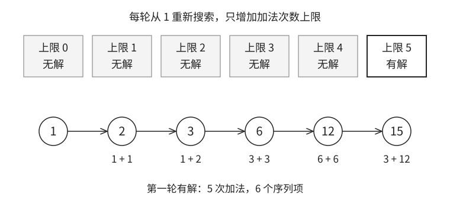

[[TOC]]

## 限制深度

DFS 找到的第一个解未必最短；BFS 按层搜索能求最少步数，但需要保存整层状态。

如果答案较浅、分支较多，可以依次限制 DFS 的最大深度为 $0,1,2,\ldots$。某个上限找不到解，就从根重新搜索，并把上限增加 $1$。这种方法称为**迭代加深搜索**（IDDFS）。

每一轮仍然按 DFS 的顺序访问节点，只是不能越过当前深度上限。它没有保存 BFS 的整层队列。

```cpp
for (int limit = 0; ; ++limit) {
    if (dfs(0, limit)) break;
}
```

假设每步代价均为 $1$，第一轮成功的上限是 $d$。前面所有小于 $d$ 的上限都已完整搜索且无解，所以这一轮找到的解必定使用 $d$ 步，步数最少。

这只保证步数最少。若题目还要求在相同步数下比较另一项指标，不能据此立即结束整轮搜索。

## 加成序列

从 $1$ 开始，每次把序列中**任意两个已有项**相加，追加一个严格大于当前末项的数，最终到达 $n$。两个加数可以相同，要求序列长度最短。

例如 $n=15$，下面是一条最短序列：

$$
1,2,3,6,12,15.
$$

它用了 $5$ 次加法，共 $6$ 项。本文的深度统一指加法次数，避免把项数和步数混用。



### 枚举下一项

设已有前缀为 $x_0,x_1,\ldots,x_k$，其中 $x_0=1$。枚举 $0\le j\le i\le k$，产生下一项：

$$
y=x_i+x_j,\qquad x_k<y\le n.
$$

超过 $n$ 的数不可能再回到 $n$，可以直接舍去。其余候选必须保留；不能只枚举“当前末项加某个已有项”，因为题目允许两个加数都不是末项。

同一前缀中，不同数对可能产生相同的 $y$。追加后得到的完整前缀相同，后续选择也相同，所以对下一项的值去重即可。

但不能只按末项做全局判重。例如前缀 $(1,2,3,6)$ 可以再产生 $9$，前缀 $(1,2,4,6)$ 可以再产生 $10$。它们末项相同，可用的加数却不同，不能合并为同一状态。

### 翻倍剪枝

当前最大值为 $x$，还允许做 $r$ 次加法。由于任意两个已有项都不超过 $x$，下一项至多是 $2x$。连续取这个最大值，最终也至多达到 $x\cdot2^r$。

因此：

$$
x\cdot2^r<n\quad\Longrightarrow\quad\text{当前分支不可能成功}.
$$

这是到达目标的必要条件。即使 $x\cdot2^r\ge n$，也不代表一定能用余下的加法恰好得到 $n$。

实现中逐次翻倍，到达 $n$ 后停止计算，不必直接计算大次幂。先搜索较大的候选值有助于尽早到达目标，但最优性来自迭代加深和完整枚举。

### 代码实现

约定 $1\le n\le100$，每行一个 $n$，输入 $0$ 结束；每组输出任意一条最短序列。当 $n=1$ 时，不需要加法，输出 `1`。

```cpp file=./addition_chain.cpp
```

`candidate[depth]` 每次进入当前前缀时重新清空。不同深度使用不同的行，避免递归子节点覆盖父节点尚未枚举完的候选。

数组深度取 $20$ 足够：按 $n$ 的二进制从高位向低位构造，每位至多执行一次翻倍、一次加 $1$。$n\le100$ 至多有 $7$ 位，因此不超过 $12$ 次加法就能构造出一条合法序列。

完整题解：[pcs2：加成序列](https://pcs2.roj.ac.cn/problems/roj/3065/)。上面的程序按本文约定只输出序列；ROJ 3065 的输出格式与评测差异见题解说明。

## 埃及分数

题目：[[[p: luogu-P1763 | 埃及分数]]]。

将一个正真分数表示成若干个不同单位分数之和：

$$
\frac ab=\frac1{x_1}+\frac1{x_2}+\cdots+\frac1{x_k},\qquad x_1<x_2<\cdots<x_k.
$$

题目先要求项数 $k$ 最少；项数相同时，要求最小的单位分数最大，也就是**最大分母 $x_k$ 最小**。

### 同层继续搜索

依次限制项数为 $1,2,3,\ldots$。第一轮有解时，已经确定最少项数，但这一轮内仍需比较所有可能改进最大分母的解。

例如：

$$
\frac{19}{45}=\frac13+\frac1{12}+\frac1{180}
=\frac15+\frac16+\frac1{18}.
$$

两种表示都用了 $3$ 项，后者的最大分母从 $180$ 降到了 $18$。若按分母从小到大枚举，遇到第一种表示就停止，会漏掉更优答案。

因此，递归找到解时只更新答案，再返回继续搜索。**当前项数的整轮搜索结束后**，若已有解，才停止增加项数。找到答案后可以增加剪枝，但不能删掉仍可能改善最大分母的分支。

### 枚举范围

设剩余分数为 $a/b$，还要放 $t$ 项，下一个分母为 $x$，上一个分母为 $p$。

由于分母严格递增，且 $1/x$ 不能超过剩余分数：

$$
x\ge\max\left(p+1,\left\lceil\frac ba\right\rceil\right).
$$

其余分母都不小于 $x$，剩余 $t$ 项的和至多为 $t/x$，所以还需要：

$$
\frac tx\ge\frac ab\quad\Longrightarrow\quad
x\le\left\lfloor\frac{tb}{a}\right\rfloor.
$$

这个上界可能包含无解候选，但不会漏解。选定 $x$ 后，剩余分数变为 $(ax-b)/(bx)$；还需放入其他项时，必须保证它为正，约分后继续搜索。若只剩一项，则检查 $b$ 能否被 $a$ 整除，以及分母是否严格大于 $p$、是否超过分母上界。

题目保证存在最大分母不超过 $10^7$ 的最优解，可把它作为分母上界。分数连乘可能很大，不能仅凭原始 $a,b<1000$ 就断定中间运算不会溢出。

完整实现与边界处理见 [pcs2：埃及分数](https://pcs2.roj.ac.cn/problems/luogu/P1763/)。

## 代价与适用范围

迭代加深会重复搜索浅层。若每个节点稳定地产生 $b>1$ 个子节点，最浅解深度为 $d$，各轮合计访问量仍为 $O(b^d)$；重复部分通常被最深一层主导。若搜索树退化成一条链，重复访问量则可能达到 $O(d^2)$。

基础 DFS 的路径和递归栈占 $O(d)$ 空间。加成序列的实现另存了逐层候选表，总辅助空间为 $O(dn)$，时间仍可能呈指数增长。

它适合最浅解不深、BFS 存储压力较大，且可以有效剪枝的问题。若解可能不存在，应根据题意设置最大深度或其他终止条件，不能无限增加上限。各步代价不同时，最少步数也不再等于最小总代价。
