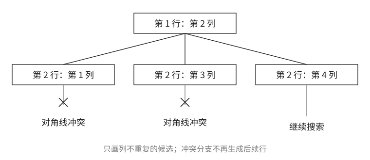
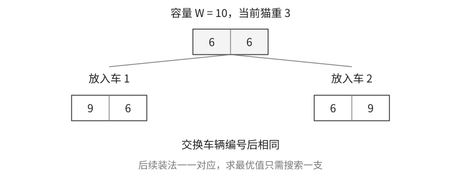

[[TOC]]

[[[rbook: dfs]]] 的每个状态都对应搜索树上的一个节点，继续决策就会进入它的子树。若能证明某棵子树不必搜索，就可以提前停止，这称为**剪枝**。

判断依据通常有三类：

| 方法 | 可以停止的原因 |
| --- | --- |
| 可行性剪枝 | 当前状态已经无法产生合法解 |
| 最优性剪枝 | 当前分支无法改进已有的最优解 |
| 排除等效冗余 | 其他分支已经代表了相同的后续可能 |

**优化搜索顺序**则是优先尝试限制更强或更有希望的选择。它本身不删除候选，但可能让冲突更早暴露，或更早找到较好的可行解，从而加强其他剪枝。它不保证每组数据都更快。

每加一条剪枝，都应回答：为什么这整棵子树可以跳过？这个理由是否适用于当前要求的“找一个解、求最优值或统计方案数”？

## 八皇后

题目：[[[p: luogu-P1219 | 八皇后]]]。

在 $n\times n$ 的棋盘上放 $n$ 个皇后，要求互不攻击。按行搜索，每行选择一列；先生成完整的列排列，再检查对角线，会把许多已经冲突的前缀继续填到最后。

以 $4\times4$ 棋盘说明：第一行放在第 $2$ 列，第二行放在第 $3$ 列，这两个皇后已经位于同一条对角线上。后续放多少个皇后，都不能消除已发生的攻击，因此可以立即剪掉。



同列由列号判断；同一条主对角线的 $row-col$ 相同，同一条副对角线的 $row+col$ 相同。用三组布尔数组维护占用情况，放置前 $O(1)$ 检查，回溯时撤销。

以下为计数核心。`col`、`diag1`、`diag2` 是初值为 `false` 的全局数组，`ways` 初值为 $0$，从 `search_queens(1)` 开始。主对角线下标加 $n$，避免负数。

```cpp
void search_queens(int row) {
    if (row > n) {
        ++ways;
        return;
    }
    for (int c = 1; c <= n; ++c) {
        int x = row - c + n, y = row + c;
        if (col[c] || diag1[x] || diag2[y]) continue;
        col[c] = diag1[x] = diag2[y] = true;
        search_queens(row + 1);
        col[c] = diag1[x] = diag2[y] = false;
    }
}
```

这属于可行性剪枝：删掉的分支都不能产生合法解，所以统计全部方案时也可以使用。标记只描述当前路径，递归返回后必须恢复，否则会错误地限制下一条分支。

最坏搜索仍为阶乘量级，辅助空间为 $O(n)$。原题还要求按字典序输出前三个方案，行、列按递增顺序枚举即可保持输出顺序。

完整题解：[pcs2：八皇后](https://pcs2.roj.ac.cn/problems/luogu/P1219/)。

## 小猫爬山

题目：[[[p: roj-3060 | 小猫爬山]]]。

有 $n\le18$ 只猫，重量为 $w_i$，每辆缆车容量为 $W$，保证 $1\le w_i\le W\le10^8$。求运送全部小猫所需的最少缆车数。

依次安排小猫。状态 `dfs(u, used)` 表示接下来安排第 $u$ 只猫，目前已开 `used` 辆车，`load[i]` 记录每辆车的载重。当前猫可以进入某辆已有车，也可以新开一辆。

### 容量与界限

**可行性剪枝。** 若 `load[i] + w[u] > W`，就不能把当前猫放入这辆车。所有重量为正，后续也不会将已经超载的车变合法。

**最优性剪枝。** 用 `best` 保存已经得到的最少车数，初值取 $n$，对应每只猫单独一车的可行方案。若 `used >= best`，继续安排只能保持或增加车数，不可能得到更优值，直接返回。

`best` 必须来自可行方案。随意给一个过小的初值，可能将所有正确答案都剪掉。本题只求最优值，所以与 `best` 相等也可以剪；若要统计全部最优分组，剪枝条件和去重方式都需要重新分析。

### 等价分支

如果两辆车的当前载重相同，将当前猫放入其中任意一辆，得到的载重多重集相同。交换车辆编号后，后续装法一一对应，所以同一层只需尝试其中一辆。



这条规则比较的是**当前这一次决策**中的车辆载重，不能把某个载重全局标记为“已经尝试过”。不同猫、不同剩余物品对应的后续问题可能不同。

空车之间也完全等价。代码只保存已经使用的车辆，额外提供一次“开新车”选择，无须枚举所有未使用的车号。

### 搜索顺序

按重量降序安排，较重的猫往往能放入的车辆更少，容量冲突也更容易提前显现。这是搜索顺序优化，所有仍然可能改进答案的装法都要继续尝试。

不能据此直接贪心。容量为 $19$，重量为 $[10,7,6,5,4,3,3]$，降序后依次放入第一辆装得下的车，会用 $3$ 辆；但可以分成：

$$
(10+6+3),\qquad(7+5+4+3),
$$

两辆都恰好装满。一个较好的贪心方案可以提供初始上界，但“先试某个选择”不意味着“只试这个选择”。

### 代码实现

同载重去重通过检查编号更小的车实现。每次递归返回后恢复载重；新车分支结束后也要将对应位置清零。

```cpp file=./cats.cpp
```

每一层至多有 $n$ 个选择，去重检查至多花费 $O(n^2)$，一个宽松的最坏时间上界为 $O(n^2n!)$。剪枝改善实际搜索量，不保证多项式时间。数组与递归栈的辅助空间为 $O(n)$。

### 搜索量对比

固定容量 $10$，按顺序输入重量 $[2,2,3,3,4,4,5,5,6,6]$。逐项加入优化，记录每次进入 DFS 的次数，包含进入后立即返回的调用：

| 已启用的优化 | DFS 调用次数 | 最少车数 |
| --- | ---: | ---: |
| 只在叶子检查容量 | 142418 | 4 |
| 提前检查容量 | 16263 | 4 |
| 再加入 `used >= best` | 539 | 4 |
| 再按重量降序 | 21 | 4 |
| 再跳过同载重车辆 | 17 | 4 |

各版本均只开一辆新车，初始 `best=n`；前三个版本保留原输入顺序，最后两个版本降序排列。这组数据的总重量为 $40$，至少需要 $4$ 辆，搜索所得结果确实最优。

表中每一行都保留了上一行的优化，数值只描述这组固定数据，不代表任意输入都能按同样比例减少。

完整题解：[pcs2：小猫爬山](https://pcs2.roj.ac.cn/problems/roj/3060/)。

## 小木棍

题目：[[[p: luogu-P1120 | 小木棍]]]。

将若干短木段全部拼成长度相等的原木，求最小原木长度。设木段总长为 $S$，枚举目标长度 $L$ 时，必须满足：

$$
L\ge\max_i a_i,\qquad S\bmod L=0.
$$

按 $L$ 递增尝试，对每个候选长度依次拼满 $S/L$ 根原木，第一个可行的 $L$ 就是答案。

木段降序排列，一根原木内部按下标递增选择，避免重复枚举同一批木段的排列；同层尝试某段失败后，跳过其他未使用的等长木段，因为它们在后续拼接中可以互换。

除此之外，还有两条需要证明的失败剪枝。

### 新原木的第一段失败

开始拼一根新原木时，可以强制放入**第一段尚未使用的木段**。若这样无法完成剩余全部拼接，就直接返回失败。

理由是：所有木段最终都必须使用。在任意合法划分中，这段木段必然属于某根原木；原木没有编号区别，可以把那根原木调整为当前先拼的这一根。因此，不必改用另一段作为起点再搜一次。

### 恰好拼满后失败

当前原木还缺长度 $r$，某段木段 $x$ 恰好长 $r$。若选入 $x$、拼满当前原木之后，剩余部分仍然无解，就可以直接回退，无须改用其他木段来填这个缺口。

假设反而存在另一种合法方案：当前缺口用若干段 $A$ 填满，长度之和为 $r$；木段 $x$ 则在另一根原木中，与剩余部分 $B$ 拼成长度 $L$。交换 $x$ 与整组 $A$：

| 原木 | 假设存在的方案 | 交换后 |
| --- | --- | --- |
| 当前这一根 | 已拼部分 $+A$ | 已拼部分 $+x$ |
| 包含 $x$ 的另一根 | $x+B$ | $A+B$ |

因为 $A$ 与 $x$ 等长，两根原木的总长度都不变，其他原木也不受影响。这就得到了以 $x$ 恰好拼满当前原木的合法方案，与“该分支已完整搜索且失败”矛盾。

两条剪枝都依赖：木段全部使用、原木等长、没有额外的分组限制。它们不能只凭代码形式照搬到其他分组题中。

完整题解：[pcs2：小木棍](https://pcs2.roj.ac.cn/problems/luogu/P1120/)。

## 数独

题目：[[[p: luogu-P1074 | 靶形数独]]]。

填满 $9\times9$ 数独，使每行、每列、每个九宫格内都没有重复数字。靶形数独还为各格指定权重，要求最大化“数字乘权重”的总分。

固定按行扫描空格，可能先在一个有多个候选的格子上展开很多分支，过很久才发现另一个格子已经没有候选。

每次搜索时，先根据行、列、宫的已用数字，计算各空格的候选集合：

- 某个空格候选数为 $0$：当前状态无法完成，立即回退，这是可行性剪枝。
- 否则选择候选数最少的空格，尝试其中每个数字，这是搜索顺序优化。

候选最少的格子往往约束更强，可以更早暴露矛盾。换顺序没有取消任何候选数字，因此仍能覆盖全部合法填法。回溯时要恢复行、列、宫的标记；若通过交换空格列表调整次序，也要恢复这个交换。

本题求最高分，找到第一个合法填法时只更新最优值，还需继续搜索可能得分更高的填法。

::: fold 最高分上界
设当前得分为 $score$，每个空格 $p$ 的权重为 $w_p$，当前候选中的最大数字为 $d_p$。忽略空格之间的相互限制，得到乐观上界：

$$
U=score+\sum_{p\text{ 为空格}}w_p d_p.
$$

任意合法完成方案在每个空格填入的数字都不超过当前候选最大值，且权重为正，因此最终得分不会超过 $U$。若 $U\le best$，该分支便无法改进已有最高分，可以剪掉。若某格没有候选，应先按不可行处理。
:::

完整题解：[pcs2：靶形数独](https://pcs2.roj.ac.cn/problems/luogu/P1074/)。
