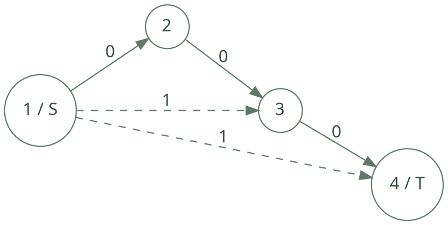

[[TOC]]

## 走得步数少，不一定付费少

在 [[[rbook: bfs]]] 中，每走一条边都花费 $1$，所以最少步数就是最小代价。

现在道路分两种：一类免费，边权为 $0$；另一类要花费一次，边权为 $1$。目标变成最少付费次数，而不是最少经过几条边。

看下面这张有向图：



直接从 $1$ 到 $4$，只走一条边，费用却为 $1$；沿 $1\to2\to3\to4$ 走三条边，总费用反而为 $0$。

**普通 BFS 按边数分层，现在需要按累计费用分层。**

## 为什么不能第一次发现后就永久标记？

假设从顶点 $1$ 扫描出边时，发现了：

- 到 $2$ 的费用为 $0$；
- 到 $3$ 的费用为 $1$；
- 到 $4$ 的费用为 $1$。

但随后扩展 $2$ 时，发现 $1\to2\to3$ 的费用为 $0$，需要把 `dist[3]` 从 $1$ 改成 $0$。再扩展 $3$，又能把 `dist[4]` 改成 $0$。

如果仍然使用“只要发现过就不更新”的条件，这两次改进都会被挡掉。

因此，判重条件需要改成**距离松弛**：

```cpp
if (dist[u] + w < dist[v]) {
    dist[v] = dist[u] + w;
    // 记录新的待处理条目
}
```

::: definition 松弛
已经知道一条到 $u$ 的路线，费用为 `dist[u]`。沿权值为 $w$ 的边走到 $v$，就得到一条费用为 `dist[u] + w` 的候选路线。

若这比目前记录的 `dist[v]` 更小，就更新它。第一次发现只说明“找到了一条路”；在距离最终确定之前，还可以找到更便宜的路。
:::

## 双端队列的规则：0 权放队头，1 权放队尾

设当前准备扩展的条目距离为 $d$：

- 沿 $0$ 权边成功更新的邻居，距离仍为 $d$，应当尽快处理；
- 沿 $1$ 权边成功更新的邻居，距离为 $d+1$，可以排在后面。

用 `deque` 双端队列，就能分别从队头、队尾插入：

```cpp
if (w == 0) dq.push_front({next_dist, v});
else dq.push_back({next_dist, v});
```

双端队列和普通队列相比，增加了向队头插入的能力。这里用它维持的不是到达顺序，而是**待处理条目的距离顺序**。

## 队列里为什么保存距离快照？

同一个点可能先以费用 $1$ 入队，随后又以费用 $0$ 入队。旧条目不会自动消失。

本文让每个条目保存 `(入队时的距离, 顶点)`。例如 `3@1` 表示“顶点 3 以距离 1 入队”，而 `3@0` 是后来产生的新条目。

弹出旧条目时，只需比较：

```cpp
auto [d, u] = dq.front();
dq.pop_front();
if (d != dist[u]) continue;
```

如果现在 `dist[3]` 已经为 $0$，那么 `3@1` 已经过期，直接跳过，不再重复扩展它的邻边。

::: note 队列顺序比较的是快照，不是不断变化的 dist
一个旧的 `3@1` 可以留在队尾，而当前 `dist[3]` 已经变成 $0$。因此不要把队列里的编号全部替换为“它现在的 dist”，再声称那些数字始终有序。

本文维持有序的是条目保存的距离快照；过期条目出队时被丢弃。
:::

## 观察距离如何从 1 改成 0

[[[animate: ./zero-one.animation.ts]]]

动画使用开头的四点图。上方显示距离和有向边，下面显示双端队列，**左侧是队头**。

顶点 $1$ 的出边依次扫描到 $2,3,4$，几个关键状态为：

| 操作 | 操作后的队列：队头 → 队尾 | 发生的距离变化 |
| --- | --- | --- |
| 扩展 1 的出边 | `2@0, 3@1, 4@1` | 首次发现三个邻居 |
| 从 2 沿 0 权边更新 3 | `3@0, 3@1, 4@1` | `dist[3]` 从 1 变为 0 |
| 从 3 沿 0 权边更新 4 | `4@0, 3@1, 4@1` | `dist[4]` 从 1 变为 0 |
| 弹出有效的 `4@0` | `3@1, 4@1` | 顶点 4 的最短距离确定为 0 |
| 弹出两个旧条目 | 空 | 距离快照不匹配，均跳过 |

这个例子同时说明：**一个点可以多次入队，但它的最短距离在有效出队时才确定。**

## 为什么双端队列能代替“找最小距离”？

### 不变量：快照按非降序排列

初始只有起点，距离快照为 $0$。

假设正在弹出的条目快照为 $d$。此时队列中尚存的快照只可能为 $d$ 或 $d+1$，并且按非降序排列。

- 若条目过期，丢掉它，不插入新条目，顺序不变；
- 若条目有效，沿 $0$ 权边产生的新快照为 $d$，放到队头；
- 沿 $1$ 权边产生的新快照为 $d+1$，放到队尾。

两种插入都不会破坏顺序，队列仍然只包含当前层与下一层。若当前层已经取完，下一层自然成为新的当前层。

因此每次有效出队时，取出的都是还待处理的最小距离。

### 有效出队时，距离为什么最终确定？

::: proof 最短路径上的第一个尚未确定的点
设顶点 $u$ 有效出队时，快照为 $d=dist[u]$。假设还存在一条到 $u$ 的路径，费用为 $d'<d$。

在这条路径上，找到第一个还没有效出队、因而距离尚未最终确定的顶点 $y$。它前面的顶点 $x$ 已经确定，并且已扫描过边 $x\to y$。

所以到 $y$ 的候选费用已经被用于松弛。因为边权非负，这个候选费用不超过整条路径的费用 $d'<d$。对应的条目，或者后来产生的更小条目，应当比 $u$ 更早有效出队。

这与 $y$ 仍然尚未确定矛盾。因此 $u$ 的当前距离就是最短距离。

起点的距离为 $0$，没有负权边能把它改得更小，从起点开始即可逐次应用这个论证。
:::

学过 [[[rbook: dijkstra]]] 后会发现，这和“每次取最小距离”的思想一致。区别在于这里的边权结构足够特殊，不用堆，双端队列就能维持顺序。学习本篇不需要先掌握 Dijkstra。

## 通用 C++17 模板

输入第一行是 $n,m,s$，接下来 $m$ 行是有向边 $u,v,w$，其中 $w$ 必须为 $0$ 或 $1$。程序逐行输出从 $s$ 到各点的最小费用，不可达输出 `-1`。

```cpp file=./zero_one_bfs.cpp
```

邻接表使用 `vector<Edge> g[maxn]`，距离使用 `int dist[maxn]`。调用 `zero_one_bfs(n, s)` 后，结果保存在 `dist` 中；点数须小于 `maxn`。

几点需要和普通 BFS 区分：

1. 距离初始为 `INF`，因为发现过的点仍可能继续改进。
2. 必须使用严格的小于号；等长路线无须再次入队。
3. 只有距离成功变小时才插入新条目。
4. 每次弹出时先检查快照是否过期，过期条目不扫描邻边。

### 复杂度不能照搬“每个点只入队一次”

一个点确实可能多次入队。

但每个顶点第一次有效出队后，距离就已经最终确定，不会再变小。因此它的出边只会在这次有效出队时扫描一次，总扫描次数为 $O(m)$。

每次成功松弛都来自一次边扫描，最多生成一个新条目。因此总条目数最多为 $m+1$，包括后来要跳过的旧条目。双端队列的每次插入、弹出为 $O(1)$，再加上距离初始化，**总时间为 $O(n+m)$**。

按有效数据计，邻接表、距离和待处理条目合计占用 $O(n+m)$ 空间；定长数组另按 `maxn` 预留容量。这个界允许队列中存在重复顶点，不需要假装重复条目不存在。

## 完整例题：洛谷 P1346 电车

题目：[[[p: luogu-P1346 | 电车]]]。

有 $N$ 个路口，每个路口的开关默认指向某一条出轨。走默认轨道不用切换；想走其它轨道，需要切换一次。求从路口 $A$ 到 $B$ 最少需要切换多少次，无法到达输出 `-1`。

第一行是 $N,A,B$，满足 $2\le N\le100$、$1\le A,B\le N$。随后 $N$ 行，每行先给出出轨数量 $K_i$，再给出各条轨道通向的路口；**列出的第一条轨道就是默认方向**。

### 一条边应该花多少钱？

从路口 $u$ 出发：

- 走第一条出轨，费用为 $0$；
- 走其它出轨，费用为 $1$。

这样就构成一张有向的 0/1 边权图。只在输入方向加边，不能因为两点之间有轨道就补上反向边。

从任意行程中去掉绕行的环，可以得到一条简单路径。路径上每个使用非默认出边的路口，在原行程中都至少切换过一次；因此这条路径按 0/1 边权计算的费用，不会超过原行程的切换总数。按这条简单路径执行时，每个路口只经过一次，又恰好能实现这个费用。

所以存在不重复路口的最优行程，无需枚举整张网络的开关状态，按默认出轨给每条有向边赋权即可。

```text
输入：
3 2 1
2 2 3
2 3 1
2 1 2

输出：
0
```

从 $2$ 沿默认轨道到 $3$，再沿默认轨道到 $1$，总切换次数为 $0$。直接从 $2$ 到 $1$ 虽然只经过一条轨道，却需要切换一次。

### 完整 C++17 实现

```cpp file=./main.cpp
```

`K_i=0` 表示没有出轨；起点等于终点时答案自然是 $0$。两种情况都不需要另写特殊的搜索流程。

## 需要还原路线时怎么办？

在严格松弛成功的分支中记录 `parent[v] = u`，然后按普通 BFS 的方法从终点回退。

区别是：普通 BFS 在第一次发现时记录前驱；0-1 BFS 在找到更短路线时需要**同时更新前驱**。不能只更新距离，却保留费用更高的旧前驱。

## BFS、0-1 BFS 和 Dijkstra

| 算法 | 适用边权 | 维护待扩展状态的结构 | 距离何时确定 |
| --- | --- | --- | --- |
| 普通 BFS | 单位边权，或统一正权换算成步数 | 先进先出的队列 | 首次发现、入队时 |
| 0-1 BFS | 只有 0 和 1 | 双端队列 | 取出最小距离的有效条目时 |
| Dijkstra | 一般非负边权 | 常用小根堆 | 取出最小距离的有效条目时 |

三者都利用了“优先处理距离更小的状态”，但能维持顺序的数据结构不同。

如果边权不再只有 0 和 1，本文的队头、队尾规则就没有上述保证。所有边权相同仍可以按步数换算；一般非负边权可继续学习 [[[rbook: dijkstra]]]。有负边则需要另外选择算法。

## 易错点与自查

| 情形 | 正确处理 |
| --- | --- |
| 发现过的点还有更短路线 | 允许严格松弛，不能在首次入队时永久封死 |
| 0 权自环或 0 权环 | 使用 `<`；等距不更新，避免无意义重复入队 |
| 同一个点有新旧两个条目 | 保存入队快照，旧条目出队时跳过 |
| 想提前到终点就结束 | 在终点**有效出队**时可结束，不能在首次发现时结束 |
| 图中存在 2、3 等其它边权 | 重新判断适用条件，不能照搬 0/1 插入规则 |
| 无法到达终点 | 距离保持 INF，按题面输出 -1 |

最后不看代码，解释四件事：为什么 0 权放队头？为什么首次发现不能确定距离？为什么快照过期就能跳过？为什么有重复条目仍然是线性时间？
