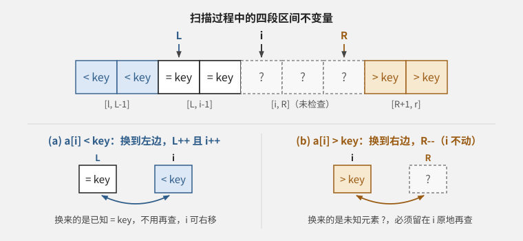

[[TOC]]

## 题意

给定一个长度为 $n$ 的数组，将其按从小到大的顺序排列。

::: definition 快速排序（三路划分）
在区间 $[l,r]$ 中选定一个基准值 $key$，通过一次线性扫描将元素重新排列为连续的三段：

$$
[\text{严格小于 }key]\;\big|\;[\text{等于 }key]\;\big|\;[\text{严格大于 }key].
$$

中间等于 $key$ 的一段已经处于最终位置，无需再排；只需递归排序左右两段即可。
:::

## 从三个桶到原地划分

最直观的实现是开三个辅助数组分桶：把比 `key` 小的放进 `L`，相等的放进 `M`，比 `key` 大的放进 `R`，递归排好 `L` 和 `R` 后按 `L + M + R` 拼回来。

辅助数组写法思路最简单，但每次递归都要申请额外空间。**如何在原数组 $[l,r]$ 上直接完成三段划分？**

只需要三个指针 `L`、`i`、`R`：

- `L`：指向“等于区”的左边界（`[l, L-1]` 全都 `< key`）；
- `R`：指向“大于区”的前一个位置（`[R+1, r]` 全都 `> key`）；
- `i`：当前正在检查的位置（`[i, R]` 尚未检查）。

## 三指针与四段区间

初始时，三段都为空，全部元素都未检查，因此指针直接从区间两端出发：

```cpp
int L = l, R = r, i = l;
```

扫描过程中（`while (i <= R)`），指针把 $[l,r]$ 始终维持成四段不变量：



每次查看 `a[i]`，只有三种情况：

1. **`a[i] < key`**：把 `a[i]` 换到左边，`swap(a[i], a[L])`，然后 **`L++` 且 `i++`**。  
   因为 `L <= i`，`a[L]` 原先位于 `[L, i-1]`（已知 `== key`）或就是 `a[i]` 本身，换过来之后无需再检查，`i` 可以放心右移。
2. **`a[i] > key`**：把 `a[i]` 换到右边，`swap(a[i], a[R])`，然后 **`R--`（`i` 不动）**。  
   因为 `a[R]` 来自尚未检查的 `[i, R]`，换到 `i` 位置后可能是任何大小，必须留在原地再检查一次。
3. **`a[i] == key`**：它本来就属于中间段，直接 **`i++`**。

当 `i > R` 时，未检查区域 `[i, R]` 变为空集，此时 `[l, L-1]` 严格小于 `key`，`[L, R]` 全部等于 `key`，`[R+1, r]` 严格大于 `key`。

## 交互演示

下面的演示支持自定义输入（例如全相等或含大量重复元素的数组）。点击「下一步」可以观察 `L`、`i`、`R` 如何把数组分成三段并只递归两侧：

[[[animate: ./quicksort-3way.animation.ts]]]

## 代码实现

把基准值选为区间内的随机元素 `key = a[l + rand() % (r - l + 1)]`，核心代码只有 10 行，边界完全对称：

```cpp
void quick_sort(int l, int r) {
    if (l >= r) return;
    int key = a[l + rand() % (r - l + 1)];
    int L = l, R = r, i = l;
    while (i <= R) {
        if (a[i] < key)      swap(a[i++], a[L++]);
        else if (a[i] > key) swap(a[i], a[R--]);
        else                 i++;
    }
    quick_sort(l, L - 1);
    quick_sort(R + 1, r);
}
```

### 为什么绝不会死循环

由于 `key` 本身取自区间 $[l, r]$，划分结束后中间段 `[L, R]` **至少包含 `key` 这 1 个元素**。因此左右两段 `[l, L-1]` 与 `[R+1, r]` 的长度都严格小于 $r - l + 1$，递归必然收敛到边界 `l >= r`。

随机选择基准值后，期望时间复杂度为 $O(n\log n)$，空间复杂度为 $O(\log n)$（递归栈）。如果所有元素都相等，一趟扫描后 `L = l, R = r`，两侧区间都为空，时间复杂度直接退化为更优的 $O(n)$。

::: fold 完整代码
```cpp file=./code/quick_sort_3way.cpp
```
:::

## 与经典二路快排的对比

传统二路快排（见 [[[rbook: quicksort]]]）只把区间分成“$\le key$”和“$\ge key$”两段，没有把等于 `key` 的元素单独拎出来。也可以配合外部动画查看二路指针的交换过程：

[[[dsa: quickSort]]]

二路写法的循环体更短，但边界更容易写错：指针必须从 `l - 1` 和 `r + 1` 出发，移动后再交换，且返回分界点 `j` 时递归区间必须写成 `(l, j)` 与 `(j + 1, r)`（不能误写成 `(l, j - 1)`，也不能随便改用 `a[r]` 作基准值，否则容易出现一侧为空的死循环）。三路快排多用一个指针，但边界全对称且绝不死循环。
