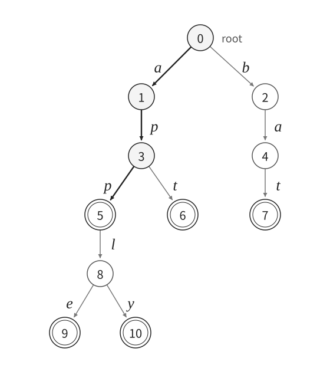

[[TOC]]

## 从逐个比较到共享前缀

维护一批字符串，支持三种操作：插入一个字符串、判断一个完整字符串是否出现过、统计有多少字符串以某个前缀开头。本文先限定字符为小写字母 `a` 到 `z`，**重复插入按次数统计**。

最直接的做法是把字符串放进数组。询问前缀 `app` 时，就把它与每个字符串的开头比较。若共有 $n$ 个字符串，前缀长为 $L$，一次询问最坏需要 $O(nL)$ 时间。

观察 `app`、`apple`、`apply`：它们开头的三个字符完全相同。如果把这段公共前缀只存一份，查找时走到 `app`，就已经同时找到了这三个字符串的共同入口。

::: algorithm Trie 的一句话
把字符串的公共前缀合并成树上的同一段路径；插入和查询都从根出发，每读一个字符，就沿对应的边走一步。
:::

## 一条路径表示一个前缀

::: definition Trie（字典树）
Trie 是一棵有根树。每条边代表一个字符，同一节点的出边字符互不相同；从根到某个节点的路径上，字符依次拼接成一个前缀。根表示空串。
:::

**节点表示前缀，边表示字符。** 节点编号只是程序中访问节点的位置，同一个字符可以出现在不同的边上。

把 `app`、`apple`、`apply`、`apt`、`bat` 插入后，得到下面这棵树。加粗的三条边表示公共前缀 `app`，双圈表示有完整字符串在这里结束。



沿根到 $5$ 号节点的路径读出 `app`。它本身是一个完整字符串，但还能沿 `l` 继续到 `appl`，再沿 `e` 或 `y` 到达 `apple`、`apply`。`apt` 在前缀 `ap` 后改走 `t`；`bat` 则从根开始走另一条分支。图中的编号用于区分节点，不要求与插入时的创建顺序一致。

::: warn 路径存在，不等于完整字符串存在
只插入 `apple` 时，`a`、`ap`、`app` 的路径都会存在，但它们没有被作为完整字符串插入过。因此，必须另外记录「字符串在这里结束」。
:::

## 节点维护什么

每个节点保存三类信息：

| 字段 | 含义 | 用途 |
| --- | --- | --- |
| `ch[c]` | 沿字符 `c` 到达的孩子节点编号 | 沿字符查找下一步 |
| `pass` | 拥有当前前缀的字符串数量，按插入次数统计 | 前缀计数 |
| `end` | 恰好在当前节点结束的字符串数量 | 完整字符串查询、重复次数统计 |

对于图中的五个字符串，部分节点的数据如下。表中的「前缀」由根到节点的路径确定，程序不需要把它再存一份。

| 节点 | 前缀 | `pass` | `end` |
| --- | --- | --- | --- |
| 0 | 空串 | 5 | 0 |
| 1 | `a` | 4 | 0 |
| 3 | `ap` | 4 | 0 |
| 5 | `app` | 3 | 1 |
| 8 | `appl` | 2 | 0 |
| 9 | `apple` | 1 | 1 |
| 6 | `apt` | 1 | 1 |
| 7 | `bat` | 1 | 1 |

`pass` 和 `end` 回答的是两个不同的问题：有多少字符串**以它开头**，以及有多少字符串**恰好等于它**。例如 `appl` 的 `pass = 2`，但 `end = 0`。

如果再插入一次 `app`，只需复用原路径：根、`a`、`ap`、`app` 的 `pass` 各加一，`app` 的 `end` 从 $1$ 变成 $2$，**不创建任何新节点**。

## 三种基本操作

### 插入字符串

以插入 `apt` 为例：

1. 从根出发，根的 `pass` 加一，表示又插入了一个字符串。
2. 读入 `a`。若没有对应的边，就新建孩子；走过去，该节点的 `pass` 加一。
3. 对 `p`、`t` 重复同样的操作。已有路径直接复用，缺少哪一段就创建哪一段。
4. 所有字符处理完毕，在当前节点令 `end` 加一。

::: note 为什么每次都从根开始
根表示空串，第一条边对应字符串的第一个字符。若沿用上一次操作结束时的位置，就把新字符串接在了旧前缀后面。
:::

### 查询完整字符串

从根出发，依次沿查询串的字符走。如果中途缺少某条边，立即返回不存在；如果走完全部字符，再检查末尾节点的 `end > 0`。

例如查询 `ap`：虽然能从根走到 $3$ 号节点，但这里 `end = 0`，所以答案是不存在。查询 `app` 则在 $5$ 号节点结束，`end = 1`，答案是存在。

### 查询前缀数量

仍然从根出发，沿前缀走。如果中途断路，返回 $0$；否则返回末尾节点的 `pass`。

例如查询前缀 `app`，走到 $5$ 号节点就可以返回 $3$。**不需要再遍历它的子树**，因为插入时已经把经过这里的次数累计好了。

## 为什么这些操作正确

::: theorem 节点计数的不变量
对任意节点 $u$，设根到 $u$ 的路径表示前缀 $p$。则 `pass[u]` 等于以 $p$ 开头的已插入字符串数量，`end[u]` 等于恰好等于 $p$ 的已插入字符串数量，两者都按插入次数统计。
:::

初始时只有根，所有计数为 $0$，结论成立。每插入一个字符串，它恰好经过自身所有前缀对应的节点，因此只给这些节点的 `pass` 加一；同时只在完整字符串对应的节点给 `end` 加一。其他节点不变，所以不变量始终成立。

查询时，相同字符从同一节点出发只能选择同一条边，因此一个前缀最多对应一个节点。路径不存在，说明没有任何插入的字符串具有这个前缀；路径存在，则根据不变量，检查 `end` 或读取 `pass` 就能得到所需答案。

## 代码模板

C++ 使用固定大小的孩子数组，字符范围为 `a` 到 `z`。$0$ 号节点是根，孩子编号为 $0$ 表示边不存在；根不会成为任何节点的孩子，因此两个含义不会冲突。

Python 使用字典存储实际存在的字符边，并把 `pass` 命名为 `pass_count`，因为 `pass` 是 Python 关键字。两个版本使用相同接口：`insert`、`contains`、`count_prefix`。

```cpp [trie-template:C++] file=./code/trie.cpp
```
```py [trie-template:Python] file=./code/trie.py
```

::: warn C++ 的动态数组可能重新分配内存
`vector` 新增节点时可能扩容，使原有元素的引用失效。不要把 `tree[u].ch[c]` 的引用保留到 `emplace_back()` 之后再使用。模板先保存孩子编号，再创建节点，随后按编号访问。
:::

模板也能处理空串：根的 `pass` 是插入总次数，根的 `end` 是空串插入次数。下面的完整程序按空白分隔输入，所以只读入非空字符串。

## 完整程序与样例

输入第一行是 $n,q$，接着输入 $n$ 个非空小写字符串，再输入 $q$ 次询问：

- `1 s`：判断完整字符串 `s` 是否出现，输出 `Yes` 或 `No`。
- `2 s`：统计有多少字符串以 `s` 为前缀，输出数量。

```cpp [trie-solution:C++] file=./code/trie_solution.cpp
```
```py [trie-solution:Python] file=./code/trie_solution.py
```

输入：

```text
5 7
app
apple
apply
apt
bat
1 app
1 ap
2 app
2 ap
2 ba
1 bat
2 cat
```

输出：

```text
Yes
No
3
4
1
Yes
0
```

其中 `ap` 的路径存在，却不是完整字符串；前缀 `ap` 对应 `app`、`apple`、`apply`、`apt`，所以计数为 $4$。

## 时间与空间复杂度

设单次操作的字符串长度为 $L$，所有插入字符串的总长度为 $S$，字符集大小为 $\Sigma$。

| 操作 | 固定孩子数组 | 字典存孩子 |
| --- | --- | --- |
| 插入 | 新建节点时初始化孩子数组，摊还 $O(1+\Sigma L)$ | 期望摊还 $O(L+1)$ |
| 完整字符串查询 | $O(L+1)$ | 期望 $O(L+1)$ |
| 前缀计数 | $O(L+1)$ | 期望 $O(L+1)$ |

本文 C++ 的 $\Sigma=26$ 是常数，因此对非空字符串，三种操作通常都记为 $O(L)$；`vector` 扩容的代价按多次插入摊还计算。查询的时间不再随已插入字符串的数量线性增长。

每插入一个字符，最多创建一个节点，所以节点数至多为 $S+1$（加上根）。固定数组版空间为 $O(\Sigma(S+1))$，字典版只存实际存在的边，空间为 $O(S+1)$，但每条字典记录的实际内存开销比整数数组大。

::: note Trie 与哈希表如何选择
如果只判断完整字符串是否出现，哈希集合通常更简洁。Trie 的优势在于同一个结构还可以处理前缀计数、沿字符逐位选择，以及按字符顺序遍历。
:::

## 从基本 Trie 继续扩展

### 集合查询与重复访问标记

先把字典中的单词插入，再对询问串检查 `end`。如果题目还要求区分「第一次询问」与「重复询问」，需要在终止节点另加访问标记；它与表示插入次数的 `end` 是两件事。

### 前缀统计与字典序

前缀计数直接使用 `pass`。若需要按字典序输出字符串，可以从根开始，按字符从小到大的顺序遍历孩子；到达 `end > 0` 的节点时先输出当前字符串，再继续访问孩子，因为一个字符串排在它的真扩展之前，例如 `app` 排在 `apple` 前面。

### 最长公共前缀与最近公共祖先

把两个字符串对应的节点记为 $u,v$。从根出发，它们先共用一段路径，随后才分叉，因此 $u,v$ 的最近公共祖先对应的前缀，恰好就是这两个字符串的**最长公共前缀**。LCA 的深度等于这个公共前缀的长度，根的深度为 $0$。

例如 `apple` 与 `apply` 对应节点 $9,10$，LCA 为 $8$ 号节点，路径表示 `appl`，长度为 $4$。`app` 与 `apple` 中，前者本身就是后者的前缀，所以 LCA 正是表示 `app` 的节点。

如果题目要对许多字符串反复查询最长公共前缀，可以考虑在建好 Trie 后预处理 LCA；只有少量查询时，直接逐字符比较更简单。

### 01-Trie 与异或最值

把非负整数写成固定长度的二进制串，字符集就只有 $0,1$。求与某个数异或的最大值时，从高位到低位，优先走相反位；该分支不存在，再走相同位。最高个不同位决定大小，因此每一步都优先让当前异或位为 $1$。

### AC 自动机的基础

如果有许多模式串，需要一起在长文本中匹配，先用 Trie 保存这些模式串，再增加失配指针，就得到 AC 自动机的基础结构。Trie 的基本查询从根匹配一个字符串；多模式匹配还需要处理文本扫描时的失配跳转。

## 推荐练习

- [[[p: luogu-P2580 | 于是他错误的点名开始了]]]：完整字符串查询，并额外记录是否已被点名。
- [[[p: luogu-P4551 | 最长异或路径]]]：进阶，把树上路径异或转为两个根路径异或，再使用 01-Trie。
- [[[p: luogu-P3808 | 【模板】AC 自动机（简单版）]]]：进阶，在 Trie 基础上学习多模式串匹配。
