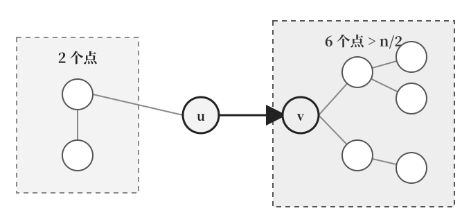
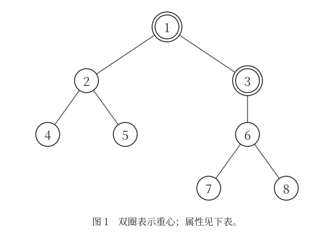
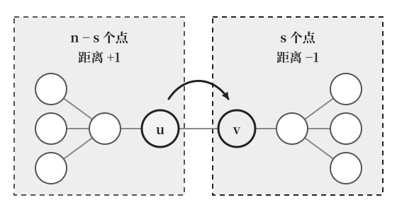

[[TOC]]

::: oneWordAlgo

删掉一个点，看剩下的最大连通块有多大；让这个最大块尽量小的点，就是树的重心。一次 DFS 统计子树大小，就能在线性时间内找出全部重心。

:::

阅读前建议先掌握 [[[rbook: tree_base]]] 和 [[[rbook: dfs_order]]] 中的子树大小。本文先从删点后的连通块出发，推导判定式，再说明重心的性质，给出可复用模板与完整程序。模板的预处理与 [[[rbook: hld]]] 同形：如果你已经为别的操作做过树链剖分，重心几乎可以白拿。

## 问题模型

给定一棵有 $n$ 个节点的无权树，节点编号为 `1..n`。删除节点 $u$ 以及与它相连的边后，树会分成若干个连通块。

记这些连通块的最大点数为 $B(u)$。**使 $B(u)$ 最小的点称为树的重心**，答案可能不止一个。单点树删除唯一的节点后没有剩余连通块，约定此时 $B(u)=0$。

重心还有一个等价判定：

$$
u\text{ 是重心}\quad\Longleftrightarrow\quad B(u)\leqslant\left\lfloor\frac n2\right\rfloor.
$$

这里比较的是原树节点数的一半，即 `n / 2`，不是剩余节点数的一半。本文先按“最大块最小”求解，再证明两个定义为什么等价。

## 核心直觉

想象删除一个路口后，树被切成几片。重心要控制的是**最大那一片的点数**，而不是路口的度数、到叶子的距离或画面上的位置。

如果从某个点看出去，有一个方向包含超过一半的节点，那么树向这个方向偏重。沿该方向移动一步，原来的大块会缩小，而身后那一块不足一半，最大块就会变小。



图中 $n=9$，删除 `u` 后的最大块有 `6` 个点。向相邻点 `v` 移动后，`u` 方向只有 `3` 个点，其余块都来自原来的 `6` 个点，并且不再包含 `v`，因此 $B(v)<6$。

这个观察解释了“为什么向大块走”。实际求全部重心时，无需逐点尝试删树：只要知道每个方向有多少点，就能直接计算 $B(u)$。

## 从子树大小得到判定式

任选一个点作为 DFS 的根，例如 `1`。设 `sz[u]` 是 `u` 的子树大小，**包含 `u` 自己**。

删除 `u` 后，各方向的连通块只有两类：

| 方向 | 连通块大小 | 原因 |
|---|---|---|
| 每个儿子 `v` 的方向 | `sz[v]` | `v` 的整棵子树仍连通 |
| 父亲方向 | `n - sz[u]` | `u` 的子树以外，所有节点仍连通 |

因此：

$$
B(u)=\max\left(\{n-sz[u]\}\cup\{sz[v]\mid v\text{ 是 }u\text{ 的儿子}\}\right).
$$

根没有父亲，`n - sz[root] = 0`，公式仍然成立。叶子没有儿子，最大块就是父亲方向的 `n-1` 个点；单点树则得到 `0`。

::: warning

只检查儿子会漏掉父亲方向。`sz[u]` 必须先累加完整，再计算 `n - sz[u]`；否则算到的并不是删除 `u` 后的连通块大小。

:::

### 用一棵树算一遍

以下面这棵树为例，以 `1` 为 DFS 根。图中双圈表示重心，节点内部仅显示原编号。



| 节点 `u` | `sz[u]` | 儿子方向的块大小 | 父亲方向 `n - sz[u]` | `B(u)` | 是否为重心 |
|---|---|---|---|---|---|
| 1 | 8 | 3、4 | 0 | 4 | 是 |
| 2 | 3 | 1、1 | 5 | 5 | 否 |
| 3 | 4 | 3 | 4 | 4 | 是 |
| 4 | 1 | 无 | 7 | 7 | 否 |
| 5 | 1 | 无 | 7 | 7 | 否 |
| 6 | 3 | 1、1 | 5 | 5 | 否 |
| 7 | 1 | 无 | 7 | 7 | 否 |
| 8 | 1 | 无 | 7 | 7 | 否 |

最小的平衡值是 `4`，在节点 `1、3` 取得。删除 `1` 后，两块大小为 `3、4`；删除 `3` 后，两块大小为 `4、3`，都不超过 $n/2=4$。

节点 `2` 的两个儿子都只有 `1` 个点，但它不是重心，因为父亲方向还有 `5` 个点。换一个 DFS 根会改变 `sz` 和父子关系，却不会改变删点后的真实连通块，所以 `B(u)` 和重心集合与 DFS 根无关。

## 关键数组与算法步骤

| 名称 | 含义 |
|---|---|
| `g[u]` | 节点 `u` 的邻接表 |
| `fa[u]` | DFS 中 `u` 的父亲，根的父亲为 `0` |
| `sz[u]` | 以当前 DFS 根为准的子树大小 |
| `son[u]` | `u` 的重儿子，即子树最大的儿子，叶子为 `0`；与树链剖分里的同名数组一致 |
| `balance[u]` | 删除 `u` 后的最大连通块大小，即 $B(u)$ |
| `best` | 所有 `balance[u]` 的最小值 |
| `ans` | 全部重心，按编号升序排列 |

按照递归 DFS 的思路，处理一个节点只需要下面几步：

```text
dfs1(u, father):
    fa[u] = father
    sz[u] = 1
    son[u] = 0
    对每个儿子 v:
        dfs1(v, u)
        sz[u] += sz[v]
        若 sz[v] > sz[son[u]]，则 son[u] = v
    balance[u] = max(sz[son[u]], n - sz[u])
```

这里多维护了一个 `son[u]`。因为它是“子树最大的儿子”，儿子方向的最大块恰好就是 `sz[son[u]]`，所以 `balance[u]` 在回溯时一次就能算完，不需要再存一份访问顺序逆着扫第二遍。处理完所有节点后，先找最小的 `balance[u]`，再按编号扫描，收集所有取到最小值的节点。

### 递归 dfs1：和树链剖分同一套预处理

C++ 模板直接沿用 [[[rbook: hld]]] 的写法：`const int maxn` 加全局数组、递归 `dfs1`，一遍 DFS 同时得到 `fa`、`sz`、`son`、`balance`。这样写的实际好处是**重心可以寄生在 HLD 的预处理上**：如果题目已经为了路径操作做过剖分，`sz` 和 `son` 早就在手，求重心只多一行赋值和一次扫描。

代价是递归深度。链形树的 `dfs1` 会递归 $n$ 层：C++ 在默认 8MB 栈下 $n=10^5$ 的链通常能过（与 HLD 模板同等风险）；Python 的默认递归上限只有一千左右，所以 Python 模板仍用显式栈逆序汇总，不依赖递归深度。

### 沿重链走：不扫全树也能找到重心

有了 `son`，还可以换一种收集方式。从 `build` 的根出发，只要重儿子的子树还**超过**一半就继续往下走：

```text
u = root
while son[u] != 0 且 2 * sz[son[u]] > n:
    u = son[u]
此时 u 是重心；若 2 * sz[son[u]] == n，son[u] 也是重心
```

这既是 HLD 味道最重的写法，也解释了“重心为什么总在重链上”。复杂度是 $O(\text{重链长度})$，最好情况下远小于扫全树；但它依赖 `sz` 和 `son` 已经按同一个根算好，所以放在 `build` 之后用。

## 算法证明

### 子树大小与最大块都计算正确

叶子的子树只有自己，`sz[u]=1`。对于非叶子，递归回溯时（Python 版是逆序扫描时）每个儿子的子树大小都已正确算出。`u` 的子树恰好由自己与所有儿子的子树组成，因此：

$$
sz[u]=1+\sum_{v\text{ 是 }u\text{ 的儿子}}sz[v].
$$

树上两点之间只有一条简单路径。删除 `u` 后，不同儿子方向无法再相互连通，父亲方向也无法绕到某个儿子方向。因此上面的各块恰好覆盖全部剩余节点，既不遗漏也不重叠，`balance[u]` 就是 $B(u)$。

扫描所有节点并取 $B(u)$ 的最小值，得到的就是定义要求的全部重心。

### 为什么重心的最大块不超过一半

设 `u` 已经使 $B(u)$ 最小，却有一个连通块 $C$ 的大小 $m>n/2$。取 $C$ 中与 `u` 相邻的节点 `v`。

删除 `v` 后，朝 `u` 方向的块有 $n-m<m$ 个点；其他块都包含在 $C\setminus\{v\}$ 中，每块至多 $m-1$ 个点。因此 $B(v)<m=B(u)$，与 `u` 的最小性矛盾。

所以任何重心都满足 $B(u)\leqslant n/2$。有限个节点中必然存在最小值，这也说明每棵非空树都存在重心。

### 为什么不超过一半就已经最优

设 $B(u)\leqslant n/2$，任取另一个点 `v`。删除 `u` 后，包含 `v` 的块记为 $C$，大小为 $s$，则 $s\leqslant B(u)$。

删除 `v` 时，$C$ 以外的所有节点仍通过 `u` 连成一块，至少有 $n-s$ 个点。因此：

$$
B(v)\geqslant n-s\geqslant n-B(u)\geqslant B(u).
$$

所以任何其他点都不能比 `u` 更好，`u` 就是重心。结合前一节，两个定义等价。

### 为什么重心在根出发的重链上

设当前点 `u` 的重儿子 `v` 满足 $2\,sz[v]>n$。

先看 `u`：$B(u)\geqslant sz[v]>n/2$，所以 `u` 不是重心。

再看 `v` 子树以外的任意点 `x`：删除 `x` 后，`v` 的整棵子树仍然连通（`x` 不在其中），所以包含它的块至少有 $sz[v]>n/2$ 个点，`x` 也不是重心。

于是重心只能藏在 `v` 的子树里，而 `v` 就是重儿子。不断重复这个判断，重心只能沿着“根 → 重儿子 → 重儿子 → …”这条重链往下走，不会拐进任何轻儿子。

停在第一个满足 $2\,sz[son[u]]\leqslant n$ 的点 `u` 上时，它一定满足平衡条件：可以从重链上走下来，说明来自父亲方向的那块超过一半，因此 $n-sz[u]<n/2$（`u` 就是根时没有父亲方向，$n-sz[u]=0$ 同样成立）；而儿子方向最大块就是 $sz[son[u]]\leqslant n/2$。两个方向都不超过一半，`u` 就是重心。

## 复杂度分析

- 时间复杂度：$O(n)$。一次 `dfs1` 汇总 `sz`、`son`、`balance`，再线性扫一遍收集答案，都只处理线性数量的节点或边。沿重链走的写法额外花 $O(\text{重链长度})\leqslant O(n)$，且不必扫全树。
- 空间复杂度：$O(n)$。邻接表与 `fa`、`sz`、`son`、`balance` 均占线性空间；C++ 版不再需要访问顺序和显式栈两个数组。
- 递归栈：C++ 的 `dfs1` 在链形树上会递归 $n$ 层，这部分开销计入空间，最坏也是 $O(n)$；Python 版用显式栈，不受语言递归上限影响。

答案由按编号扫描得到，因此无需额外排序。

## 代码模板

两份模板的预处理思路相同（一遍 DFS 求出 `sz`，用重儿子表示儿子方向的最大块），但接口按语言习惯分开：C++ 沿用 HLD 的全局数组加 `dfs1`/`build`，Python 用动态列表加显式栈的 `find_centroids`。都不使用 `struct` / `class`。

| C++ 接口 | Python 接口 | 用途 |
|---|---|---|
| `init(n)` | `init(n)` | 清空旧图，每组新数据调用一次；C++ 只清 `g`，其余数组由 `dfs1` 逐点覆写 |
| `add_edge(u, v)` | `add_edge(u, v)` | 添加无向边，两端都会写入邻接表 |
| `build(root=1)` | `find_centroids(root=1)` | 求全部重心，填充 `balance`、`best`、`ans`；Python 版直接返回升序列表 |
| `centroid_on_heavy_path()` | — | 沿重链求重心（至多两个，升序），需在同一次 `build` 之后调用 |
| `balance[u]`、`best` | 同名 | 查询删除某点后的最大连通块大小、以及重心的平衡值 |

C++ 调用顺序是 `init(n)` → 添加 `n-1` 条边 → `build()`，答案在 `ans` 里；Python 是 `init(n)` → 添加 `n-1` 条边 → `find_centroids()` 取返回值。要求 $n\geqslant1$，编号和根均在 `1..n` 内，输入是连通无环的树。可以在同一棵树上更换根重复 `build`，重心集合不会改变；但 `centroid_on_heavy_path()` 依赖最近一次 `build` 的父子关系，要和它配对使用。

```cpp [centroid-template:C++] file=./tree_centroid.cpp
```
```python [centroid-template:Python] file=./tree_centroid.py
```

另一种收集答案的方法是直接检查 `balance[u] <= n / 2`，Python 写成 `balance[u] <= n // 2`。两者与取最小值完全等价；本文保留 `best`，方便需要输出最优平衡值的题目复用。

## 完整代码

输入格式：第一行是节点数 `n`，接下来 `n-1` 行，每行两个整数 `u v`，表示一条无向边。

输出格式：第一行输出重心个数；第二行按编号升序输出全部重心，编号之间用空格分隔。下面两份程序都包含模板和读入输出，可以独立运行。

```cpp [centroid-full:C++] file=./code/tree_centroid.cpp
```
```python [centroid-full:Python] file=./code/tree_centroid.py
```

## 测试用例

### 两个重心

输入：

```text
8
1 2
1 3
2 4
2 5
3 6
6 7
6 8
```

输出：

```text
2
1 3
```

这就是前面的示例树，`best=4`。两个重心相邻，删掉它们之间的边 `(1,3)`，两侧恰好各有 `4` 个点。

### 单点树

输入：

```text
1
```

输出：

```text
1
1
```

此时 `sz[1]=1`、`balance[1]=best=0`，唯一的节点就是重心。

### 星形树

输入：

```text
5
1 2
1 3
1 4
1 5
```

输出：

```text
1
1
```

删除 `1` 后，每个连通块都只有 `1` 个点；删除任意叶子后，剩下 `4` 个点仍连通。因此只有 `1` 是重心。

## 重要性质

### 至少一个，至多两个；若有两个，必定相邻

设 `c` 是重心。如果删除 `c` 后每块都严格小于 $n/2$，那么对任意其他点 `v`，包含 `c` 的反方向至少有 $n-s>n/2$ 个点，所以 `v` 不是重心，重心唯一。

如果某一块 $C$ 恰好有 $n/2$ 个点，设其中与 `c` 相邻的点为 `v`。删除 `v` 后，朝 `c` 的块也恰好有 $n/2$ 个点，其他块更小，所以 `v` 也是重心。

`C` 中更远的点被删除后，包含 `c` 的块还会包含 `v`，其大小至少为 $n/2+1$，不可能是重心。其他方向的点同样不满足条件。又因为删 `c` 后总共只剩 $n-1$ 个点，不可能有两块同时达到 $n/2$，所以第二个重心至多一个。

因此，两个重心之间的边一定把树分成两个等大的部分，双重心只可能出现在偶数个节点的树中。**偶数个节点并不保证有两个重心**，例如 `6` 个节点的星形树仍只有中心节点这一个重心。

### 重心使到所有节点的距离和最小

定义 $F(u)=\sum_x\operatorname{dist}(u,x)$。切开边 `(u,v)` 后，设 `v` 一侧有 $s$ 个点。从 `u` 移到 `v`：

- `v` 一侧的 $s$ 个点，距离各减少 `1`；
- 其余 $n-s$ 个点，距离各增加 `1`。

所以：

$$
F(v)-F(u)=(n-s)-s=n-2s.
$$



若某个方向超过一半，向该方向移动会使距离和减小，所以非重心不可能最优。

从重心 `c` 出发，沿任意路径向外走，第一步前进方向的点数不超过一半；继续前进时，前方的连通块严格缩小，每一步的 $n-2s$ 都非负。因此沿任意路径距离和都不会降低，重心就是全局最优点。两个重心的距离和相同。

### 重心与中心的区别

| 概念 | 优化目标 | 常用求法 |
|---|---|---|
| 树的重心 | 删除节点后，最大连通块的点数最小 | 统计子树大小 |
| 树的中心 | 到其他节点的最大距离最小 | 无权树直径的中点 |

例如链 `1—2—3—4—5`，再在 `1` 上挂四个叶子，总共 `9` 个点。删除 `1` 后最大块有 `4` 个点，`1` 是唯一重心；最长路径从一个新叶子走到 `5`，长 `5` 条边，其中间节点为 `2、3`，它们才是中心。

重心平衡点数，中心控制最远距离。直径中点的知识可参考 [[[rbook: diameter]]]。

### 重心分治为什么只有对数层

在当前大小为 $m$ 的连通块里选一个重心，删除它后，每个子问题至多有 $\lfloor m/2\rfloor$ 个点。因此沿任意递归分支，问题规模至少每层减半，递归深度为 $O(\log n)$。

如果每层对各连通块做线性工作，总时间为 $O(n\log n)$；若每层还有排序等操作，需要另算这部分开销。递归中判断重心必须使用**当前连通块大小**，不能一直用最初的 `n`。本文模板求的是一整棵树的重心，改成点分治时还需要删除标记和连通块遍历。

## 应用分类与经典例题

### 一、删除节点后的平衡问题

题目要求“删除一个点，使最大剩余连通块最小”，直接计算 `balance`。如果只要求输出最优值，输出 `best`；要求最小编号的重心，取 `ans[0]`。

### 二、距离和最小的选址

[[[p: luogu-P1395]]]

选择会议地点，使所有节点到它的距离和最小，可以先找重心，再从这个重心遍历一次，累加距离。求一个最优点及其距离和仍只需 $O(n)$；若题目还要求所有点的距离和，再使用上面的 $F(v)=F(u)+n-2sz[v]$ 做换根统计。

C++ 中距离和应使用 `long long`，因为链上距离和可达到 $O(n^2)$。

### 三、反复拆分树上的路径问题

当需要统计经过某个分治点的路径，再分别处理剩余连通块时，选重心能控制子问题大小。这是重心分治的基础；如何统计跨子树的路径，还要由具体题目决定。

### 四、删边后的重心变化

[[[p: luogu-P5666]]]

对每条边，删除后分别处理两侧连通块的全部重心。每次重新 DFS 会达到 $O(n^2)$，需要进一步利用最大子树方向、换根或倍增复用信息。本文模板适合求一次重心，不能直接在每条边上重跑来解决大规模数据。

## 易错点与扩展

- **不要漏掉父亲方向。** 即使某个点的所有儿子子树很小，`n - sz[u]` 仍可能很大。
- **比较的是整棵树的一半。** 不是 `sz[u] / 2`，也不是 `(n-1) / 2`；整数判定记得包含等号。
- **保留全部答案。** 两个重心可能同时取得最优值，题目要求最小编号时再从中选择。
- **DFS 根不是答案。** 它只用于组织父子关系，换根不改变真实的删点结果。
- **区分点数和距离。** 重心不是重儿子，也不一定是直径中点；度数最大同样不等于重心。
- **重链走法省的是扫描，不是预处理。** 它跳过的是“扫全树找最小值”，`sz` 和 `son` 仍要整棵树算一遂；而且必须和同一次 `build` 配对。

如果节点有非负权值且总权值为正，可以把“点数”替换成“点权和”，相应地统计子树权值和，并把阈值改为总权值的一半。此时需要重新检查想使用的性质：允许零权点时，满足平衡条件的点可能超过两个，不能直接照搬无权树的结论。存在负点权时，上面的平衡与距离和论证也不能直接使用。

## 相关阅读

- [[[rbook: tree_base]]]
- [[[rbook: dfs_order]]]
- [[[rbook: diameter]]]
- [[[rbook: hld]]]
