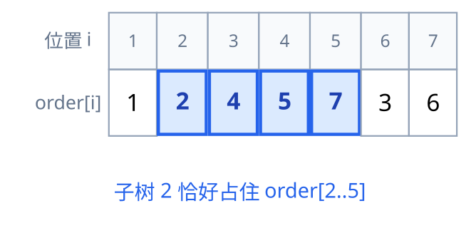
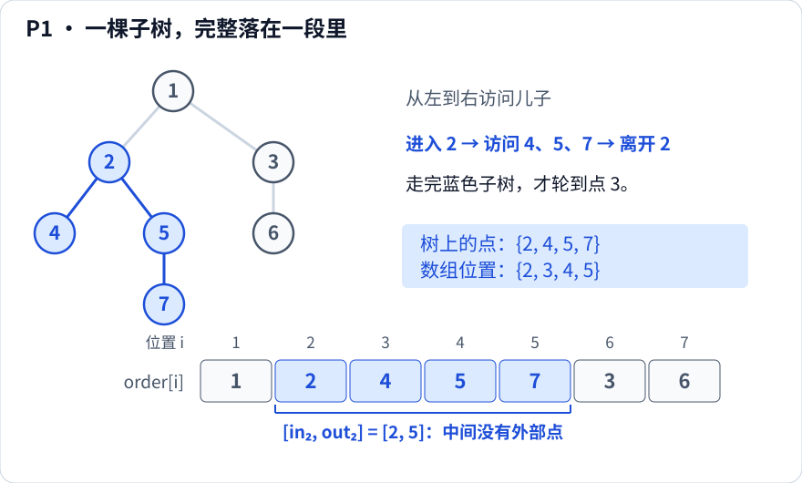
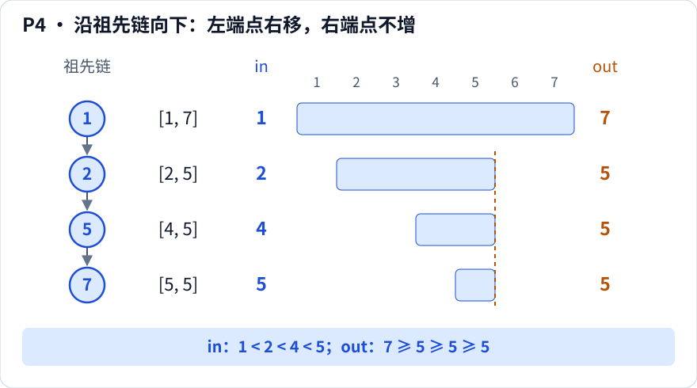

[[TOC]]

::: oneWordAlgo

进入时记左端点，退出时记右端点：子树从树上的一段，变成数组上的一段。

:::

## 问题模型

给定一棵 $n$ 个点的有根树（根记作 $root$），需要支持下面几类操作中的一种或几种：

- **子树整体操作**：查询子树内的权值和/最大值，或者给整棵子树加一个值；
- **祖先判定**：快速回答 $u$ 是不是 $v$ 的祖先；
- **路径与子树互化**：把“路径修改”变成“子树上的加减”，或者反过来；
- **给一个线性顺序**：让离线算法（排序、扫描线、分块、虚树）能按这个顺序处理树上的点。

难点在于树不是线性的：一个点和它的子树在编号上毫无规律。DFS 序的做法是**重新编号**，给每个点记两个时间戳：

- $in_u$：第一次进入点 $u$ 的时刻，用 $1 \sim n$ 依次编号；
- $out_u$：$u$ 的整棵子树访问完、即将离开 $u$ 的时刻，取此时已经用掉的最大编号。

再把点按进入时间排成一排，记 $order[i]$ 为第 $i$ 个被访问的点。$in, out$ 两个数组加一条 $order$，就是本文所有性质的全部原料。

::: info

**定义（先序，也叫 DFS 序、dfn）**：对根做一次深度优先遍历，进入点 $u$ 时让 $in_u$ 等于当前计数器加一，并把 $u$ 追加到序列末尾；$u$ 的所有儿子递归返回后，让 $out_u$ 等于当前计数器。

后面说的“DFS 序”默认都指这一种：每个点只出现一次，长度是 $n$。

:::

## 核心直觉

DFS 只有一个动作：往深处走，走不动再退回。

所以一旦进入点 $u$，在把 $u$ 的每一个后代都走完之前，程序不会离开 $u$，也就不会去碰 $u$ 子树以外的地方。这段时间里计数器只会因为 $u$ 子树里的点而增加，于是

$$
\text{subtree}(u) = \{\,order[i] \mid in_u \leqslant i \leqslant out_u \,\}
$$

也就是说：**树上的“子树”这种递归结构，在时间轴上是连续的一段**。

![样例树上每个点标出它的区间 [in, out]，子树 2 的四个点被标成蓝色](./images/preorder-time.svg)

上图里每个点的第二个数字就是它的区间 $[in_u, out_u]$。可以看到区间是**嵌套或互不相交**的：$[2,5]$ 把 $[3,3]$、$[4,5]$、$[5,5]$ 整段包住，而 $[6,7]$ 和 $[2,5]$ 完全不重叠。这种嵌套结构正是下面所有性质的基础。

把点按 $in$ 排成一排，子树的连续性就更直观了：



蓝色的四格是子树 $2$ 的全部点，它们连成一段，右端点就是 $out_2 = 5$。中间没有插进任何不属于子树 $2$ 的点，这就是 DFS 序能用的**唯一理由**。

## 四种序列先分清

“DFS 序”这个词在题解里经常混着用，实际却是四类不同的东西，长度都不一样：

| 名字 | 什么时候记录 | 长度 | 典型用途 |
| --- | --- | --- | --- |
| 先序（本文的 DFS 序） | 进入点时写一次 | $n$ | 子树区间、祖先判定、树上差分 |
| 后序（退出序） | 退出点时写一次 | $n$ | 自底向上 DP、儿子先于父亲处理 |
| 欧拉序 | 进入时写一次，每次从儿子返回再写一次 | $2n-1$ | 欧拉序 + RMQ 求 LCA |
| 括号序 | 进入写一次，退出再写一次 | $2n$ | 树上莫队、路径转区间 |

同一个样例树的四种序列：

| 序列 | 内容 |
| --- | --- |
| 先序 | $1,2,4,5,7,3,6$ |
| 后序 | $4,7,5,2,6,3,1$ |
| 欧拉序 | $1,2,4,2,5,7,5,2,1,3,6,3,1$ |
| 括号序 | $1,2,4,4,5,7,7,5,2,3,6,6,3,1$ |

::: warning 别把欧拉序当先序用

先序里每个点只出现一次；欧拉序里一个点会出现很多次，每从它退回一次就再写一次。

- 拿欧拉序去套“子树是连续区间”，得到的那段区间会比子树大，长度根本不是 $out_u - in_u + 1$；
- 反过来，需要 RMQ 求 LCA 却只存了先序，区间里根本没有“退回祖先”的那些记录，最浅点也就无从谈起。

两者都叫“dfs 序”，但长度、含义、用途完全不同，写代码时先确认自己在用哪一个。

:::

## 算法实现

### 步骤

1. 邻接表存下 $n-1$ 条无向边，从 $root$ 开始 DFS，父亲用参数传下去，避免走回边。
2. 进入 $u$：`in_[u] = ++timer`，`order_[timer] = u`，`sz[u] = 1`。
3. 递归每个儿子 $v$：先记 `dep[v] = dep[u] + 1`，递归返回后 `sz[u] += sz[v]`。
4. 退出 $u$：`out_[u] = timer`。此时 `timer` 正好等于 $in_u + sz_u - 1$。
5. 需要欧拉序时，在第 3 步每次从儿子返回后再写一次 $u$。

### 代码模板

下面的模板不含 `main`，直接复制进题解。递归版够短，链形树怕爆栈时换用同文件里的 `dfs_order_iter`。

```cpp file=./dfs_order.cpp
```

迭代版要记住两件事：栈元素里的 `idx` 兼作“是否已经进入过”的标记；`sz` 要在弹出时结算给父亲，因为那时子树已经全部处理完。

### 完整代码

读入一棵树和若干祖孙询问，输出先序、欧拉序、每个点的四元组，以及每次询问的结果。

两个版本输出完全一致（Python 用显式栈遍历，欧拉序部分仍是递归，已放宽递归上限）：

```cpp [g1:C++] file=./code/dfs_order_full.cpp
```
```py [g1:Python] file=./code/dfs_order_full.py
```

## 性质

下面都以“$in/out/sz/dep/order$ 已经算好”为前提。所有性质都来自同一条事实：**离开 $u$ 之前，DFS 不会访问 $u$ 子树以外的点**。

下面六张图都沿用前面的样例树，按图中从左到右的顺序访问儿子。注意区分**点的编号**与**点在序列中的位置**；祖先判定默认包含点自身。

### P1 子树是连续区间



看蓝色部分：树上虽然分了叉，排到数组里却紧挨着。进入点 $2$ 后，必须把 $4,5,7$ 都走完，才会访问子树外的点 $3$。

$$
v \in \text{subtree}(u) \Longleftrightarrow in_u \leqslant in_v \leqslant out_u
$$

### P2 区间长度就是子树大小

![区间 [2,5] 从左到右共有四格，对应子树 2 的四个点；叶子 7 的区间 [5,5] 有一格](./images/property-2-size.svg)

从位置 $2$ 数到位置 $5$，两端都包含，共有 $5-2+1=4$ 格；每格恰好对应子树里的一个点。

$$
sz_u = out_u - in_u + 1
$$

只存 $in, out$ 就能同时得到子树大小；反过来，只存了 $in$ 和 $sz$ 也能算出 $out_u = in_u + sz_u - 1$。

### P3 祖孙关系就是区间包含

![点 2 的区间 [2,5] 包含点 5 的 [4,5] 和点 7 的 [5,5]，但与点 3 的 [6,7] 不相交](./images/property-3-containment.svg)

对齐同一条位置轴看：$5$ 和 $7$ 的区间都被 $2$ 的区间包住，所以 $2$ 是它们的祖先；$3$ 的区间完全在另一边，所以 $2$ 与 $3$ 没有祖孙关系。

$$
u \text{ 是 } v \text{ 的祖先} \Longleftrightarrow in_u \leqslant in_v \leqslant out_u
$$

等价写法是两个不等式同时成立：

$$
in_u \leqslant in_v \quad\text{且}\quad out_v \leqslant out_u
$$

**推论**：$u$ 与 $v$ 没有祖孙关系 $\Longleftrightarrow$ 两个区间 $[in_u, out_u]$ 与 $[in_v, out_v]$ 不交。因为 DFS 必须先办完一棵子树、彻底退出，才会进入另一棵子树，两段区间不可能交叉。

### P4 祖先链上两个时间戳单调



沿链 $1 \to 2 \to 5 \to 7$ 向下，区间左端点一直右移，右端点却可能不动：$2,5,7$ 都在访问完点 $7$ 后退出，这期间没有新点进入，所以它们的 $out$ 都是 $5$。**退出动作有先后，$out$ 的值却可以相等。**

若 $u$ 是 $v$ 的祖先且 $u \neq v$，则

$$
in_u < in_v \quad\text{且}\quad out_u \geqslant out_v
$$

也就是越靠近根，$in$ 越小、$out$ 不会更小。因此按 $in$ 从小到大排序后，任何一个点都排在它所有后代的前面。

### P5 后序与第二套序号：双 DFS 序

后序（退出序）就是“儿子先于父亲”的顺序，把点按后序排好后从前往后处理，每次处理时儿子的信息已经齐了——树上 DP 与树上差分的汇总都靠这个顺序。

更有用的是**退出序的逆序**。它有一个等价的定义：把每个点的儿子列表顺序反转后再做一次 DFS，得到的进入序。记作 $rdfn$，则

$$
rdfn_u = n - \mathrm{cnt}(u) + 1
$$

其中 $\mathrm{cnt}(u)$ 是 $u$ 在退出序中的名次。这时祖孙判定变成两维**同向**的不等式：

$$
u \text{ 是 } v \text{ 的祖先} \Longleftrightarrow in_u \leqslant in_v \text{ 且 } rdfn_u \leqslant rdfn_v
$$

为什么非要第二维？只看 $in$ 挡不住“位置在 $v$ 左边、却不是 $v$ 祖先”的点。样例树里把 $4$ 和 $5$ 都染黑，去查 $7$ 的祖先：$in_4 = 3 < in_7 = 5$，只看 $in$ 会把 $4$ 选成答案，但 $4$ 和 $7$ 分属 $2$ 的两个儿子，$4$ 根本不是祖先；补上 $rdfn_4 = 7 > rdfn_7 = 6$ 就把它排除了。

两维同向之后，“$v$ 的祖先”变成平面上左下角矩形 $[1, in_v] \times [1, rdfn_v]$ 里的点，于是可以交给线段树或树状数组做最值、计数查询。

![后序反转得到反向进入序；在横轴 in、纵轴 rdfn 的平面上，点 7 的祖先落在 [1,5] 乘 [1,6] 的矩形内，旁支点 4 位于矩形上方](./images/property-5-double-order.svg)

读图时先看上面的两行序列，再看下面的坐标图：矩形右上角是查询点 $7$，矩形内的 $1,2,5$ 正好组成它的祖先链。点 $4$ 虽然在 $7$ 左边，却在矩形上方，因此被第二个条件排除；按包含自身的约定，点 $7$ 也在答案中。

### P6 欧拉序：区间最浅点就是 LCA

![查询点 4 和 7，欧拉序区间 [3,6] 为 4、2、5、7，对应深度 3、2、3、4，最浅点是位置 4 上的点 2](./images/property-6-euler-lca.svg)

从点 $4$ 走到点 $7$，欧拉序记下 $4 \to 2 \to 5 \to 7$。中间退回的点 $2$ 最浅，它就是最近公共祖先。

欧拉序长度是 $2n-1$，每个点出现多次。设 $pos(u)$ 是 $u$ 第一次出现的位置，$E$ 是欧拉序。先令 $l=\min(pos(u),pos(v))$、$r=\max(pos(u),pos(v))$，则

$$
k \in \operatorname*{arg\,min}_{l \leqslant i \leqslant r} dep[\,E[i]\,], \qquad \text{lca}(u,v) = E[k]
$$

这里 $k$ 是**查询区间内最浅点的一次出现位置**，取任意一个最小值位置都可以。图中 $k=4$、$E[4]=2$，而 $pos(2)=2$，在查询区间外；因此不能把 $k$ 写成 $pos(\text{lca}(u,v))$。

直观理由：这段区间里出现的点全都落在 $\text{lca}(u,v)$ 的子树内，而 LCA 本身也在其中出现过，所以深度最小的那次出现只能是它。详见 [[[rbook: jump_lca]]]。

## 正确性证明

### P1：子树是连续区间

**关键不变量**：离开点 $u$ 时，计数器 `timer` 的值恰好等于“$u$ 子树内已编号的点数”加上“$in_u$ 之前用掉的编号数”。

对 $u$ 归纳，记 $S_u$ 为 $u$ 的子树。

1. 进入 $u$ 时分配 $in_u$，此时 $S_u$ 中只有 $u$ 拿到了编号。
2. 设 $u$ 的儿子为 $v_1, \dots, v_k$。处理 $v_i$ 之前，$S_{v_1},\dots,S_{v_{i-1}}$ 已经全部编号完毕，$v_{i+1}$ 之后的子树一个点都没被访问；由归纳假设，处理完 $v_i$ 时新占用的编号正好是 $S_{v_i}$ 中的全部点。
3. 所有儿子处理完后，被分配过编号的点集恰好是 $\{u\} \cup S_{v_1} \cup \dots \cup S_{v_k} = S_u$，并且它们拿到的编号连成一段，右端点就是当时的 `timer`，即 $out_u$。
4. 由第 2 步，处理 $u$ 的任何后代期间，DFS 都不可能跳到 $S_u$ 之外，所以这段编号里不会混进外部点。

于是 $S_u$ 与区间 $[in_u, out_u]$ 一一对应，P1 成立；区间长度等于 $|S_u|$，即 P2。

### P3：区间包含与祖孙关系等价

- 若 $u$ 是 $v$ 的祖先，则 $v \in S_u$，由 P1 得 $in_u \leqslant in_v \leqslant out_u$。
- 若 $in_u \leqslant in_v \leqslant out_u$，则 $v$ 的编号落在 $u$ 的区间里，而这个区间里的点恰好是 $S_u$ 的点，所以 $v \in S_u$，即 $u$ 是 $v$ 的祖先。
- 若两区间相交：存在下标 $i \in [in_u, out_u] \cap [in_v, out_v]$，则点 $order[i]$ 同时属于 $S_u$ 与 $S_v$，于是 $u, v$ 都是它的祖先。祖先构成一条链，所以 $u, v$ 中必有一个是另一个的祖先。
- 若其中一个是另一个的祖先：由 P1，后代那段区间被祖先的区间完整包含，两区间必然相交。

合起来就是：**两个区间不交 $\Longleftrightarrow$ 两点互不为祖先**。

### P4

设 $u$ 是 $v$ 的祖先且 $u \neq v$。由 P1，$in_v \in [in_u, out_u]$ 且 $v \neq u$，故 $in_u < in_v$；又 $S_v \subseteq S_u$，两段连续区间一段含于另一段，故 $out_v \leqslant out_u$。

### P5：双 DFS 序为什么能判祖先

设第一遍 DFS 按给定的儿子顺序走，第二遍把每个点的儿子顺序整个反转。

- 若 $u$ 是 $v$ 的祖先：两遍 DFS 都必须从 $u$ 走到 $v$，进入 $u$ 一定早于进入 $v$，所以 $in_u \leqslant in_v$ 且 $rdfn_u \leqslant rdfn_v$。
- 若 $u, v$ 互不为祖先：记 $l = \text{lca}(u,v)$，则 $u, v$ 分别落在 $l$ 的两个不同儿子的子树中。第一遍先走了其中一个分支，第二遍把 $l$ 的儿子顺序反转后必然先走另一个分支。于是第一遍的大小关系在第二遍被颠倒：$in_u < in_v$ 时必有 $rdfn_u > rdfn_v$，两条不等式不可能同时成立。

### P6：欧拉序区间的浅点

设 $w = \text{lca}(u,v)$，则 $u, v \in S_w$。从 $u$ 的第一次出现走到 $v$ 的第一次出现期间，DFS 一直待在 $w$ 的子树里：一旦退出 $S_w$ 就离开了 $w$，而 $v$ 还在 $S_w$ 中，再也回不去。

所以这段区间里记录的每个点都满足 $dep \geqslant dep_w$，而 $w$ 自己也在区间中出现过（从 $u$ 走到 $v$ 必须经过 $w$）。深度最小的那次出现因此正是 $w$。

## 复杂度分析

设树有 $n$ 个点。

- 预处理时间：每个点进入一次、每条边被父亲检查两次，$O(n)$。
- 预处理空间：邻接表 $O(n)$，`in/out/sz/dep/order` 各 $O(n)$，欧拉序 $O(n)$。
- 单次祖先判定：$O(1)$。
- 递归 DFS 的栈深度最坏为 $n$（链），迭代版需要同样量级的显式栈。

## 测试用例

输入：

```text
7
1 2
1 3
2 4
2 5
5 7
3 6
4
2 7
4 5
3 6
4 7
```

输出：

```text
order: 1 2 4 5 7 3 6
euler: 1 2 4 2 5 7 5 2 1 3 6 3 1
1: in=1 out=7 size=7 dep=1
2: in=2 out=5 size=4 dep=2
3: in=6 out=7 size=2 dep=2
4: in=3 out=3 size=1 dep=3
5: in=4 out=5 size=2 dep=3
6: in=7 out=7 size=1 dep=3
7: in=5 out=5 size=1 dep=4
2 7 yes
4 5 no
3 6 yes
4 7 no
```

看几处关键数字：

- 点 $2$ 的子树是 $\{2,4,5,7\}$，区间 $[2,5]$ 长度正好是 $4$；
- 叶子 $4,6,7$ 的 $in$ 与 $out$ 相等，区间退化成一点；
- 询问 `4 5`：$in_4 = 3, in_5 = 4$，虽然 $4$ 的编号更小，但 $out_4 = 3 < in_5$，区间不交，所以 $4$ 不是 $5$ 的祖先。

::: fold 两个边界情形

- $n = 1$：输出 `1: in=1 out=1 size=1 dep=1`，没有边，`order` 与 `euler` 都只有一个点。
- 链 $1-2-\cdots-n$：$in_u = u$，$out_u = n$，所有区间互相包含，任意两点都有祖孙关系。这也是最考验递归栈的形状。

:::

## 应用分类详解

DFS 序的本质是**两个方向的翻译**：把“子树”翻译成“区间”，把“祖先”翻译成“区间包含”。

### 一、子树上的查询与修改

**典型模式：** 单点修改 + 子树查询，或子树修改 + 单点/子树查询。
**识别信号：** 题面出现“以 $u$ 为根的子树”“子树内所有点”“给整棵子树加 $x$”。
**核心建模：** 点权按 `in_[u]` 放到数组上，子树操作就是区间操作，交给树状数组或线段树。

| 应用场景 | 经典题目 | 核心思路 |
| --- | --- | --- |
| 单点修改 + 子树求和 | 子树查询模板题 | 点权放 `in_[u]`，子树和 = 区间 `[in_u, out_u]` 和 |
| 子树加 + 单点查询 | 子树修改模板题 | 区间加 + 单点查，树状数组差分即可 |
| 子树加 + 子树求和 | 线段树维护子树 | 区间加 + 区间和，叶子是 `order[i]` 对应的点 |

### 二、祖先关系与“点在不在子树里”

**典型模式：** 反复判断 $u$ 是否为 $v$ 的祖先，或统计每个点子树内满足条件的点数。
**识别信号：** “祖先”“后代”“是否属于某棵子树”“以 $u$ 为根的子树中有几个”。
**核心建模：** 用 $in_u \leqslant in_v \leqslant out_u$ 做 $O(1)$ 判定；统计类问题把点集按 $in$ 排序后二分，子树就变成一个下标区间。

| 应用场景 | 经典题目 | 核心思路 |
| --- | --- | --- |
| 判断祖先 | 虚树、子树统计类题目 | 也可用 LCA，$O(1)$ 版用时间戳 |
| 子树内计数 | 离线统计类问题 | 点按 $in$ 排序，子树 = 连续下标区间 |
| 换根后的子树判定 | 换根 DP 类问题 | 以 $u$ 为根时“$v$ 在 $u$ 子树内”要重新讨论 |

### 三、路径与子树的互化

**典型模式：** 给一条路径整体加值、最后统计每个点；或给点加值、查询根到某点的路径和。
**识别信号：** “路径加”“路径上的点被经过几次”“最后输出每个点的值”。
**核心建模：** 利用“$x$ 在根到 $u$ 的路径上 $\Longleftrightarrow$ $u \in \text{subtree}(x)$”，把路径与子树互换，再用区间操作或差分。

| 应用场景 | 经典题目 | 核心思路 |
| --- | --- | --- |
| 路径加、最后统一输出 | 松鼠的新家 P3258 | 树上差分后按逆 $in$ 序（子先父后）汇总 |
| 路径覆盖次数的最大值 | Max Flow P (P3128) | 点差分：两端加、LCA 与父亲减 |
| 单点加、根路径求和 | 根路径统计题 | 单点加 → 子树区间加，查询退化成单点 |

### 四、按 DFS 序排序的离线结构

**典型模式：** 每次询问只涉及少量关键点，或需要把树上点集变成连续段。
**识别信号：** “每次给出 $k$ 个关键点”“按顺序插入点并回答连通块”“统计子树内某些颜色的数量”。
**核心建模：** 所有点按 $in$ 排序后，子树是区间；关键点集按 $in$ 排序后，相邻两点（含首尾）的 LCA 足以还原虚树的所有分叉点。

| 应用场景 | 经典题目 | 核心思路 |
| --- | --- | --- |
| 虚树 | 消耗战 P2495 | 关键点按 $in$ 排序，加入相邻 LCA 后建树 |
| 路径离线统计 | 树上莫队 | 用括号序把路径变成区间，出现奇数次的点才在路径上 |
| 子树颜色统计 | 简单题 | 子树是区间，同一颜色按 $in$ 排序后做区间计数 |

### 五、LCA 与欧拉序

**典型模式：** 大量询问两点 LCA，且树是静态的。
**识别信号：** “最近公共祖先”“两点距离”“路径是否相交”。
**核心建模：** 欧拉序 + RMQ 把 LCA 变成区间最小值，预处理 $O(n \log n)$、查询 $O(1)$。

| 应用场景 | 经典题目 | 核心思路 |
| --- | --- | --- |
| 静态 LCA | LCA 模板 P3379 | 欧拉序长度 $2n-1$，区间最浅点即 LCA |
| 路径相交判定 | 仓鼠找 sugar (P3398) | 两条路径相交，当且仅当一个端点的 LCA 落在另一条路径上 |

### 六、定制一套自己的“dfs 序”

**典型模式：** 子树操作还不够，还要支持任意路径的查询与修改。
**识别信号：** “路径加/路径求和”“查询路径上第一个黑点”。
**核心建模：** 改变编号规则。让重儿子先编号，得到重链剖分的序（同一条重链连续）；或者用两遍儿子顺序相反的 DFS 得到双序，把祖孙关系变成二维偏序。

| 应用场景 | 经典题目 | 核心思路 |
| --- | --- | --- |
| 路径操作 | 树链剖分模板 | 重儿子优先编号，一棵子树仍然连续 |
| 路径上的最浅黑点 | Qtree3 (P4116) | 双 DFS 序转二维偏序，或剖分后每条重链查最浅点 |

## 易错点

- **`out` 写成 `in[u] + 1`**：只有叶子才成立。正确做法是退出时取当前 `timer`，或者用 `in[u] + sz[u] - 1`。
- **祖先判定写反方向**：写成 $in_u \leqslant in_v \wedge out_u \leqslant out_v$ 是后代条件；判祖先要的是 $out_v \leqslant out_u$。
- **多组数据忘记清 `timer`**：不清就会接着上一组的编号继续涨，所有区间全错。
- **父亲哨兵不一致**：常见做法是根的父亲取 $0$ 并令 $dep_0 = 0$；如果改成“根的父亲是自己”，要检查跳过 `v == fa` 的逻辑会不会把根卡死。
- **把欧拉序当先序**：欧拉序长度是 $2n-1$，拿它开 $n$ 大小的数组会越界。
- **递归爆栈**：链形树深度是 $n$，$n \geqslant 10^5$ 时考虑迭代写法或开大栈。

## 练习题目

- [[[p: luogu-P3258 | 松鼠的新家]]]：按访问顺序把每段路径整体加一，等价于树上差分；最后按逆 $in$ 序把儿子的贡献推给父亲。
- [[[p: luogu-P3128 | Max Flow P]]]：点差分模板题，答案在按逆 $in$ 序求子树和时得到。
- [[[p: luogu-P2495 | 消耗战]]]：每次给一批关键点，按 $in$ 排序后加相邻 LCA 建虚树，把 $O(n)$ 的 DP 压到 $O(k)$。
- [[[p: luogu-P1600 | 天天爱跑步]]]：把“观察员能看到谁”写成关于 $dep$ 与 $in$ 的方程，按逆 $in$ 序合并桶统计贡献。
- [[[p: luogu-P4116 | Qtree3]]]：查询根到某点路径上最浅的黑点。单用 $in$ 挡不住“在左边但不在这条路径上”的黑点，改用双 DFS 序变成平面左下角矩形，配合线段树二分。
- [[[p: luogu-P3384 | 【模板】树链剖分]]]：把“先重儿子”写进编号规则，子树与重链同时连续，路径操作也能落到区间上。

## 参考

- 书的存储与遍历：[[[rbook: tree_base]]]、[[[rbook: graph_traversal]]]；
- 差分思想：[[[rbook: differential]]]，树上版本见 [[[rbook: diff_on_tree]]]；
- 倍增与 LCA：[[[rbook: binary_jump]]]、[[[rbook: jump_lca]]]；
- 子树区间常用的数据结构：[[[rbook: sgt_update_range]]]。
