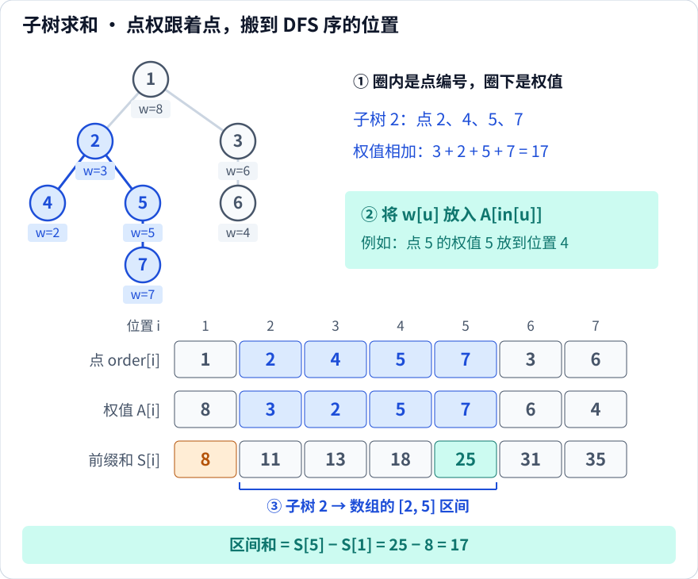
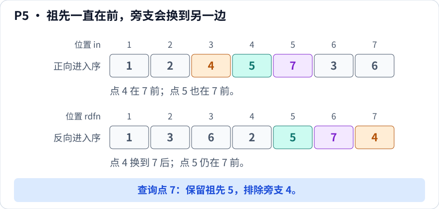

[[TOC]]

::: oneWordAlgo

进入新点时编号，退出时记下当前最大编号：一棵子树就变成了数组上的一个连续区间。

:::

## 从一个具体问题开始

给定一棵以 $1$ 为根的树，每个点有一个固定的权值。现在反复询问：**以点 $u$ 为根的子树里，所有点的权值加起来是多少？**

一次询问可以从 $u$ 出发，把它和所有后代走一遍。但询问很多时，相同的点会被反复访问。如果这些点恰好放在数组的连续一段里，就能先算前缀和，再做区间求和。

DFS 序要解决的就是这一步：**给树上的点安排一个顺序，让每棵子树都占据连续的一段。**

第一次阅读，先沿着“编号 → P1～P4 → 最小代码 → 子树求和实例”走完。后面的四种序列、双 DFS 序与欧拉序是进阶内容，可以在需要时再读；完整模板放在文末供查阅。

## 先分清点编号、进入位置和右端点

点原来的编号保留不动，我们额外记录它在 DFS 中的位置：

| 记号 | 含义 | 样例中点 $5$ 的记录 |
| --- | --- | --- |
| $u$ | 点原来的编号 | $u=5$ |
| $in_u$ | 第一次进入 $u$ 时，它排在第几个 | $in_5=4$ |
| $out_u$ | 走完 $u$ 的子树时，已经用掉的最大位置编号 | $out_5=5$ |
| $order[i]$ | 排在第 $i$ 个位置的点是谁 | $order[4]=5$ |

$in$ 是“点 → 位置”，$order$ 是“位置 → 点”。例如 $in_5=4$ 与 $order[4]=5$ 说的是同一件事：点 $5$ 第四个被访问。下面的样例树会展示完整顺序。

::: info

**本文的 DFS 序是先序：每个点只在第一次进入时记录一次，长度为 $n$。**

计数器 `timer` 表示“已经给多少个点编了号”。**只有进入新点时才加一；退出时只是抄下当前计数器，不再加一。**

因此，$out_u$ 表示子树的**右端点**。虽然常被叫作“退出时间戳”，它并不是给每次退出动作单独分配的序号。

:::

## 核心直觉

DFS 只有一个动作：往深处走，走不动再退回。

所以一旦进入点 $u$，在把 $u$ 的每一个后代都走完之前，程序不会离开 $u$，也就不会去碰 $u$ 子树以外的地方。这段时间里计数器只会因为 $u$ 子树里的点而增加，于是

$$
\text{subtree}(u) = \{\,order[i] \mid in_u \leqslant i \leqslant out_u \,\}
$$

也就是说：**树上的“子树”这种递归结构，在时间轴上是连续的一段**。

![样例树上每个点标出它的区间 [in, out]，子树 2 的四个点被标成蓝色](./images/preorder-time.svg)

上图里圆圈第一行是点编号，第二行是它的区间 $[in_u, out_u]$。可以看到区间是**嵌套或互不相交**的：$[2,5]$ 把 $[3,3]$、$[4,5]$、$[5,5]$ 整段包住，而 $[6,7]$ 和 $[2,5]$ 完全不重叠。这种嵌套结构是理解子树与祖孙关系的基础。

把点按 $in$ 排成一排，子树的连续性就更直观了：


蓝色的四格是子树 $2$ 的全部点，它们连成一段，右端点就是 $out_2 = 5$。中间没有插进任何不属于子树 $2$ 的点，这就是子树操作能够转成区间操作的原因。

### 为什么连续退出三个点，out 都是 5？

沿样例树按从左到右的顺序遍历，进入点 $7$ 时，前面已经访问了 $1,2,4,5$。接下来发生的动作是：

| 动作 | 有没有进入新点 | 动作后的 `timer` | 记下什么 |
| --- | --- | --- | --- |
| 进入 $7$ | 有 | $5$ | $in_7=5$，$order[5]=7$ |
| 退出 $7$ | 没有 | $5$ | $out_7=5$ |
| 退出 $5$ | 没有 | $5$ | $out_5=5$ |
| 退出 $2$ | 没有 | $5$ | $out_2=5$ |
| 进入 $3$ | 有 | $6$ | $in_3=6$，$order[6]=3$ |

退回父亲不算访问新点，所以前三次退出都抄到了同一个数。叶子 $7$ 没有儿子，进入后立即退出，自然有 $in_7=out_7$。

## 基础性质：一棵子树对应一个区间

记 $sz_u$ 为子树 $u$ 的点数（包含 $u$ 自己）。下面先用样例的编号理解四条基础性质，再看怎样写代码算出它们。它们都来自同一条事实：**离开 $u$ 之前，DFS 不会访问 $u$ 子树以外的点**。

本文所有图例都沿用前面的样例树，默认按图中从左到右的顺序访问儿子；P5 会单独说明反向遍历。注意区分**点的编号**与**点在序列中的位置**；祖先判定默认包含点自身。

### P1 子树是连续区间


看蓝色部分：树上虽然分了叉，排到数组里却紧挨着。进入点 $2$ 后，必须把 $4,5,7$ 都走完，才会访问子树外的点 $3$。

$$
v \in \text{subtree}(u) \Longleftrightarrow in_u \leqslant in_v \leqslant out_u
$$

### P2 区间长度就是子树大小

![区间 [2,5] 从左到右共有四格，对应子树 2 的四个点；叶子 7 的区间 [5,5] 有一格](./images/property-2-size.svg)

从位置 $2$ 数到位置 $5$，两端都包含，共有 $5-2+1=4$ 格；每格恰好对应子树里的一个点。

$$
sz_u = out_u - in_u + 1
$$

只存 $in, out$ 就能同时得到子树大小；反过来，只存了 $in$ 和 $sz$ 也能算出 $out_u = in_u + sz_u - 1$。

**十秒自测：** $out_2=5$，是否表示子树 $2$ 最后访问的是“点 $5$”？

<details>
<summary>查看答案</summary>

不是。$5$ 是数组位置，最后访问的点是 $order[5]=7$。子树的四个点是 $order[2],order[3],order[4],order[5]$，即 $2,4,5,7$。

</details>

### P3 祖孙关系就是区间包含

![点 2 的区间 [2,5] 包含点 5 的 [4,5] 和点 7 的 [5,5]，但与点 3 的 [6,7] 不相交](./images/property-3-containment.svg)

对齐同一条位置轴看：$5$ 和 $7$ 的区间都被 $2$ 的区间包住，所以 $2$ 是它们的祖先；$3$ 的区间完全在另一边，所以 $2$ 与 $3$ 没有祖孙关系。

$$
u \text{ 是 } v \text{ 的祖先} \Longleftrightarrow in_u \leqslant in_v \leqslant out_u
$$

等价写法是两个不等式同时成立：

$$
in_u \leqslant in_v \quad\text{且}\quad out_v \leqslant out_u
$$

**推论**：$u$ 与 $v$ 没有祖孙关系 $\Longleftrightarrow$ 两个区间 $[in_u, out_u]$ 与 $[in_v, out_v]$ 不交。因为 DFS 必须先办完一棵子树、彻底退出，才会进入另一棵子树，两段区间不可能交叉。

### P4 祖先链上两个时间戳单调


沿链 $1 \to 2 \to 5 \to 7$ 向下，区间左端点一直右移，右端点却可能不动：$2,5,7$ 都在访问完点 $7$ 后退出，这期间没有新点进入，所以它们的 $out$ 都是 $5$。**退出动作有先后，$out$ 的值却可以相等。**

若 $u$ 是 $v$ 的祖先且 $u \neq v$，则

$$
in_u < in_v \quad\text{且}\quad out_u \geqslant out_v
$$

也就是越靠近根，$in$ 越小、$out$ 不会更小。因此按 $in$ 从小到大排序后，任何一个点都排在它所有后代的前面。

**十秒自测：** $in_4<in_7$，能说明 $4$ 是 $7$ 的祖先吗？如果只交换根的两个儿子的访问顺序，子树连续性会失效吗？

<details>
<summary>查看答案</summary>

不能。点 $4$ 的区间是 $[3,3]$，装不下位置 $in_7=5$；“先访问”不等于“是祖先”。

交换根的两个儿子后，先序变为 $1,3,6,2,4,5,7$，子树 $2$ 的区间从 $[2,5]$ 变成 $[4,7]$。具体位置变了，但 DFS 仍然会先走完整棵子树再离开，连续性不变。

</details>

## 最小实现：只记录 in、out 和 order

现在把编号过程写成代码。无向边已经存入邻接表 `tree`，递归参数 `fa` 是父亲，用来避免沿原路走回去。

```cpp
#include <iostream>
#include <vector>
using namespace std;

const int maxn = 100005;
vector<int> tree[maxn];
int in_[maxn], out_[maxn], order_[maxn];
int timer = 0;

void dfs_order(int u, int fa) {
    in_[u] = ++timer;          // 只有进入新点，才占一个位置
    order_[timer] = u;         // 这个位置存的是哪个点
    for (int v : tree[u]) {
        if (v == fa) continue;
        dfs_order(v, u);
    }
    out_[u] = timer;           // 子树走完，抄下右端点，不加一
}
```

这里数组按 $n\leqslant10^5$ 开好。读入边后，先令 `timer = 0`，再调用 `dfs_order(1, 0)`。函数退出时，`[in_[u], out_[u]]` 就是子树 $u$ 的区间；大规模深树的递归栈问题见后面的复杂度说明。

这里暂时不维护额外数组：子树大小可以直接用 `out_[u] - in_[u] + 1` 得到，祖先判定可以直接用 `in_[u] <= in_[v] && in_[v] <= out_[u]`。文末再提供包含深度、子树大小与迭代遍历的完整模板。

## 完整小例子：子树求和变成区间求和

回到开头的问题。仍用同一棵树，按点编号 $1\sim7$ 依次给出权值 $8,3,6,2,5,4,7$；权值固定不变。

**第一步，把权值放到 DFS 序的位置上。** 点 $u$ 的权值 $w[u]$ 放到 $A[in_u]$，等价地说，$A[i]=w[order[i]]$。



| 位置 $i$ | $1$ | $2$ | $3$ | $4$ | $5$ | $6$ | $7$ |
| --- | --- | --- | --- | --- | --- | --- | --- |
| 点 $order[i]$ | $1$ | $2$ | $4$ | $5$ | $7$ | $3$ | $6$ |
| 权值 $A[i]$ | $8$ | $3$ | $2$ | $5$ | $7$ | $6$ | $4$ |
| 前缀和 $S[i]$ | $8$ | $11$ | $13$ | $18$ | $25$ | $31$ | $35$ |

**第二步，给数组算前缀和。** 令 $S[0]=0$，$S[i]=S[i-1]+A[i]$。

**第三步，把查询翻译成区间。** 子树 $2$ 包含点 $2,4,5,7$，对应的位置是 $[in_2,out_2]=[2,5]$，所以

$$
\text{sum}(2)=A[2]+A[3]+A[4]+A[5]=S[5]-S[1]=25-8=17
$$

直接看树上的权值，也是 $3+2+5+7=17$。对任意 $u$ 都有

$$
\text{sum}(u)=S[out_u]-S[in_u-1]
$$

下面这段接在 DFS 预处理之后使用；`n` 和从下标 $1$ 开始的点权数组 `w` 已经读入，点权及其总和能用 `long long` 保存：

```cpp
vector<long long> a(n + 1), prefix(n + 1);
for (int u = 1; u <= n; u++) a[in_[u]] = w[u];
for (int i = 1; i <= n; i++) prefix[i] = prefix[i - 1] + a[i];

// 查询子树 2：样例输出 17
cout << prefix[out_[2]] - prefix[in_[2] - 1] << '\n';
```

一次 DFS 加一次前缀和预处理需要 $O(n)$ 时间，每次求和只需 $O(1)$。如果点权会修改，普通前缀和就不能直接保持这个效率；但子树对应的区间不变，可以再换用树状数组或线段树维护。

**十秒自测：** 叶子 $7$ 的子树和是多少？整棵树的权值和是多少？

<details>
<summary>查看答案</summary>

叶子 $7$ 对应位置 $[5,5]$，答案是 $S[5]-S[4]=25-18=7$。整棵树对应位置 $[1,7]$，答案是 $S[7]-S[0]=35$。

</details>

## 基础操作的复杂度

- DFS 预处理：每个点进入一次，每条无向边的两个邻接表项各检查一次，时间 $O(n)$，空间 $O(n)$。
- 查询子树大小、判断一对点是否有祖孙关系：每次 $O(1)$。
- 固定点权的子树求和：额外用 $O(n)$ 时间、空间算前缀和，此后每次 $O(1)$。
- 递归栈深度最坏为 $n$（链形树）。大规模深树应使用文末的迭代方式。

## 易错点

- **退出时又让 `timer` 加一**：本文只在进入新点时加一，退出时直接记 `out_[u] = timer`；否则得到的不是长度为 $n$ 的先序编号。
- **把 `out` 固定写成 `in[u] + 1`**：这只在子树恰有两个点时成立。叶子应为 `out_[u] = in_[u]`；一般情况是 `out_[u] = in_[u] + sz[u] - 1`。
- **祖先判定写反方向**：$in_u \leqslant in_v$ 且 $out_u \leqslant out_v$ 不能判定祖孙关系，互不相关的点 $4,5$ 也满足。判 $u$ 是 $v$ 的祖先，应为 $in_u \leqslant in_v$ 且 $out_v \leqslant out_u$；判 $u$ 是 $v$ 的后代，则交换 $u,v$。
- **多组数据忘记清 `timer`**：不清就会接着上一组的编号继续涨，所有区间全错。
- **无向边走回父亲**：邻接表同时存了两个方向，递归时必须跳过 `v == fa`。本文从 `dfs_order(1, 0)` 开始，根深度另设为 $1$。
- **把欧拉序当先序**：欧拉序长度是 $2n-1$，拿它开 $n$ 大小的数组会越界。
- **递归爆栈**：链形树深度是 $n$，$n \geqslant 10^5$ 时考虑迭代写法或开大栈。

## 进阶：四种序列的区别

“DFS 序”这个词在题解里经常混着用，这里区分四种记录方式，它们的长度和用途如下：

| 名字 | 什么时候记录 | 长度 | 典型用途 |
| --- | --- | --- | --- |
| 先序（本文的 DFS 序） | 进入点时写一次 | $n$ | 子树区间、祖先判定、树上差分 |
| 后序（退出序） | 退出点时写一次 | $n$ | 自底向上 DP、儿子先于父亲处理 |
| 欧拉序 | 进入时写一次，每次从儿子返回再写一次 | $2n-1$ | 欧拉序 + RMQ 求 LCA |
| 括号序 | 进入写一次，退出再写一次 | $2n$ | 树上莫队、路径转区间 |

同一个样例树的四种序列：

| 序列 | 内容 |
| --- | --- |
| 先序 | $1,2,4,5,7,3,6$ |
| 后序 | $4,7,5,2,6,3,1$ |
| 欧拉序 | $1,2,4,2,5,7,5,2,1,3,6,3,1$ |
| 括号序 | $1,2,4,4,5,7,7,5,2,3,6,6,3,1$ |

::: warning 别把欧拉序当先序用

先序里每个点只出现一次；欧拉序里每次从一个儿子返回，都要再记录一次父亲。叶子只出现一次，有儿子的点会重复出现。

- **欧拉序中，遍历一棵子树的记录仍然连续**，但同一个点可能被记录多次。从第一次记录 $u$ 到最后一次记录 $u$，共有 $2sz_u-1$ 条记录，不能套用先序的下标和区间长度公式；
- 反过来，需要 RMQ 求 LCA 却只存了先序，区间里根本没有“退回祖先”的那些记录，最浅点也就无从谈起。

例如子树 $2$ 在先序中对应 $2,4,5,7$，共 $4$ 个点；在欧拉序中对应 $2,4,2,5,7,5,2$，共 $7=2\times4-1$ 条记录。它们表示同一棵子树，但数组位置与记录次数不同。

:::

## 进阶性质：祖先集合与最近公共祖先

P5 额外引入第二套进入序；P6 则改用会重复记录点的欧拉序。它们各自有独立的编号，先序的 `in/out` 仍按前文定义。

### P5 已知 v，求出它的所有祖先 u：双 DFS 序

现在只给定一个点 $v$，要找出所有满足“$u$ 是 $v$ 的祖先”的点 $u$。例如给定 $v=7$，要找出的就是 $1,2,5,7$（沿用本文包含自身的约定；严格祖先则去掉 $7$）。

P3 最直接的用法是：给定 $u,v$，用 $O(1)$ 时间判断一次祖孙关系。固定 $v$ 后，它同样能描述全部祖先：找出所有覆盖位置 $in_v$ 的区间 $[in_u,out_u]$ 即可。因此，**P3 并非只能判断一对点**；逐点判断需要 $O(n)$ 时间，也可以借助区间查询结构处理。这里引入双 DFS 序，是为了把祖先集合表示成一个方便查询的二维矩形。

先做第二遍 DFS：**根不变，只把每个点的儿子访问顺序反过来**，仍在进入点时记录一次。点 $u$ 在第二遍进入序中的位置记作 $rdfn_u$。



两行序列都从左往右读。第一遍先走根的儿子 $2$，再走 $3$，在 $2$ 内先走 $4$ 再走 $5$；第二遍先走 $3$ 再走 $2$，在 $2$ 内先走 $5$ 再走 $4$。

盯住查询点 $7$：

- **祖先 $5$ 一直在前面**：无论先走哪条旁支，要到达 $7$ 都必须先进入 $5$。
- **旁支 $4$ 会换边**：它与 $7$ 分属点 $2$ 的两个儿子分支；调换儿子顺序后，原本先走的 $4$ 就变成了后走。

因此，严格祖先在两遍中都更早，严格后代在两遍中都更晚，旁支则一早一晚；点自身的两个位置都相等。**同时保留两遍都不晚于 $v$ 的点，就恰好保留了全部祖先。**

把每个候选点 $u$ 画成平面上的点 $(in_u,rdfn_u)$，则 $v$ 的祖先集合为

$$
\operatorname{Anc}(v) = \{\,u \mid in_u \leqslant in_v \text{ 且 } rdfn_u \leqslant rdfn_v\,\}
$$

也就是说：**已知 $v$，就确定了矩形 $[1,in_v] \times [1,rdfn_v]$；矩形内的全部点 $u$，恰好就是 $v$ 的全部祖先。**

例如点 $4$ 对应 $(3,7)$，点 $7$ 对应 $(5,6)$。第一维 $3<5$ 成立，但第二维 $7>6$ 不满足，所以点 $4$ 被排除；点 $5$ 对应 $(4,5)$，两个条件都满足。

![后序反转得到反向进入序；在横轴 in、纵轴 rdfn 的平面上，点 7 的祖先落在 [1,5] 乘 [1,6] 的矩形内，旁支点 4 位于矩形上方](./images/property-5-double-order.svg)

读图时先看上面的两行序列，再看下面的坐标图：给定 $v=7$，由 $(in_7,rdfn_7)=(5,6)$ 画出左下矩形，圈出的点就是 $\operatorname{Anc}(7)=\{1,2,5,7\}$。点 $4$ 虽然在 $7$ 左边，却在矩形上方，因此不属于答案。

这给出的是**整个祖先集合的范围**，具体怎样查询还要看任务。如果只需逐个列出全部祖先，沿父亲指针向根走就能在 $O(k)$ 时间内完成，其中 $k$ 是输出的点数，双 DFS 序并不是必需的。双序更适合把“祖先中有多少黑点”“祖先中的最小权值”等问题转成矩形内的计数、最值查询，再配合离线扫描或适合二维查询的数据结构处理。

**第二套序号也可以从后序得到。** 后序在退出点时记录它，儿子总在父亲前面，适合树上 DP 与树上差分的自底向上汇总。把后序整个反转，恰好就是第二遍 DFS 的进入序：最后退出的根先出现，各个儿子子树的顺序也被反转，子树内部同理。

记 $\mathrm{cnt}(u)$ 为点 $u$ 在后序中的名次，则

$$
rdfn_u=n-\mathrm{cnt}(u)+1
$$

注意 $\mathrm{cnt}(u)$ 与 $out_u$ 不同：前者给每次退出单独排名，后者只抄进入计数器。例如 $\mathrm{cnt}(2)=4$、$out_2=5$，所以不能用 $n-out_u+1$ 代替 $rdfn_u$。

**十秒自测：** 把第一遍先序直接倒过来，能得到第二遍的进入序吗？

<details>
<summary>查看答案</summary>

不能。先序反转后根 $1$ 会排在最后，但第二遍 DFS 仍然必须先进入根。应当反转的是后序：$4,7,5,2,6,3,1$ 反转后得到 $1,3,6,2,5,7,4$。

</details>

### P6 欧拉序：区间最浅点就是 LCA

记 $dep[u]$ 为点 $u$ 的深度，根的深度为 $1$，每向下一层加一。最近公共祖先（LCA）是两点共有的祖先中，离根最远的那个。

![查询点 4 和 7，欧拉序区间 [3,6] 为 4、2、5、7，对应深度 3、2、3、4，最浅点是位置 4 上的点 2](./images/property-6-euler-lca.svg)

从点 $4$ 走到点 $7$，欧拉序记下 $4 \to 2 \to 5 \to 7$。中间退回的点 $2$ 最浅，它就是最近公共祖先。

欧拉序长度是 $2n-1$，每个点出现多次。设 $pos(u)$ 是 $u$ 第一次出现的位置，$E$ 是欧拉序。先令 $l=\min(pos(u),pos(v))$、$r=\max(pos(u),pos(v))$，则

$$
k \in \operatorname*{arg\,min}_{l \leqslant i \leqslant r} dep[\,E[i]\,], \qquad \text{lca}(u,v) = E[k]
$$

这里 $k$ 是**查询区间内最浅点的一次出现位置**，取任意一个最小值位置都可以。图中 $k=4$、$E[4]=2$，而 $pos(2)=2$，在查询区间外；因此不能把 $k$ 写成 $pos(\text{lca}(u,v))$。

直观理由：这段区间里出现的点全都落在 $\text{lca}(u,v)$ 的子树内，而 LCA 本身也在其中出现过，所以深度最小的那次出现只能是它。详见 [[[rbook: jump_lca]]]。

**十秒自测：** 查询点 $5$ 与 $7$ 时，欧拉区间中的最小深度为 $3$，LCA 是不是点 $3$？

<details>
<summary>查看答案</summary>

不是。两点第一次出现的位置是 $5,6$，欧拉区间为 $5,7$，深度为 $3,4$。最小深度 $3$ 对应的点是 $E[5]=5$，所以 LCA 是点 $5$。深度、数组下标、点编号是三种不同的量。

</details>

## 进一步应用：按需要查阅

DFS 序的本质是**两个方向的翻译**：把“子树”翻译成“区间”，把“祖先”翻译成“区间包含”。

### 一、子树上的查询与修改

**典型模式：** 单点修改 + 子树查询，或子树修改 + 单点/子树查询。
**识别信号：** 题面出现“以 $u$ 为根的子树”“子树内所有点”“给整棵子树加 $x$”。
**核心建模：** 点权按 `in_[u]` 放到数组上，子树操作就是区间操作，交给树状数组或线段树。

| 应用场景 | 经典题目 | 核心思路 |
| --- | --- | --- |
| 单点修改 + 子树求和 | 子树查询模板题 | 点权放 `in_[u]`，子树和 = 区间 `[in_u, out_u]` 和 |
| 子树加 + 单点查询 | 子树修改模板题 | 区间加 + 单点查，树状数组差分即可 |
| 子树加 + 子树求和 | 线段树维护子树 | 区间加 + 区间和，叶子是 `order[i]` 对应的点 |

### 二、祖先关系与“点在不在子树里”

**典型模式：** 反复判断 $u$ 是否为 $v$ 的祖先，或统计每个点子树内满足条件的点数。
**识别信号：** “祖先”“后代”“是否属于某棵子树”“以 $u$ 为根的子树中有几个”。
**核心建模：** 用 $in_u \leqslant in_v \leqslant out_u$ 做 $O(1)$ 判定；统计类问题把点集按 $in$ 排序后二分，子树就变成一个下标区间。

| 应用场景 | 经典题目 | 核心思路 |
| --- | --- | --- |
| 判断祖先 | 虚树、子树统计类题目 | 也可用 LCA，$O(1)$ 版用时间戳 |
| 子树内计数 | 离线统计类问题 | 点按 $in$ 排序，子树 = 连续下标区间 |
| 换根后的子树判定 | 换根 DP 类问题 | 以 $u$ 为根时“$v$ 在 $u$ 子树内”要重新讨论 |

### 三、路径与子树的互化

**典型模式：** 给一条路径整体加值、最后统计每个点；或给点加值、查询根到某点的路径和。
**识别信号：** “路径加”“路径上的点被经过几次”“最后输出每个点的值”。
**核心建模：** 利用“$x$ 在根到 $u$ 的路径上 $\Longleftrightarrow$ $u \in \text{subtree}(x)$”，把路径与子树互换，再用区间操作或差分。

| 应用场景 | 经典题目 | 核心思路 |
| --- | --- | --- |
| 路径加、最后统一输出 | 松鼠的新家 P3258 | 树上差分后按逆 $in$ 序（子先父后）汇总 |
| 路径覆盖次数的最大值 | Max Flow P (P3128) | 点差分：两端加、LCA 与父亲减 |
| 单点加、根路径求和 | 根路径统计题 | 单点加 → 子树区间加，查询退化成单点 |

### 四、按 DFS 序排序的离线结构

**典型模式：** 每次询问只涉及少量关键点，或需要把树上点集变成连续段。
**识别信号：** “每次给出 $k$ 个关键点”“按顺序插入点并回答连通块”“统计子树内某些颜色的数量”。
**核心建模：** 所有点按 $in$ 排序后，子树是区间；关键点集按 $in$ 排序后，相邻两点（含首尾）的 LCA 足以还原虚树的所有分叉点。

| 应用场景 | 经典题目 | 核心思路 |
| --- | --- | --- |
| 虚树 | 消耗战 P2495 | 关键点按 $in$ 排序，加入相邻 LCA 后建树 |
| 路径离线统计 | 树上莫队 | 用括号序选取区间，按出现次数的奇偶保留点，必要时额外补上 LCA |
| 子树颜色统计 | 简单题 | 子树是区间，同一颜色按 $in$ 排序后做区间计数 |

### 五、LCA 与欧拉序

**典型模式：** 大量询问两点 LCA，且树是静态的。
**识别信号：** “最近公共祖先”“两点距离”“路径是否相交”。
**核心建模：** 欧拉序 + RMQ 把 LCA 变成区间最小值，预处理 $O(n \log n)$、查询 $O(1)$。

| 应用场景 | 经典题目 | 核心思路 |
| --- | --- | --- |
| 静态 LCA | LCA 模板 P3379 | 欧拉序长度 $2n-1$，区间最浅点即 LCA |
| 路径相交判定 | 仓鼠找 sugar (P3398) | 两条路径相交，当且仅当其中一条路径的两端点的 LCA 落在另一条路径上 |

### 六、定制一套自己的“dfs 序”

**典型模式：** 子树操作还不够，还要支持任意路径的查询与修改。
**识别信号：** “路径加/路径求和”“查询路径上第一个黑点”。
**核心建模：** 改变编号规则。让重儿子先编号，得到重链剖分的序（同一条重链连续）；或者用两遍儿子顺序相反的 DFS 得到双序，把祖孙关系变成二维偏序。

| 应用场景 | 经典题目 | 核心思路 |
| --- | --- | --- |
| 路径操作 | 树链剖分模板 | 重儿子优先编号，一棵子树仍然连续 |
| 路径上的最浅黑点 | Qtree3 (P4116) | 双 DFS 序转二维偏序，或剖分后每条重链查最浅点 |

## 代码与运行样例

基础阅读到这里已经可以完成子树区间操作。下面保留可复制的完整实现，按需要查阅。

### 代码模板

下面的模板不含 `main`，直接复制进题解。递归版够短，链形树怕爆栈时换用同文件里的 `dfs_order_iter`。

```cpp file=./dfs_order.cpp
```

迭代版要记住两件事：栈元素里的 `idx` 兼作“是否已经进入过”的标记；`sz` 要在弹出时结算给父亲，因为那时子树已经全部处理完。

### 完整代码

读入一棵树和若干祖孙询问，输出先序、欧拉序、每个点的四元组，以及每次询问的结果。

两个版本输出完全一致。Python 的先序部分用显式栈，欧拉序部分仍是递归；放宽递归上限不能把它变成迭代算法，极深的树仍需改写欧拉序遍历。下面的样例用来核对小树上的编号与查询结果：

```cpp [g1:C++] file=./code/dfs_order_full.cpp
```
```py [g1:Python] file=./code/dfs_order_full.py
```

### 运行样例

输入：

```text
7
1 2
1 3
2 4
2 5
5 7
3 6
4
2 7
4 5
3 6
4 7
```

输出：

```text
order: 1 2 4 5 7 3 6
euler: 1 2 4 2 5 7 5 2 1 3 6 3 1
1: in=1 out=7 size=7 dep=1
2: in=2 out=5 size=4 dep=2
3: in=6 out=7 size=2 dep=2
4: in=3 out=3 size=1 dep=3
5: in=4 out=5 size=2 dep=3
6: in=7 out=7 size=1 dep=3
7: in=5 out=5 size=1 dep=4
2 7 yes
4 5 no
3 6 yes
4 7 no
```

看几处关键数字：

- 点 $2$ 的子树是 $\{2,4,5,7\}$，区间 $[2,5]$ 长度正好是 $4$；
- 叶子 $4,6,7$ 的 $in$ 与 $out$ 相等，区间退化成一点；
- 询问 `4 5`：$in_4 = 3, in_5 = 4$，虽然 $4$ 的编号更小，但 $out_4 = 3 < in_5$，区间不交，所以 $4$ 不是 $5$ 的祖先。

**两个边界情形**

::: fold

- $n = 1$：输出 `1: in=1 out=1 size=1 dep=1`，没有边，`order` 与 `euler` 都只有一个点。
- 链 $1-2-\cdots-n$：$in_u = u$，$out_u = n$，所有区间互相包含，任意两点都有祖孙关系。这也是最考验递归栈的形状。

:::

## 附录：性质的严格证明

### P1：子树是连续区间

**关键不变量**：离开点 $u$ 时，计数器 `timer` 的值恰好等于“$u$ 子树内已编号的点数”加上“$in_u$ 之前用掉的编号数”。

对 $u$ 归纳，记 $S_u$ 为 $u$ 的子树。

1. 进入 $u$ 时分配 $in_u$，此时 $S_u$ 中只有 $u$ 拿到了编号。
2. 设 $u$ 的儿子为 $v_1, \dots, v_k$。处理 $v_i$ 之前，$S_{v_1},\dots,S_{v_{i-1}}$ 已经全部编号完毕，$v_{i+1}$ 之后的子树一个点都没被访问；由归纳假设，处理完 $v_i$ 时新占用的编号正好是 $S_{v_i}$ 中的全部点。
3. 所有儿子处理完后，被分配过编号的点集恰好是 $\{u\} \cup S_{v_1} \cup \dots \cup S_{v_k} = S_u$，并且它们拿到的编号连成一段，右端点就是当时的 `timer`，即 $out_u$。
4. 由第 2 步，处理 $u$ 的任何后代期间，DFS 都不可能跳到 $S_u$ 之外，所以这段编号里不会混进外部点。

于是 $S_u$ 与区间 $[in_u, out_u]$ 一一对应，P1 成立；区间长度等于 $|S_u|$，即 P2。

### P3：区间包含与祖孙关系等价

- 若 $u$ 是 $v$ 的祖先，则 $v \in S_u$，由 P1 得 $in_u \leqslant in_v \leqslant out_u$。
- 若 $in_u \leqslant in_v \leqslant out_u$，则 $v$ 的编号落在 $u$ 的区间里，而这个区间里的点恰好是 $S_u$ 的点，所以 $v \in S_u$，即 $u$ 是 $v$ 的祖先。
- 若两区间相交：存在下标 $i \in [in_u, out_u] \cap [in_v, out_v]$，则点 $order[i]$ 同时属于 $S_u$ 与 $S_v$，于是 $u, v$ 都是它的祖先。祖先构成一条链，所以 $u, v$ 中必有一个是另一个的祖先。
- 若其中一个是另一个的祖先：由 P1，后代那段区间被祖先的区间完整包含，两区间必然相交。

合起来就是：**两个区间不交 $\Longleftrightarrow$ 两点互不为祖先**。

### P4

设 $u$ 是 $v$ 的祖先且 $u \neq v$。由 P1，$in_v \in [in_u, out_u]$ 且 $v \neq u$，故 $in_u < in_v$；又 $S_v \subseteq S_u$，两段连续区间一段含于另一段，故 $out_v \leqslant out_u$。

### P5：双 DFS 序为什么能判祖先

设第一遍 DFS 按给定的儿子顺序走，第二遍把每个点的儿子顺序整个反转。

- 若 $u=v$：两个不等式都取等号，点自身被保留。
- 若 $u$ 是 $v$ 的严格祖先：两遍 DFS 都必须先进入 $u$ 再进入 $v$，所以两个不等式都成立。
- 若 $u$ 是 $v$ 的严格后代：第一遍就有 $in_u>in_v$，不满足条件。
- 若 $u, v$ 互不为祖先：记 $l = \text{lca}(u,v)$，则 $u, v$ 分别落在 $l$ 的两个不同儿子的子树中。第一遍先走了其中一个分支，第二遍把 $l$ 的儿子顺序反转后必然先走另一个分支。于是第一遍的大小关系在第二遍被颠倒：$in_u < in_v$ 时必有 $rdfn_u > rdfn_v$，两条不等式不可能同时成立。

### P6：欧拉序区间的浅点

不妨交换 $u,v$，使 $pos(u) \leqslant pos(v)$。设 $w = \text{lca}(u,v)$，则 $u, v \in S_w$。从 $u$ 的第一次出现走到 $v$ 的第一次出现期间，DFS 一直待在 $w$ 的子树里：一旦退出 $S_w$ 就离开了 $w$，而 $v$ 还在 $S_w$ 中，再也回不去。

所以这段区间里记录的每个点都满足 $dep \geqslant dep_w$，而 $w$ 自己也在区间中出现过（从 $u$ 走到 $v$ 必须经过 $w$）。深度最小的那次出现因此正是 $w$。

## 练习题目

- [[[p: luogu-P3258 | 松鼠的新家]]]：按访问顺序把每段路径整体加一，等价于树上差分；最后按逆 $in$ 序把儿子的贡献推给父亲。
- [[[p: luogu-P3128 | Max Flow P]]]：点差分模板题，答案在按逆 $in$ 序求子树和时得到。
- [[[p: luogu-P2495 | 消耗战]]]：每次给一批关键点，按 $in$ 排序后加相邻 LCA 建虚树，把 $O(n)$ 的 DP 压到 $O(k)$。
- [[[p: luogu-P1600 | 天天爱跑步]]]：把“观察员能看到谁”写成关于 $dep$ 与 $in$ 的方程，按逆 $in$ 序合并桶统计贡献。
- [[[p: luogu-P4116 | Qtree3]]]：查询根到某点路径上最浅的黑点。单用 $in$ 挡不住“在左边但不在这条路径上”的黑点，改用双 DFS 序变成平面左下角矩形，配合线段树二分。
- [[[p: luogu-P3384 | 【模板】树链剖分]]]：把“先重儿子”写进编号规则，子树与重链同时连续，路径操作也能落到区间上。

## 参考

- 书的存储与遍历：[[[rbook: tree_base]]]、[[[rbook: graph_traversal]]]；
- 差分思想：[[[rbook: differential]]]，树上版本见 [[[rbook: diff_on_tree]]]；
- 倍增与 LCA：[[[rbook: binary_jump]]]、[[[rbook: jump_lca]]]；
- 子树区间常用的数据结构：[[[rbook: sgt_update_range]]]。
