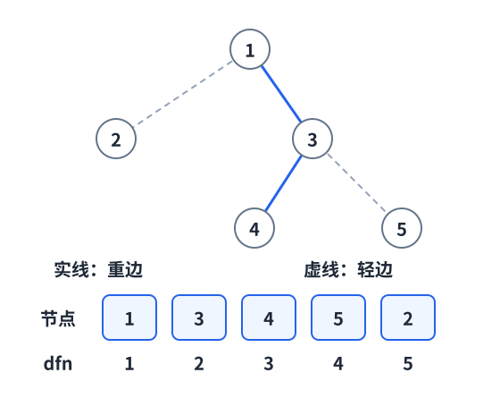
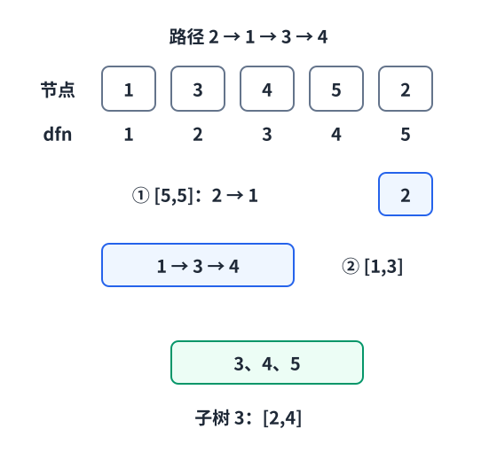

[[TOC]]

::: oneWordAlgo

树链剖分先让重儿子连续编号，把树上路径拆成 $O(\log n)$ 段数组区间，再交给线段树处理。

:::

阅读前建议先掌握 [[[rbook: dfs_order]]] 和 [[[rbook: sgt_update_range]]]。本文先讲重链剖分如何编号、拆路径，再给出可复用模板与完整程序。

## 问题模型

本文讨论重链剖分：树的边不变，根在预处理前确定。给定一棵 $n$ 个点的有根树，每个点有权值，要求支持：

- 树上两点路径加；
- 树上两点路径求和；
- 某个子树整体加；
- 某个子树求和。

树上路径不是数组区间，不能直接套线段树。树链剖分的目标是把树上的路径拆成少量连续区间。

## 核心直觉

树剖只做一件核心的事：

> DFS 编号时，永远优先走重儿子。

重儿子是**子树节点数最多**的儿子，不是编号最大或深度最大的儿子。并列时任选一个，叶子没有重儿子。连向重儿子的边叫重边，其余父子边叫轻边；由重边连接的极大路径叫重链，单独的点也可以是一条链。

普通 DFS 序已经能把子树变成区间，但任意路径仍可能零散。我们只改变访问儿子的顺序：先把重儿子一路走到底，再处理沿途留下的轻子树。这样一来，重链也连续了。



图中根为 `1`，`sz[3]=3 > sz[2]=1`，所以 `son[1]=3`；`4、5` 的子树同样大，这里选 `4`。三条重链是 `1→3→4`、`5`、`2`。下面始终使用这一种合法编号：

| 原节点 `u` | 1 | 3 | 4 | 5 | 2 |
|---|---|---|---|---|---|
| `dfn[u]` | 1 | 2 | 3 | 4 | 5 |
| `top[u]` | 1 | 1 | 1 | 5 | 2 |

注意，`dfn` 是位置，节点权值应写到 `base[dfn[u]] = a[u]`，线段树维护的是这份重排后的数组。

```text
树上重链：1 -> 3 -> 4
DFS 编号：1    2    3
```

路径查询时，如果两个点不在同一条重链，就把更深的链头到当前点这一段处理掉，然后跳到链头的父亲。每跳一次都跨过一条轻边，而轻边最多跨 $O(\log n)$ 次。

## 关键数组

- `fa[u]`：父亲；
- `dep[u]`：深度；
- `sz[u]`：子树大小；
- `son[u]`：重儿子；
- `top[u]`：当前重链的链头；
- `dfn[u]`：DFS 新编号；
- `rev[dfn]`：新编号对应的原节点（若无需按新编号反查原节点，模板中可省略）。

子树也会变成连续区间：

$$
u\text{ 的子树} \Longleftrightarrow [dfn[u],\ dfn[u]+sz[u]-1]
$$

## 看看剖分后的树

选择示例数据后会自动生成划分；自定义数据输入完成后点击「生成划分」。上方树图的节点内只显示原编号，黑色粗实线表示重边，灰色细虚线表示轻边；下方属性表列出每个节点的 `top`、`size`（即 `sz`）、`son`（重儿子）和 `dfn`。

点击节点或表格中的编号，双圈会标出选中节点，灰底标出它所在的重链；切换到「它的子树」，再对照下方的 `dfn` 序列，观察子树如何占据连续区间。也可以展开「查看 / 自定义树数据」，输入自己的树或修改根节点。图中采用 tidy tree 布局，沿重边相连的节点构成重链，不要求画成竖直的一条线。

[[[animate: ./hld.animation.ts]]]

## 算法步骤

### 第一次 DFS

1. 计算 `fa[u]`、`dep[u]`。
2. 统计 `sz[u]`。
3. 找到子树最大的儿子，记为 `son[u]`。

### 第二次 DFS

1. 从链头开始给节点分配 `dfn`。
2. 优先递归重儿子，让重链编号连续。
3. 再递归所有轻儿子，每个轻儿子开启一条新链。

### 两遍 DFS 的实现

两份模板都用全局数组（Python 用列表）和两个独立函数 `dfs1` / `dfs2`，与上面的伪代码一一对应：

1. `dfs1(u, father)`：进入时写 `fa`、`dep`，递归完儿子后汇总 `sz`、选出 `son`。
2. `dfs2(u, head)`：进入时写 `top`、`dfn`、`base`，然后**先递归重儿子**（继承链头 `head`），再递归轻儿子（以自己为新链头）。

`build(root)` 只做三件事：`dfs1(root, 0)` → `dfs2(root, root)` → 建线段树。第二遍是重儿子优先的 DFS，所以同一条重链上的点天然连续编号。

注意递归深度：链形树有 $n$ 层，C++ 在 $n \approx 10^5$ 时通常仍在默认栈内，$n$ 更大（或 $10^6$）要开大栈（`ulimit -s unlimited`）；Python 模板在读入后按 $n$ 调高 `sys.setrecursionlimit`。线段树递归深度只有 $O(\log n)$，不成问题。

### 路径操作

处理路径 `(u, v)`：

1. 当 `top[u] != top[v]`：
   - 选择链头更深的一边；
   - 在线段树上处理 `[dfn[top[u]], dfn[u]]`；
   - 令 `u = fa[top[u]]`。
2. 最后两点在同一条重链上，交换端点使 `dep[u] <= dep[v]`，再处理 `[dfn[u], dfn[v]]`。



例如路径 `2→1→3→4`：`top[2]=2` 比 `top[4]=1` 更深，先处理 `[5,5]`，令 `u=fa[2]=1`；此时与 `4` 同链，处理 `[1,3]`。虽然节点 `4` 本身更深，第一步仍应该跳 `2` 所在的链。判断的是**链头深度**。

路径 `4→3→5` 则拆成 `[4,4]` 和 `[2,3]`。两段互不重叠，最近公共祖先 `3` 只算一次。

### 子树操作

同一张图中，节点 `3` 的子树是 `3、4、5`，对应 `[2,4]`。因此子树修改、查询都只需要一次区间操作：

```text
L = dfn[u]
R = dfn[u] + sz[u] - 1
```

树剖只是决定区间边界。区间加、区间和由懒标记线段树完成：给长度为 `len` 的区间加 `delta`，区间和增加 `delta * len`，懒标记增加 `delta`；访问部分区间前先下传标记。

## 算法证明

**核心不变量**：每条重链在 DFS 序上是连续区间。

1. 第二次 DFS 总是先访问重儿子，所以从链头沿重儿子一直走的节点会被连续编号。
2. 轻儿子会开启新链，离开当前重链后才递归，因此不会插入到当前重链的编号中间。
3. 子树是普通 DFS 序的连续区间，优先重儿子不会破坏 DFS 序的子树连续性。

**为什么跳链不会漏点或越过 LCA？**

循环保持：未处理的部分恰好是当前 `u` 到 `v` 的简单路径。设 `t=top[u]` 是两个链头中较深的一个。若 LCA 位于 `t` 或 `t` 下方，则 `v` 也在 `t` 的子树内；`v` 要么与 `u` 同链，要么其链头比 `t` 更深，都与当前选择矛盾。因此 `[t,u]` 完全属于待处理路径，可以整段取走。

取走后，从 `fa[t]` 继续，既不重复链头，也不会漏掉链头上方的点。每一步都缩短未处理路径；同链时浅端点就是 LCA，最后一次区间操作恰好处理剩余部分。因此所有片段不重不漏。

为什么路径只会拆成 $O(\log n)$ 段？

设 `v` 是 `u` 的轻儿子，`h` 是重儿子。由于重儿子不小于轻儿子：

$$
sz[h] \geqslant sz[v]
\quad\Longrightarrow\quad
sz[u] \geqslant 1+sz[h]+sz[v] > 2sz[v].
$$

所以沿轻边向下，子树规模不到原来的一半；沿轻边向上，子树规模超过原来的两倍。即使多个儿子并列最大，这个不等式仍成立。

沿着轻边向上跳时，子树规模至少翻倍：

$$
1,\ 2,\ 4,\ 8,\ \cdots,\ n
$$

因此任意点到根最多跨 $O(\log n)$ 条轻边。一般路径可以在 LCA 处分为两条向上的路径，两边相加仍是 $O(\log n)$ 段。

## 复杂度分析

预处理两次 DFS：

- 时间复杂度：$O(n)$。
- 空间复杂度：$O(n)$。

每次路径修改或路径查询：

- 拆成 $O(\log n)$ 段；
- 每段在线段树上操作 $O(\log n)$；
- 总时间复杂度：$O(\log^2 n)$。

子树修改和子树查询是一次线段树区间操作，时间复杂度 $O(\log n)$。

## 代码模板

两份模板提供相同接口，不使用 `struct` 或 `class`。数组下标和区间端点都从 `1` 开始，所有区间均为闭区间。

模板内部按“数据结构层 / 树剖层”分成两段，用横幅注释隔开，可以整段复制或整段删除：

```text
/*------------------------ sgt 代码 开始 ------------------------*/
   base[] / tr[] / lazy[]
   norm / ls / rs
   apply / pushdown / seg_build / range_add / range_sum
/*------------------------ sgt 代码 结束 ------------------------*/

/*------------------------ hld 代码 开始 ------------------------*/
   g[] / a[] / fa[] / dep[] / sz[] / son[] / top[] / dfn[] / timer
   init / add_edge / dfs1 / dfs2 / build
   lca / path_add / path_sum / subtree_add / subtree_sum
/*------------------------ hld 代码 结束 ------------------------*/
```

两段之间只有两个接口：`base[]`（`dfs2` 把点权写进去，`seg_build` 读它）和 `range_add` / `range_sum`（路径与子树操作调用它们）。所以换数据结构时只改 sgt 段内部，换树形操作时只改 hld 段，互不影响。

| 接口 | 用途 |
|---|---|
| `init(n, mod)` | 每组数据重新调用：C++ 只清邻接表（其余数组由 `build` 逐点覆写）；Python 重建各列表 |
| `a[u]`、`add_edge(u,v)` | 设置初值、添加无向边 |
| `build(root)` | 固定根，两遍 DFS 预处理并建立线段树；每次初始化后调用一次 |
| `path_add(u,v,delta)` / `path_sum(u,v)` | 路径加 / 路径和，包含两个端点 |
| `subtree_add(u,delta)` / `subtree_sum(u)` | 子树加 / 子树和，包含 `u` |
| `lca(u,v)` | 只跳链求 LCA，$O(\log n)$ |

常见改造：

- 只做子树操作（不需要跳链）：删掉 `lca` / `path_add` / `path_sum`；
- 只求 LCA（不需要区间操作）：删掉整个 sgt 段以及 `subtree_add` / `subtree_sum`；
- 换线段树为树状数组、平衡树等：保留 `range_add` / `range_sum` 两个函数名和签名即可；
- 维护最大值 / 异或等：sgt 段换成对应合并方式，`apply` 改成相应标记；
- 边权转点权：只改 hld 段里 `path_*` 的区间端点（见后面的易错点）。

C++ 版使用定长全局数组，`maxn` 按题目约束调整，且必须满足 $n \leqslant maxn$：`tr`、`lazy` 占用 `4 * maxn` 个 `long long`，`maxn` 开到 $10^6$ 时这两个数组约需 64MB。Python 版按 $n$ 动态建列表，没有这个限制。

要求输入是一棵连通树，$n \geqslant 1$，`root` 在 `1..n` 内。模板处理取模后的和；初值和增量可以是负数，输出统一落在 `[0,mod-1]`。C++ 约定 $1 \leqslant mod \leqslant 2^{31}-1$，初值和增量在 `long long` 范围内，乘法使用 `long long`。不取模的问题需要同步修改线段树与路径累加处，并检查和及乘积的范围。

Python 版本兼容 Python 3.8+，模板已自动调高 `sys.setrecursionlimit`，无需手动设置。大数据仍需结合评测时限和内存限制选择语言。

```cpp [hld-template:C++] file=./hld.cpp
```
```python [hld-template:Python] file=./hld.py
```

## 完整代码

输入格式：第一行 `n m root mod`，第二行给出 `n` 个初始点权，随后 `n-1` 行无向边，再给出 `m` 行操作：

- `1 x y z`：路径 `x` 到 `y` 的点权加 `z`。
- `2 x y`：输出路径和对 `mod` 取模的结果。
- `3 x z`：以固定根为准，子树 `x` 的点权加 `z`。
- `4 x`：输出子树和对 `mod` 取模的结果。

以下程序包含模板和读入输出，可独立运行。Python 按行读取，初始权值需放在同一行。

```cpp [hld-full:C++] file=./code/hld.cpp
```
```python [hld-full:Python] file=./code/hld.py
```

## 测试用例

输入：

```text
5 5 1 100
1 2 3 4 5
1 2
1 3
3 4
3 5
2 4 5
1 2 4 1
2 4 5
3 3 2
4 3
```

输出：

```text
12
14
20
```

解释：

- 初始路径 `4 -> 3 -> 5` 的和为 `4 + 3 + 5 = 12`；
- 路径 `2 -> 4` 加 `1` 后，点 `1,2,3,4` 都增加；
- 子树 `3` 加 `2` 后，点 `3,4,5` 都增加，子树和变为 `20`。

### 单点与负增量

```text
1 5 1 7
3
2 1 1
1 1 1 -5
4 1
3 1 9
2 1 1
```

输出为 `3、5、0`（各占一行）。`u=v` 时点权查询仍包含这个点；`mod=1` 时所有输出都应为 `0`。

## 边权、方向与易错点

**边权转点权。** 把边 `(fa[x],x)` 的权值存到较深的端点 `x`，根的位置放 `0`。跳链阶段仍处理 `[dfn[top[u]],dfn[u]]`，因为链头保存的正是本次跨过的轻边权。最后同链时，设 `u` 较浅，只处理 `[dfn[u]+1,dfn[v]]`，排除 LCA 保存的那条路径外的边。空区间直接跳过；`u=v` 的边权和为 `0`。查询子树内部的边也要排除子树根位置。本文代码默认点权，切换模型时需修改这些边界。

**非交换信息。** 和、最大值不在意片段顺序；字符串、矩阵乘法、颜色段却在意路径方向。此时要分别累计原起点侧和终点侧，在线段树里维护区间正向与反向信息，再按路径顺序合并，不能直接照搬 `path_sum` 的累加方式。

**常见错误。** 比较 `dep[top[u]]`，不是 `dep[u]`；跳到 `fa[top[u]]`，不是 `fa[u]` 或 `top[u]`；在线段树上使用 `dfn`，不是原编号。不要把“在同一条重链”写成“两点深度相同”。

仅有子树操作时，普通 DFS 序就足够；只有 LCA 查询时，可以只保留树剖数组与 `lca`，不需要线段树。树剖预处理依赖固定边结构，直接增删边会使编号失效。

## 应用分类详解

树链剖分的本质是把树上路径转成少量数组区间。只要题目要求频繁操作树上路径，就应该考虑树剖。

### 一、路径修改和路径查询

**典型模式：** 两点之间路径加、路径求和、路径最大值。

**识别信号：** 出现“$u$ 到 $v$ 的路径上所有点/边”并且操作次数很多。

**核心建模：** 用树剖拆路径，用线段树维护区间信息。

| 应用场景 | 经典题目 | 核心思路 |
|---|---|---|
| 树剖模板 | [[[p: luogu-P3384]]] | 路径和 + 子树和 |
| 树上路径最大值 | [[[p: luogu-P2590]]] | 线段树维护最大值 |

### 二、子树整体操作

**典型模式：** 修改某个点的整棵子树，或查询子树权值和。

**识别信号：** 出现“以 $u$ 为根的子树”。

**核心建模：** 子树在 DFS 序中是连续区间 `[dfn[u], dfn[u]+size[u]-1]`。

| 应用场景 | 经典题目 | 核心思路 |
|---|---|---|
| 子树加与子树求和 | [[[p: luogu-P3384]]] | DFS 序区间操作 |
| 树上统计 | 子树贡献类题目 | 把子树压成数组区间 |

### 三、路径拆分后的复合维护

**典型模式：** 线段树节点维护的不只是和，还可能是最大值、最小值、颜色段、矩阵等。

**识别信号：** 路径信息能通过区间合并得到。

**核心建模：** 树剖只负责拆路径；真正维护什么信息由线段树决定。

## 经典例题

### 1. [[[p: luogu-P3384]]]

树链剖分模板题，完整覆盖路径加、路径和、子树加、子树和。

### 2. [[[p: luogu-P2590]]]

练习单点赋值、路径求和与路径最大值：线段树同时维护和与最大值。最大值不取模，查询单位元应设为负无穷，避免全负权时错误返回 `0`。

### 3. [[[p: luogu-P4114]]]

路径最大边权类问题。适合练习边权转点权，以及路径查询时如何排除 LCA 点。

## 相关阅读

- [[[rbook: dfs_order]]]
- [[[rbook: sgt_update_range]]]
- [[[rbook: jump_lca]]]
