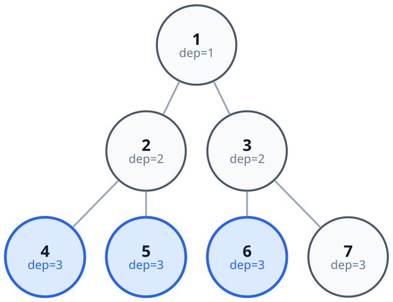
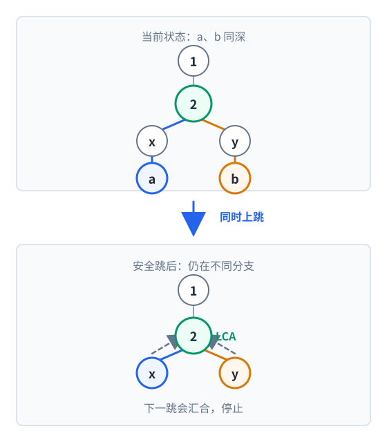

[[TOC]]

::: algorithm

先把每个点向上 $2^j$ 步的祖先全部预处理出来，再把两个点按二进制位一步步往上跳，直到停在 LCA 的两个不同儿子上。

:::

阅读前建议先掌握 [[[rbook: tree_base]]]（树的存储与遍历）、[[[rbook: dfs_order]]]（深度与子树区间）和 [[[rbook: binary_jump]]]（倍增思想）。

## 问题模型

给定一棵有根树，需要反复回答：两个点 $u$ 和 $v$ 的**最近公共祖先**是谁。

树必须先选定根。根不同，祖先关系也可能不同，所以题目给了根 $s$ 就从 $s$ 开始 DFS；只有题目没指定根时，才习惯把 $1$ 当作根。

::: note

**最近公共祖先（Lowest Common Ancestor，LCA）**：在有根树中，$u$ 和 $v$ 的所有公共祖先里深度最大的那个点，记作 $\text{lca}(u,v)$。祖先包含点自己，所以 $u$ 是 $v$ 的祖先时 $\text{lca}(u,v)=u$。

:::



用上面这棵样例树对照：

| 查询 | LCA | 属于哪种情形 |
| --- | --- | --- |
| $\text{lca}(4,5)$ | $2$ | 两点的 LCA 在中间层，谁都不是谁的祖先 |
| $\text{lca}(4,6)$ | $1$ | 两点分居根的两个不同子树 |
| $\text{lca}(3,7)$ | $3$ | 一个点本身就是另一个点的祖先 |
| $\text{lca}(4,2)$ | $2$ | 同上，浅点是答案 |

LCA 是所有“树上路径”问题的基础：知道 $\text{lca}(u,v)$，路径 $u\to v$ 就被拆成了 $u\to \text{lca}$ 与 $v\to \text{lca}$ 两条向上的链。因此两点距离可以写成

$$
\text{dist}(u,v)=\text{dep}[u]+\text{dep}[v]-2\,\text{dep}[\text{lca}(u,v)]
$$

## 核心直觉：为什么可以“一次跳很多层”

最笨的求法是：让两个点一步一步往上爬，直到相遇。链形树上单次询问就是 $O(n)$，太慢。

**爬树法**（也就是倍增法在树上的用法）注意到：上跳的距离可以任意拆分，只要把它拆成若干个 $2$ 的幂。

于是预处理一张表

$$
\text{up}[u][j]=u\text{ 的 }2^j\text{ 级祖先}
$$

需要上跳 $13$ 层时，因为 $13=8+4+1$，就依次跳 $2^3$、$2^2$、$2^0$，三次到位。任何不超过 $n$ 的距离都只需要 $O(\log n)$ 次跳跃。

![从 u 出发沿父亲关系找到各级祖先，并在下方表格里填出 up[u][0..2]](./images/lca-up-table.svg)

这张表的精髓是**它自己可以递推**：跳 $2^j$ 步，等于先跳 $2^{j-1}$ 步，再从落点跳 $2^{j-1}$ 步，

$$
\text{up}[u][j]=\text{up}\big[\text{up}[u][j-1]\big][j-1]
$$

所以只要知道每个点的父亲（$j=0$ 那一列），整张表就能一层层推出来，不需要为每一列单独做一次遍历。

## 算法步骤

### 一、预处理：一次 DFS 填满两张表

从根开始 DFS，进入点 $u$ 时做两件事：

1. 记下深度 `dep[u]` 与父亲 `up[u][0]`；
2. 用递推式把 `up[u][1..lg]` 整行拼出来。

因为走到 $u$ 时，它父亲的整行一定已经算完（父亲在 DFS 树上先被访问），所以这两步可以合并在同一次 DFS 里，不必“先 DFS 再跑一轮倍增 DP”。

根的父节点指向哨兵点 `0`，约定 `dep[0]=0`、`up[0][*]=0`。这样任何越界的上跳都会落进这个“黑洞点”，查询时不需要再判断祖先是否存在。

倍增层数 `lg` 取 `floor(log2(n))`。因为任何上跳距离都不超过 $n-1$，它的二进制最高位不会超过 `lg`，所以这一层数足够；若写成固定常量（例如 `MAXLOG = 17`），必须保证 $2^{\text{MAXLOG}}\ge n$。

### 二、第 k 祖先：把 k 拆成二进制

求 $u$ 向上跳 $k$ 层的落点，从低位到高位检查 $k$ 的每一个二进制位，是 $1$ 就跳对应的 $2^j$ 步：

```cpp
int kth_ancestor(int u, int k) {
    for (int j = 0; j <= lg && u; ++j)
        if (k >> j & 1) u = up[u][j];
    return u;
}
```

这一步是 LCA 查询“把深点提到同一层”的子程序，本身也常被单独考（第 $k$ 级祖先）。

### 三、查询 LCA：先对齐，再一起跳

查询 $\text{lca}(u,v)$ 分三段：

1. **对齐**：若 $u$ 比 $v$ 浅就交换，保证 $u$ 更深；然后让 $u$ 上跳 $\text{dep}[u]-\text{dep}[v]$ 层，两点同深。
2. **同点直接返回**：此时若 $u=v$，说明浅点就是 LCA。
3. **一起跳**：$j$ 从大到小枚举，如果 $\text{up}[u][j]\ne\text{up}[v][j]$ 就同时跳；相等说明这一步会到达或越过 LCA，不能跳。循环结束时两点停在 LCA 的**两个不同儿子**上，答案是 $\text{up}[u][0]$。



第 3 步为什么“不相等才跳”是关键：我们始终让两个点保持**不同**。一旦祖先相同，说明这个位置已经是公共祖先，可能正好是 LCA，也可能在 LCA 之上；此时不能确定，就不跳。等所有 $j$ 都试完，两个点被顶到了“还能保持不同”的最深处，它们的父亲必然就是 LCA。

## 算法证明

### P1：对齐不会越过 LCA

设 $u$ 更深。LCA 既是 $u$ 的祖先又是 $v$ 的祖先，所以 $u$ 到 LCA 的路径长度不小于 $v$ 到 LCA 的路径长度。把 $u$ 上提到与 $v$ 同深，只删掉了 $u$ 到 LCA 下方的若干点，没有跨过 LCA。因此对齐之后，LCA 仍是两点的公共祖先。

### P2：对齐后 $u=v$ 时答案就是它

同深且 $u=v$，说明浅点 $v$ 是 $u$ 的祖先，而它又是 $v$ 自己，故它就是最深的公共祖先。

### P3：从大到小同时跳不会越过 LCA

设 $w=\text{lca}(u,v)$，对齐后 $u\ne v$，两点分别在 $w$ 的两个不同儿子的子树中。

对任意 $j$，若 $\text{up}[u][j]=\text{up}[v][j]$，则这一点是公共祖先，深度不超过 $w$ 的深度，跳过去就可能到达或越过 $w$，所以不跳；若两者不等，落点仍在 $w$ 下方（否则会汇合到 $w$ 或 $w$ 之上，祖先必然相同），可以安全跳。所以**整个循环里两点始终位于 $w$ 的两个不同儿子的子树内**。

### P4：循环结束时两点是 $w$ 的儿子

对齐后两点同深，且循环中每次都同时上跳，所以循环结束时两点仍同深，记为 $u',v'$。

反设 $d=\text{dep}[u']-\text{dep}[w]\ge 2$，取 $j=\lfloor\log_2 d\rfloor$，则 $2^j\le d<2^{j+1}$，且 $j\le lg$，所以这个 $j$ 在循环里被枚举过。此时

$$
\text{dep}\big[\text{up}[u'][j]\big]=\text{dep}[u']-2^j>\text{dep}[w]
$$

即 $\text{up}[u'][j]$ 严格在 $w$ 下方。$v'$ 与 $u'$ 同深且位于 $w$ 的另一个儿子子树内，若 $\text{up}[u'][j]=\text{up}[v'][j]$，这个点就是深度大于 $\text{dep}[w]$ 的公共祖先，与 $w$ 是最近公共祖先矛盾。所以 $\text{up}[u'][j]\ne\text{up}[v'][j]$，循环当时会继续跳，与循环已结束矛盾。

故 $d=1$，即 $\text{dep}[u']=\text{dep}[w]+1$，同理 $\text{dep}[v']=\text{dep}[w]+1$，而 $w$ 是它们的祖先，所以 $u',v'$ 正是 $w$ 的两个儿子，$\text{up}[u'][0]=w$。

## 复杂度分析

设树有 $n$ 个点、$m$ 次询问。

- 预处理：一次 DFS 访问 $n$ 个点，每点填 $O(\log n)$ 个祖先，时间 $O(n\log n)$，空间 $O(n\log n)$；
- 单次查询：对齐 $O(\log n)$，同时上跳 $O(\log n)$，合计 $O(\log n)$；
- 总时间 $O\big((n+m)\log n\big)$。

$n=10^5$ 时 `up` 表是 $10^5\times 18$ 个 `int`，约 7MB，通常可以接受。$n=10^6$ 时这张表就到 80MB 左右，需要换更省空间的写法（例如只存父亲 + 迭代爬，或者改用树链剖分 / 欧拉序 + RMQ）。

## 代码模板

两份模板的接口保持一致，都是全局数组 + 自由函数，不使用 `struct` 或 `class`，可以整段复制进题解。编号 $1..n$，根的父亲是哨兵 `0`。唯一差别是 Python 需要先 `init(n)` 分配列表，C++ 用定长全局数组所以没有这一步。

| 接口 | 用途 |
| --- | --- |
| `init(n)`（仅 Python） | 先按 $n$ 分配邻接表与祖先表，并按 $n$ 放宽递归上限；C++ 用定长全局数组，无需调用 |
| `add_edge(u, v)` | 添加无向边，$n-1$ 条边都要加 |
| `build(n, root)` | 加完边后调用一次：按 $n$ 算 `lg`，再 DFS 填 `dep` 与 `up` |
| `lca(u, v)` | 求最近公共祖先，$O(\log n)$ |
| `kth_ancestor(u, k)` | 求 $u$ 的第 $k$ 级祖先，越界返回 `0` |
| `dist(u, v)` | 两点间边数，$O(\log n)$ |

两份模板都把“深度 + 祖先表”的填充放在同一次 DFS 里，所以预处理只有一个入口 `build`。C++ 用定长全局数组，多组数据时只需清一下邻接表；Python 按 $n$ 动态建列表，多组数据重调一次 `init(n)` 即可，没有 `MAXLOG` 这类常量限制。

```cpp [lca-template:C++] file=./template.cpp
```
```python [lca-template:Python] file=./template.py
```

## 完整代码

输入格式（即 [[[p: luogu-P3379]]] 的格式）：第一行 `n m root`，随后 $n-1$ 行无向边，再 $m$ 行查询，每行两个点。

```cpp [lca-full:C++] file=./code/jump_lca.cpp
```
```python [lca-full:Python] file=./code/jump_lca.py
```

## 测试用例

用本节开头那棵样例树（根为 $1$）：

```text
7 6 1
1 2
1 3
2 4
2 5
3 6
3 7
4 5
4 6
3 7
4 2
1 7
2 3
```

输出：

```text
2
1
3
2
1
1
```

对照前面那张表：$\text{lca}(4,5)=2$、$\text{lca}(4,6)=1$、$\text{lca}(3,7)=3$、$\text{lca}(4,2)=2$；最后两个查询 $\text{lca}(1,7)=1$、$\text{lca}(2,3)=1$ 都是“浅点是答案”的情形。

换根也值得试一次。下面这棵是链，根取中间的点 $5$：

```text
8 3 5
1 2
2 3
3 4
4 5
5 6
6 7
7 8
1 8
5 5
6 7
```

输出为 `5`、`5`、`6`。第一个查询说明根在链中间时，两端点的 LCA 就是根自己；`5 5` 说明 $u=v$ 时返回点自身；`6 7` 说明一个点是另一个点的祖先时返回浅点。

## 易错点

- **`lg` 不够大**：`lg` 取 `floor(log2(n))`；写成固定常量时必须满足 $2^{\text{MAXLOG}}\ge n$，否则大的上跳会被悄悄截断。
- **根用错**：题目给了根就从它 DFS。若把根固定成 $1$，而题目实际以别的点为根，整张祖先表都是错的。
- **忘记对齐后的同点判断**：少写 `if (u == v) return u;`，会在“一个点是另一个点的祖先”时返回 `0` 或死循环。
- **比较 `up[u][j]` 的方向反了**：写成“相等才跳”会把两个点直接顶到根上。
- **根的父节点处理不一致**：模板统一用哨兵 `0`，且 `dep[0]=0`、`up[0][*]=0`。若改成“根的父亲是根自己”，则必须同时保证不会在 `up[0]` 上越界。
- **递归爆栈**：链形树深度可达 $n$，$n\ge 10^5$ 时 C++ 要开大栈（`ulimit -s unlimited`），Python 模板已在 `init` 里调高 `sys.setrecursionlimit`。
- **多组数据忘记清空**：C++ 的 `up` 表会被 DFS 逐点覆写，但邻接表 `g[]` 必须自己 `clear()`；Python 重调一次 `init(n)` 即可。

## 扩展：一次上跳顺便维护路径信息

很多题不只问 LCA，还要问路径上的最大边、最小边、边权和。做法是在 `up[u][j]` 旁边维护一张同样大小的表，合并方式与 `up` 完全一样——因为“跳 $2^j$ 步”总能拆成“先跳 $2^{j-1}$，再跳 $2^{j-1}$”。

例如维护向上跳 $2^j$ 条边经过的最大边权：

$$
\text{mx}[u][j]=\max\big(\text{mx}[u][j-1],\ \text{mx}[\text{up}[u][j-1]][j-1]\big)
$$

查询时仍然“先对齐、再同时跳”，只在真正发生跳跃的地方把对应信息并进答案。

| 维护信息 | 含义 | 典型用途 |
| --- | --- | --- |
| `mx[u][j]` | 向上 $2^j$ 条边的最大边权 | 货车运输、瓶颈路 |
| `mn[u][j]` | 向上 $2^j$ 条边的最小边权 | 路径瓶颈最小值 |
| `sum[u][j]` | 向上 $2^j$ 条边的边权和 | 路径长度、费用 |

::: warn

维护**边权**时，节点跳到 LCA 后不要把 LCA 的父边算进去。通常只在实际发生上跳时合并这一段的信息；对齐阶段也要注意，最后落到 LCA 时那一步没有跨过新的边。

:::

另一个常见扩展是判断祖先关系。用 LCA 的写法是 $\text{lca}(u,v)=u$；若还要做子树判断、虚树或路径包含判断，用 [[[rbook: dfs_order]]] 的时间戳更直接：`in[u] <= in[v] && out[v] <= out[u]`。

## 和其它 LCA 求法的对比

| 方法 | 预处理 | 单次查询 | 适用场景 |
| --- | --- | --- | --- |
| 倍增（爬树）法 | $O(n\log n)$ | $O(\log n)$ | 在线查询，容易扩展路径信息 |
| 欧拉序 + RMQ | $O(n\log n)$ | $O(1)$ | 静态树、只问 LCA |
| Tarjan 离线 | 近似 $O(n+m)$ | 离线统一处理 | 所有询问可以提前读完 |
| 树链剖分 | $O(n)$ | $O(\log n)$ | 同时要做路径修改与路径查询 |

如果只问 LCA，爬树法足够稳定、代码最短；如果要路径加 / 路径和这类复合操作，改用 [[[rbook: hld]]]。

## 练习题目

- [[[p: luogu-P3379 | 【模板】最近公共祖先（LCA）]]]：倍增 LCA 标准模板题，本文完整代码可直接提交。
- [[[p: luogu-P5836 | 【模板】最近公共祖先（LCA）（离线）]]]：同样的查询，用 Tarjan 离线做，可与本文对拍。
- [[[p: luogu-P5903 | 【模板】树上 k 级祖先]]]：直接练 `kth_ancestor`，把 $k$ 拆成二进制位向上跳。
- [[[p: luogu-P3258 | 松鼠的新家]]]：按访问顺序把每段路径整体加一，用 LCA + 树上差分。
- [[[p: luogu-P3128 | Max Flow P]]]：点差分模板题，统计每条路径的覆盖次数。
- [[[p: luogu-P1967 | 货车运输]]]：先建最大生成树，再用 LCA 倍增维护路径最小边权。
- [[[p: luogu-P4180 | 严格次小生成树]]]：枚举非树边，用 LCA 倍增查询路径最大边与严格次大边。
- [[[p: luogu-P4281 | 紧急集合]]]：一次查询三个点，答案与它们两两 LCA 中深度最大的两个有关。

## 参考

- 树的存储与遍历：[[[rbook: tree_base]]]；
- 深度、子树区间与祖孙判定：[[[rbook: dfs_order]]]；
- 倍增思想的通用形式：[[[rbook: binary_jump]]]；
- 把路径拆成区间做区间操作：[[[rbook: hld]]]；
- 树上差分：[[[rbook: diff_on_tree]]]。
