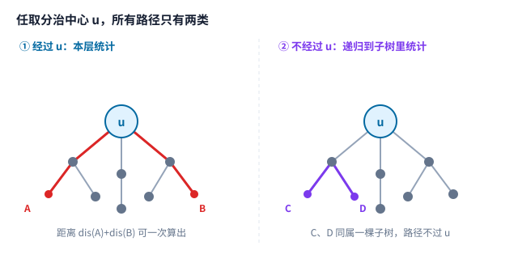
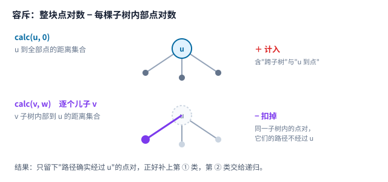

[[TOC]]

::: oneWordAlgo

每次在当前连通块里挑一个点当分治中心，把「经过这个中心的路径」在本层当场数掉；剩下的路径必然整条落在某一棵子树里，于是递归进去继续数。中心选重心，才能保证每层规模减半，总层数只有 $O(\log n)$。

:::

阅读前建议先掌握 [[[rbook: tree-centroid]]]：点分治的全部效率都来自「重心让每个子问题不超过一半」。分治框架本身只是普通的 DFS，还用到 [[[rbook: dfs_order]]] 里的子树概念。

本文的组织顺序是：先从一道具体题目看出瓶颈在哪，再说明为什么「按路径经过谁分类」能把 $O(n^2)$ 降下来，接着讲清**容斥**这一步（这是唯一不直观的地方），然后给出可直接复用的模板与两道例题的改造方式，最后集中列出踩坑点。

## 问题引入：一条路径一条路径算是来不及的

以 [[[p: luogu-P4178]]] 为例：给定一棵 $n$ 个点的带权树，求距离不超过 $K$ 的点对数量。$n\le 4\times 10^4$，边权不超过 $10^3$，$K\le 2\times 10^4$。

最直接的做法是枚举起点，DFS 一遍求出它到所有点的距离：

```text
for 每个起点 s:
    DFS 一次，求 s 到每个点的距离
    统计距离 <= K 的点
```

一次 DFS 是 $O(n)$，$n$ 个起点就是 $O(n^2)$。$n=4\times10^4$ 时约 $1.6\times10^9$ 次操作，过不了。

问题的本质是：**答案依赖的量有 $O(n^2)$ 个（点对），但不能一个一个算。** 所以必须想办法「一次算出一大批点对的贡献」。点分治给的就是这种批量统计的方式。

## 核心直觉：按「路径经过谁」分类

固定的树上看，任意一条路径都有两种处境。任选一个点 $u$：



- **经过 $u$**：路径被 $u$ 分成两段，长度分别是 $u$ 到两个端点的距离。所以只要知道两侧各点到 $u$ 的距离，就能一次配对统计，不需要知道具体端点是谁。
- **不经过 $u$**：这条路径整条都在删除 $u$ 后剩下的某一个连通块（也就是 $u$ 的某一棵子树）里，和 $u$ 无关。

这个分类有两个好性质：

1. 第 ① 类可以**批量**算——一堆距离两两配对，是排序加双指针的活。
2. 第 ② 类**规模变小了**——不再包含 $u$，可以递归处理。

于是算法有了轮廓：

```text
solve(当前连通块):
    选出中心 u
    统计「经过 u」的路径（批量）
    删掉 u，对每个剩下的连通块递归 solve
```

## 为什么中心必须选重心

轮廓里有一句含糊的「选出中心 $u$」。它决定算法快慢。

假设每次随便挑一个点，比如永远挑编号最小的点。考虑一条链 $1-2-\cdots-n$：第一次删掉 $1$，剩下 $n-1$ 个点；再删 $2$，剩 $n-2$ 个……每层只减少一个点，一共 $n$ 层，每层还要扫一遍整块，退化成 $O(n^2)$。

如果选**重心**，删除后每块大小都不超过一半（见 [[[rbook: tree-centroid]]]）：

$$
\text{下一层每块大小}\le\left\lfloor\frac{m}{2}\right\rfloor\quad(m\text{ 是当前块大小})
$$

于是沿任意一条递归分支，规模每层减半，**层数只有** $O(\log n)$。

::: warning

这里要的是一个性质：**子问题规模减半**。它保证的是层数少，不保证每层工作量小。每层仍然要把该层的所有连通块扫一遍，总共 $O(n)$ 量级——但层数从 $n$ 降到 $\log n$，这才是点分治的收益来源。

:::

注意求重心时用的是**当前连通块的点数**，不是最初的 $n$。这是点分治里最常见的错误，后面「易错点」会再强调。

## 统计经过 $u$ 的路径：容斥

现在解决唯一不直观的一步：怎么在 $u$ 处批量数出「经过 $u$」的点对。

先把 $u$ 的每棵子树里的点到 $u$ 的距离都收集起来，得到一个距离多重集 $D$，注意它**包含 $u$ 自己（距离为 $0$）**。

如果直接在 $D$ 上数「两数之和 $\le K$」的点对数，会混进不该算的：同一棵子树里的两个点，它们在 $D$ 里的配对照样满足条件，但真实路径并不经过 $u$，而是整条在那棵子树内部。这类点对属于第 ② 类，应该交给递归，不能在这里重复计入。

处理办法是**容斥**：



$$
\text{经过 }u\text{ 的点对数}
=\underbrace{\text{calc}(u,0)}_{\text{整块}}
-\sum_{v\text{ 是 }u\text{ 的儿子}}\underbrace{\text{calc}(v,\,w(u,v))}_{\text{子树 }v\text{ 内部}}
$$

两个 $calc$ 用的是同一套逻辑：收集一批到 $u$ 的距离，数出两两之和 $\le K$ 的对数。区别只在**收集范围**和**距离起点**：

| 调用 | 收集哪些点 | 到 $u$ 的距离起点 |
|---|---|---|
| `calc(u, 0)` | 整块（含 $u$ 自己） | $0$ |
| `calc(v, w)` | 只有子树 $v$ 内部 | $w(u,v)$，因为 $v$ 到 $u$ 就已经有这条边的长度 |

::: info

**为什么第一步要把 $u$ 自己放进去？**

距离 $0$ 放进集合后，「$u$ 与某个距离为 $d$ 的点」就体现为 $0+d\le K$，一对端点里有一个是 $u$ 的路径就被自动数进来了。若漏掉 $u$，所有以 $u$ 为一端的路径都会丢。

**为什么减去子树时不会有负数结果？**

$calc(v,w)$ 数的是子树 $v$ 内部的点对，这些点对在整块那一步里必然也被数过一次（整块包含子树 $v$），所以减法是精确的「扣掉多算的部分」，不是凑出来的。

:::

`calc` 内部就是排序加双指针：把距离升序排好，左指针从最小开始，右指针从最大开始；若两端之和 $\le K$，说明左指针和右指针之间的点都能与左指针配对，一次加上 $(r-l)$ 个；否则右指针左移。

## 完整算法步骤

把上面的部分拼起来：

```text
getsz(u, fa):            返回 u 所在连通块的点数，顺便填好 sz
getroot(u, fa):          在连通块里找重心 root（需要 total = 块大小，sz 已填好）

calc(u):                 统计经过 u 的路径
    D = { u 自己, 距离 0 }
    对 u 的每个未删儿子 v: 把 v 子树内各点到 u 的距离加入 D
    ans += 数 D 中两两之和 <= K 的对数
    对 u 的每个未删儿子 v:
        单独收集 v 子树内各点到 u 的距离
        ans -= 数这些距离两两之和 <= K 的对数

solve(u):
    removed[u] = true
    calc(u)
    对 u 的每个未删儿子 v:
        total = getsz(v, u)        // 重算！子树 v 现在是独立连通块
        getroot(v, u)              // 得到新重心
        solve(root)

divide():
    total = getsz(1, 0)
    getroot(1, 0)
    solve(root)
```

`removed[u]` 是「作为分治中心被删掉」的标记。所有遍历（求块大小、求重心、收集距离）都要跳过已删的点，这样它们自然被限制在当前连通块内部。

### 为什么 `total` 必须在每一层重算

`getroot` 判定重心时要用 `total - sz[u]` 表示「父亲方向」的块大小。这个 `total` 必须是**当前连通块**的点数。

如果一直沿用最初的 $n$，那么在最深层的连通块里，`total - sz[u]` 会算出一个远大于真实值的「父亲方向」，于是 `mx[u]` 全部偏大，重心可能被选错，分治就退化了。

更隐蔽的是**复用旧的 `sz`**。`sz[v]` 是在上一次以某个点为根时算出来的，未必等于删除 $u$ 之后 $v$ 那一块的真实大小。所以每进入一棵子树，都要用 `getsz` 重新算一遍再交给 `getroot`。

## 模板代码

下面这份模板可以直接过 [[[p: luogu-P4178]]]：

```cpp file=./code/point_divide.cpp
```

一份实现里 `calc` 是核心，其余都是脚手架。想改成别的题，通常只需要动 `calc` 里的「数点对」那一步。

### 从「不超过 $K$」改成「恰好 $K$」

两者可以互相转化，用一次减法即可：

$$
\text{恰好 }=K\text{ 的点对数}=\text{不超过 }K\text{ 的点对数}-\text{不超过 }(K-1)\text{ 的点对数}
$$

因为容斥是线性可加的，对两个不同的阈值各算一遍再相减，结果仍然是「经过 $u$ 且恰好 $K$」的点对数。多询问时把两个阈值都算出来即可，不必改容斥结构。

## 另一种统计方式：边收集边标记

容斥不是唯一选择。下面这道题会把差别暴露出来。

[[[p: luogu-P3806]]]

给一棵 $n\le 10^4$ 个点的树，边权 $w\le 10^4$，再给 $m\le 100$ 个询问 $k\le 10^7$，问每个 $k$ 是否存在距离恰好为 $k$ 的点对。输出 `AYE` 表示存在，`NAY` 表示不存在。

如果照搬容斥：每个询问都要跑两遍排序与双指针，$m=100$ 时约 $100$ 倍开销；更麻烦的是「存在性」不是可加的量，直接对布尔值做容斥是错的（必须先数出**对数**再判断是否大于 $0$）。

换个思路：不收集完再算，而是**边收集边标记**。维护一个桶 `used[d]`，表示「距离 $d$ 是否已经被占用」。处理 $u$ 时：

```text
used[0] = 本层时间戳        // u 自己
对 u 的每个未删儿子 v:
    收集 v 子树内各点到 u 的距离
    ① 先查询：对每个距离 d 与每个询问 k，看 used[k - d] 是否已被占用
    ② 再标记：把本子树的这些距离写进 used
```

顺序是 ①→②，绝不能反。先查后标意味着本子树去和「已经处理过的兄弟子树 + $u$ 自己」配对；同一子树内部的两个点这时还没进桶，自然不会被配上。**容斥要解决的问题，被处理顺序直接消掉了。**

代价是 $(k-d)$ 直接当下标，桶需要覆盖到最大的询问值。

```cpp file=./code/point_divide_queries.cpp
```

配合时间戳 `stamp`，每换一个分治中心只需 `++stamp`，不用把整个桶清空——否则每组数据的清空代价就是 $O(\max K)$。

两种写法的取舍：

| | 容斥 + 排序 | 边收集边标记 |
|---|---|---|
| 适用 | 统计**数量**（可加的量） | 判断**存在**、或统计需要取 $\min/\max$ 的量 |
| 额外开销 | 每个阈值一次排序，$O(\log)$ | 每个询问每个距离一次查询 |
| 空间 | $O(n)$ | $O(\max K)$ |
| 坑 | 减法必须精确、起点要带边权 | ①查询必须在②标记之前 |

## 复杂度

设当前层各连通块大小之和为 $O(n)$。每个连通块要做：求块大小、求重心、收集距离各 $O(m)$；排序 $O(m\log m)$。所以单层总开销是 $O(n\log n)$。

层数是 $O(\log n)$，因此总时间

$$
O(n\log^2 n).
$$

空间是 $O(n)$：`sz`、`mx`、`dis`、邻接表都是线性的；递归栈深度 $O(\log n)$。

如果能用一个值域桶代替排序（询问值很小或距离范围很窄时），单层可以降到 $O(n)$，总时间变成 $O(n\log n)$。[[[p: luogu-P2634]]] 就是这种情形：它只关心距离模 $3$ 的余数，桶只要 $3$ 个格。

## 经典例题

### 一、模板题：多次询问是否存在距离 $K$

[[[p: luogu-P3806]]]

就是上面「边收集边标记」那份模板，直接可过。它的定位是让你确认三件事做对了：重心选择、`total` 重算、查询与标记的顺序。

### 二、统计不超过 $K$ 的点对数量

[[[p: luogu-P4178]]]

即本文主模板 `point_divide.cpp`。若 $K$ 较小，可以把排序换成值域桶 + 树状数组，把 $O(\log^2 n)$ 优化到 $O(n\log n)$。

### 三、余数类：距离为 3 的倍数

[[[p: luogu-P2634]]]

只关心距离模 $3$ 的余数，所以收集距离时不必存真实值，直接 `%3`。桶只需 `cnt[0..2]` 三个格，配对规则是：

- 余数 $0$ 配 $0$：$cnt[0]\times cnt[0]$
- 余数 $1$ 配 $2$：$2\times cnt[1]\times cnt[2]$

最后除以总点对数 $n^2$ 并约分。这题是把「统计量的值域很小」换成「不需要排序」的典型。

### 四、最小化类：恰好 $K$ 且边数最少

[[[p: luogu-P4149]]]

给一棵 $n\le 2\times 10^5$ 的树，求一条边权和恰好为 $K$ 的简单路径中，**边数最少**的是几条。

统计量从「个数」变成了「最小值」，所以可以做容斥，但桶里存的不是布尔值而是**最小边数**：`best[d]` 表示到当前中心距离为 $d$ 的点里，最少用了多少条边。处理顺序仍然是「先查后标」，查的时候用 `best[K-d]+当前边数` 更新答案。

这题还有个容易忽略的细节：**点从 $0$ 开始编号**，读入后统一 `+1` 更省事。另外 $n$ 达到 $2\times 10^5$，链形数据下递归 DFS 的深度可能到 $2\times 10^5$，栈要留够或改手工栈。

## 点分治与相邻技术

| 技术 | 适合的问题 | 与点分治的关系 |
|---|---|---|
| 树上 DP / 换根 DP | 能以子树或全局为单位递推的量 | 优先考虑，通常 $O(n)$ 就够，别上分治 |
| 树链剖分（HLD） | 路径修改、路径查询 | 处理「一条路径」，点分治处理「所有点对」 |
| 点分治 | 统计满足距离条件的**点对** | 本层批量算跨中心的，其余递归 |
| 边分治 | 类似点分治，但按边切 | 需要先转二叉树，否则度数大会退化 |
| 动态点分治（点分树） | 带修改的点对统计 | 把点分治的递归结构存下来当数据结构用 |

选择顺序上有一条经验：**先在 $O(n)$ 的树形 DP 里找答案，找不到再考虑点分治。** 很多看似「所有点对」的题，其实能在合并子树时递推出来。

## 易错点

- **`total` 没按当前连通块重算。** 最常见的一类 WA。用最初的 $n$ 会让「父亲方向」偏大，重心选错，复杂度退化甚至答案错。
- **复用了上一层的 `sz`。** `sz` 是相对某个根算的，进入新连通块必须重新 `getsz`。
- **`calc` 里漏了 $u$ 自己。** 距离 $0$ 不放进集合，所有以 $u$ 为一端的路径都会丢。
- **减子树时距离起点写成了 $0$。** 子树 $v$ 里的点到 $u$ 至少要走 $w(u,v)$，起点必须是这条边的权值。
- **忘记排序就直接双指针。** 双指针的前提是序列有序；漏掉 `sort` 会得到一个「看起来跑得通」的错误答案。
- **对布尔值做容斥。** 容斥只对**可加**的量成立。问存在性时要先数出对数再判断是否大于 $0$。
- **边收集边标记时把顺序写反。** 先标记再查询，会把同一子树内的点对误算成路径经过中心。
- **用 `memset` 清空整个桶。** 每组数据清 $O(\max K)$ 会超时，用时间戳或只清用过的位置。
- **多组数据没清 `removed` 和邻接表。** 上一组的分治标记残留会让这一组少遍历点。
- **递归深度按 $O(\log n)$ 估算。** 分治层数确实是 $O(\log n)$，但 `getroot`、`getsz`、`getdis` 都是普通 DFS，在链形树上单个函数的递归深度可达 $O(n)$。$n=2\times10^5$ 时要留意栈。
- **距离上界按最坏情况估。** $n=4\times10^4$、边权 $10^3$ 时距离和约 $4\times10^7$，还在 `int` 范围内；但边权或点数的量级一换就可能越界。距离和与点对计数这两类答案都建议直接开 `long long`。
- **桶内存按询问最大值开。** $k\le10^7$ 的桶约 $40\text{MB}$，能过但别再多开几份；多组数据共用同一个桶即可。

## 相关阅读

- [[[rbook: tree-centroid]]]
- [[[rbook: dfs_order]]]
- [[[rbook: hld]]]
- [[[rbook: tree_base]]]
