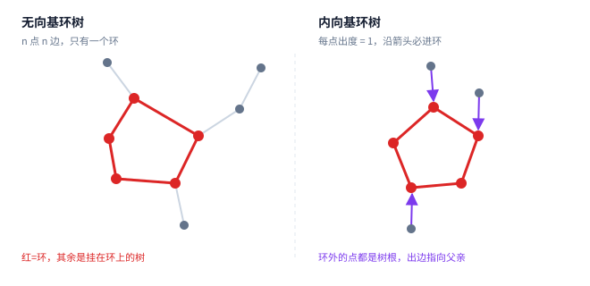

[[TOC]]

::: oneWordAlgo

基环树就是「一棵树再多一条边」，因此 $n$ 个点 $n$ 条边的连通图恰好只有一个环。所有题目的第一步都是**把那个环找出来**：环上的每个点都是挂在它上面的那棵树的根，于是「环上怎么处理」和「树上怎么处理」可以分开做。

:::

阅读前建议先掌握 [[[rbook: tree_base]]] 和 [[[rbook: topsort]]]。环的判定与提取本质上是 DFS 与拓扑排序的应用，找环的更多写法见 [[[rbook: graph_tarjan_loop]]]。

## 什么是基环树

一棵树有 $n$ 个点、$n-1$ 条边。如果往树上**再加一条边**，就会出现唯一一个环——这样得到的图叫**基环树**。

反过来也成立：如果一个连通无向图有 $n$ 个点、$n$ 条边，那么它一定恰好含有一个环。这个「点数 = 边数」的判定非常好用，读题时一眼就能认出基环树。



结构上可以这样理解：

$$
\text{基环树}\ =\ \text{一个环}\ +\ \underbrace{\text{环上每个点挂着一棵树}}_{\text{这些树与环只交于那个根}}
$$

把环上的点记作 $c_1,c_2,\dots,c_k$。删掉环上的所有边之后，图会裂成 $k$ 棵树，树的根恰好是环上的点。**这就是基环树题的基本分解方式。**

### 三种常见形态

| 形态 | 判定 | 结构 | 典型题 |
|---|---|---|---|
| 无向基环树 | $n$ 点 $n$ 边的连通无向图 | 环 + 挂树 | 基环树直径、基环树 DP |
| 内向基环树 | **每个点出度 = 1** | 环 + 指向环的树（箭头朝环） | [[[p: luogu-P2921]]] |
| 外向基环树 | **每个点入度 = 1** | 环 + 从环长出的树 | [[[p: luogu-P2607]]] |

内向与外向互为**反图**：把每条边反向，内向就变成外向。所以外向基环树的题，一个常用做法是「反向建图，当成内向基环树做」。

::: warning

「$n$ 点 $n$ 边」只是基环树的**必要条件**，不是充分条件。如果图不连通，$n$ 点 $n$ 边会得到**基环树森林**（若干个基环树各贡献一个环，也可能有孤立环）。很多题（如 [[[p: luogu-P2607]]]）的数据就是基环树森林，要对每个环分别处理再汇总。

:::

## 核心套路：先找环，再把环当「根」

几乎所有基环树题都遵循同一个三步流程：

```text
1. 找出环上的点（和环上的边）
2. 把每个环上点的挂树处理掉（通常是树上 DP / DFS）
3. 处理环本身
```

第 3 步是真正有变化的地方，常见的有三种：

| 手法 | 做法 | 适用 |
|---|---|---|
| **断环成链** | 在环上挑一条边断开，图就变成树了；但断掉的边可能被用到，所以要么枚举、要么对断点两端分类讨论 | 环上 DP、最大权独立集 |
| **破环成倍长链** | 把环复制一份接在后面，用前缀和 + 单调队列计算环上两点间的最远/最优 | 基环树直径 |
| **缩点** | 把整个环缩成一个点，得到一棵树，在树上做 | 求距离、计数类 |

其中「断环成链」最容易理解也最容易写错。以最大权独立集为例：断掉环上一条边 $(c_1, c_k)$ 之后图成了树，可以直接树上 DP。但断掉的那条边原本约束着 $c_1$ 和 $c_k$ 不能同时选，所以要把这个约束补回来——常见做法是**强制 $c_1$ 不选**和**强制 $c_k$ 不选**各跑一遍，取较大值。

## 找环

### 无向基环树：DFS + 时间戳

在无向图上 DFS，**所有非树边都连向祖先**（没有横叉边）。所以一旦沿着某条边走到一个「时间戳更小的已访问点」，就发现了一个环：它就是「当前点到该祖先」的树上路径，加上这条回边。

```cpp file=./code/find_cycle.cpp
```

几个关键点：

- 用 `in_edge` 记录「进来的那条边」，跳过它的反向边（`i ^ 1`）。这样即使有重边也不会立刻走回去。
- 只从时间戳大的一侧处理（`dfn[v] < dfn[u]`），否则同一个环会被从两端各算一次。
- 沿父亲指针回溯时，环的边权就是「儿子那条父亲边」的权值；最后补上回边的权值。

### 内向基环树：拓扑排序剥叶

内向基环树（每个点出度 1）有一个更简单、更不容易写错的办法：**拓扑排序剥掉所有不在环上的点**。

道理很直白：环外的点一定有一条「通向环」的路径，它们的入度可能大于 0，但只要不断把入度变成 0 的点删掉，最终剩下的就一定全是环上的点——因为环上的点互相供给入度，剥不掉。

```cpp file=./code/functional_cycle.cpp
```

这段代码顺便解决了一类题：**求出每个点「沿出边一直走，到回到已访问点」的步数**。环上的点答案是环长，环外的点递推 `ans[u] = ans[nxt[u]] + 1`，按拓扑序逆序处理即可。

## 经典例题

### 一、外向基环树 + 最大权独立集

[[[p: luogu-P2607]]]

每个骑士有且仅有一个最厌恶的人，且两人不能同时入选。把「厌恶」看成一条有向边，每个点出度恰好为 1——这就是外向基环树森林。

弱化版是树上最大权独立集，也就是「没有上司的舞会」：设 $f(u,0/1)$ 表示 $u$ 选/不选时子树内的最大和。

$$
\begin{aligned}
f(u,0) &= \sum_{v \in \text{son}(u)} \max\bigl(f(v,0), f(v,1)\bigr),\\
f(u,1) &= w_u + \sum_{v \in \text{son}(u)} f(v,0).
\end{aligned}
$$

放到基环树上，就按前面说的断环：对每条环边 $(c_1,c_k)$，分别强制 $c_1$ 不选、强制 $c_k$ 不选，各做一次树形 DP，取较大值。注意这是**基环树森林**，每个连通块算完再求和。

### 二、内向基环树练手

[[[p: luogu-P2921]]]

$N\le 10^5$，每个隔间贴了「下一个隔间」的标语，问从每个隔间出发、到第一次回到去过的隔间为止经过多少个隔间。就是上面 `functional_cycle.cpp` 的原题，数据里允许自环，本文模板已经覆盖。

### 三、基环树直径

[[[p: luogu-P4381]]]

$N\le 10^6$，给一个基环树森林（每座桥连一座岛），求各基环树直径之和。

直径只有两种可能：

1. **不经过环**：完全在某棵挂树内部。用普通树形 DP 求最长链即可。
2. **经过环**：设环上点 $i$ 的挂树中最长链为 $f_i$，环上两点 $i,j$ 的距离为 $d(i,j)$，则候选值是
   $$
   \max_{i\ne j}\bigl(f_i+f_j+d(i,j)\bigr).
   $$

第 2 类需要**破环成链**：把环复制一遍接在尾部，用前缀和 $s$ 表示「从链首沿环走到当前位置的距离」，于是

$$
d(i,j) = s_j - s_i \quad(i<j,\ j-i<k),
$$

条件 $j-i<k$ 表示两点之间的路径不绕整圈。要最大化 $f_j+s_j + (f_i - s_i)$，对固定的 $j$ 只需维护前若干个 $i$ 中 $(f_i-s_i)$ 的最大值——这正是**单调队列**的标准形式，环上部分 $O(k)$ 完成。

$N$ 到 $10^6$，递归 DFS 在链形数据上会爆栈，求环与求树 DP 都建议写成迭代或手工栈。

### 四、枚举断边 + 贪心

[[[p: luogu-P5022]]]

$m=n-1$ 时是纯树：从 $1$ 出发，每次走向编号最小且未访问的邻居，就是字典序最小的 DFS 序。

$m=n$ 时是基环树：最终路线必然**恰好少走环上的一条边**。于是枚举删掉环上的哪一条边，每次当成树做一遍贪心 DFS，在所有方案里取字典序最小。因为环长最多为 $n$，枚举 $O(n)$ 次、每次 $O(n)$，总 $O(n^2)$——在本题的数据范围内可以接受。

### 五、城市环路

[[[p: luogu-P1453]]]

同样是基环树上的最大权独立集，与第一题思路一致：断环、强制端点不选、树形 DP，只是输入是「点权 + 无向边」的无向基环树，找环用本文第一份模板即可。

## 易错点

- **把「$n$ 点 $n$ 边」当成连通图。** 它只能保证「环的个数 = 边数 − 点数 + 连通块数」，图不连通时请按基环树森林处理，对每个环分别算再汇总。
- **无向图找环时不判反向边。** 一定要跳过 `in_edge ^ 1`，否则重边（两点之间有两条边）会被误判成「立刻走回去」而找不到环。
- **同一个环被算两遍。** 回边要从时间戳大的一侧处理，只认 `dfn[v] < dfn[u]`。
- **环的顺序搞反。** 沿父亲回溯得到的是「从回边起点到祖先」的顺序，通常需要反转才能让「相邻两点之间是一条环边」。环边权与环上点要一一对齐，写错会得到随机错误。
- **内向基环树用 DFS 找环。** 出度为 1 的图上拓扑剥叶更短、更稳，也顺便给了拓扑序，可以直接用来递推答案。
- **自环没考虑。** 内向基环树允许 $nxt_u = u$，此时环长是 $1$；模板里绕一圈的写法能自然处理，但手写时要确认不会死循环。
- **外向/内向弄混。** 出度为 1 是内向（箭头朝环），入度为 1 是外向（箭头离环）。两者互为反图，做题前先确认题目给的是哪一个。
- **断环后忘了补约束。** 断掉的那条边仍然约束着两个端点，必须通过「强制某一端不选」跑两遍来补回来，只删不管会算大。
- **基环树直径只算了经过环的情况。** 挂在环上的树自己也可能藏着直径，两种都要取 $\max$。
- **递归深度。** 基环树常配 $n\ge 10^5$ 的数据，链形挂树会让递归 DFS 达到 $O(n)$ 深度，栈要留够或改迭代。

## 相关阅读

- [[[rbook: tree_base]]]
- [[[rbook: graph_tarjan_loop]]]
- [[[rbook: topsort]]]
- [[[rbook: tree-centroid]]]
- [[[rbook: point-divide]]]
