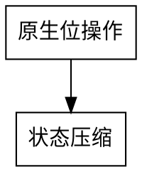

# Graphviz 图形

文章里的 `dot` 和 `viz-dot` 代码块都在构建期转换成内联 SVG。无需修改旧文章中的 `viz-dot`，浏览器无需下载 Graphviz 库，也不访问外部绘图服务。

````markdown

````

每个代码块放一张图。支持项目原有的 `file=./figure.dot` 文件引用和 `[分组:标签]` 代码标签页。默认展示图形，下方的「查看 DOT 源码」可展开完整源码并复制。

构建机器必须安装 Graphviz，执行 `dot -V` 应能看到版本。Node 通过 stdin 传递 DOT，调用 `dot -Tsvg`，设定 10 秒超时和 8 MiB 输出上限。缺少命令、DOT 语法错误或输出无效会记录含文章路径和代码块行号的 `graphviz` 诊断并抛错，发布构建会失败。

默认字体使用与文章相同的 Noto Serif SC，作者在 DOT 中指定的字体、颜色和布局仍优先。深浅主题都把原图放在白色图纸上，保留图中颜色与黑色文字的对比。宽图在图框内横向滚动，打印时缩放到纸宽并隐藏源码。每幅 SVG 的 ID 及内部引用使用独立前缀，避免同页多图互相干扰。

实现位于 `src/publishing/markdown/plugins/graphviz.ts`、`fence.ts` 与 `src/markdown-style/graphviz.scss`。使用 `npm run prepare` 后运行 `node --test tests/graphviz.test.js`；实际文章检查用 `node .agents/skills/rbook-markdown/scripts/render-check.js math/binary`。

命令参数与输出格式参考 [Graphviz 命令行](https://graphviz.org/doc/info/command.html)和 [SVG 输出说明](https://graphviz.org/docs/outputs/svg/)。
